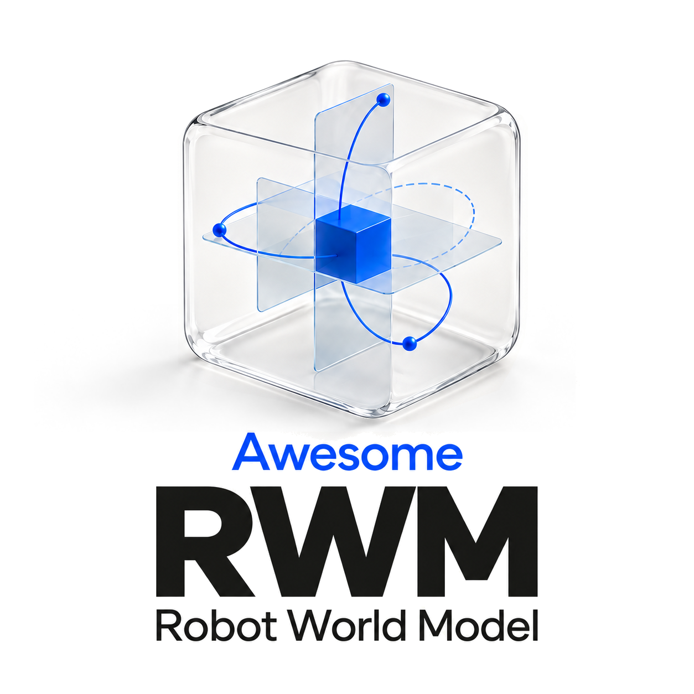
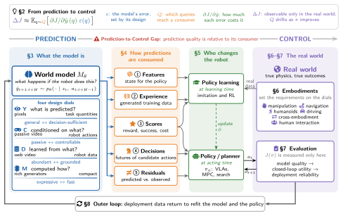
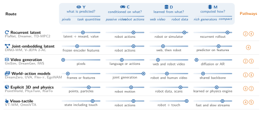
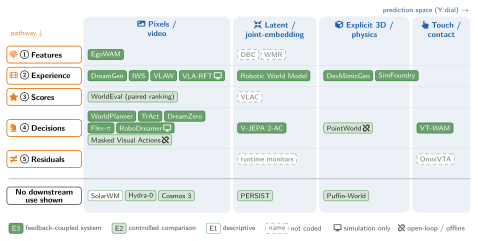
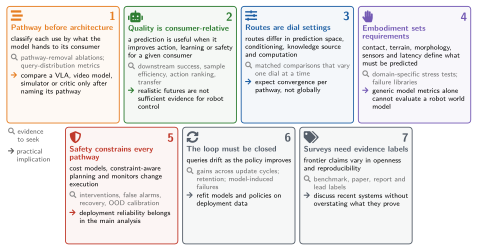

<h1>Awesome Robot World Models</h1>

Companion repository to the survey <b>From Prediction to Control: A Survey of Closed-Loop World Models for Robot Learning</b>

<a href="#papers"><b>📚 Papers by section</b></a> &nbsp;·&nbsp; <a href="docs/evidence-atlas.md"><b>🔬 Evidence atlas</b></a> &nbsp;·&nbsp; <a href="docs/resources.md"><b>🧰 Resources</b></a> &nbsp;·&nbsp; <a href="docs/catalog.md"><b>🔎 Catalog</b></a>

A world model affects a robot only through the component that consumes its predictions, so the quality of a world model is relative to its consumer. The survey describes each model by four design dials, follows its predictions through five pathways to the learners and policies that change robot behavior, and relates these pathways to embodiment requirements, real-world evaluation and the outer loop that refits models from deployment data.

## 🗺️ How the survey is organized

*Figure 1 of the survey, read clockwise.* The model (§3) is specified by four design dials; its predictions reach the robot through five pathways (§4) that feed either policy learning or action selection (§5). The real world sets the requirements (§6) and is the only place where utility is measured (§7). Deployment data travel back along the outer loop to refit the model (§8).

## 🎛️ Four design dials

| Dial | Question | Spectrum | Trade-off |
|---|---|---|---|
| [**Y**](docs/sections/03-design-dials.md#sec-3-1) | What is predicted? | pixels ↔ task quantities | general ↔ decision-sufficient |
| [**C**](docs/sections/03-design-dials.md#sec-3-3) | Conditioned on what? | passive video ↔ robot actions | passive ↔ controllable |
| [**D**](docs/sections/03-design-dials.md#sec-3-4) | Learned from what? | web video ↔ robot data | abundant ↔ grounded |
| [**M**](docs/sections/03-design-dials.md#sec-3-5) | Computed how? | rich generators ↔ compact | expressive ↔ fast |

<b>Technical routes as dial settings</b> (Figure 4)

## 🔀 Five pathways

| | Pathway | The model hands over | At learning time | At acting time | Typical failure |
|---|---|---|---|---|---|
| 1 | [**Features**](docs/sections/04-pathways.md#sec-4-1) | state for the policy | predictive loss shapes the policy's state zt | state estimate zt as input | state aliasing; missing contact state |
| 2 | [**Experience**](docs/sections/04-pathways.md#sec-4-2) | generated training data | rollouts or synthetic demonstrations train the policy |  | simulator bias; exploited model errors |
| 3 | [**Scores**](docs/sections/04-pathways.md#sec-4-3) | reward, success, cost | rewards and progress signals for the learner | costs and success estimates rank candidates | reward hacking; miscalibration |
| 4 | [**Decisions**](docs/sections/04-pathways.md#sec-4-4) | futures of candidate actions |  | simulate candidate actions, choose at | compounding error; optimistic search |
| 5 | [**Residuals**](docs/sections/04-pathways.md#sec-4-5) | predicted vs. observed |  | compare ot+1 with its prediction; correct or alert | delayed detection; false alarms |

Any use that changes model or policy parameters from deployment data belongs to the outer loop (§8).

<b>Evidence map: pathway against prediction space</b> (Figure 9)

## 📚 Papers by section

The 565 works cited in the survey, each listed once under the subsection that discusses it. ★ marks the representative works that Figure 2 names for a subsection. Each section page lists every citation in the order of the text.

### 📖 1 · Introduction

World models now supply robot systems with representations, training experience, action choices and assessments of behavior. [Section page →](docs/sections/01-introduction.md)

<b>Introduction</b> · 13 works

- [Survey of Model-Based Reinforcement Learning: Applications on Robotics](<https://doi.org/10.1007/s10846-017-0468-y>) · Journal of Intelligent &amp; Robotic Systems 2017
- [Model-based Reinforcement Learning: A Survey](<https://arxiv.org/abs/2006.16712>) · Foundations and Trends in Machine Learning 2023
- [Robotic world models – conceptualization, review, and engineering best practices](<https://doi.org/10.3389/frobt.2023.1253049>) · Frontiers in Robotics and AI 2023
- [Towards General-Purpose Robots via Foundation Models: A Survey and Meta-Analysis](<https://robotics-fm-survey.github.io/>) · 2024
- [Aligning Cyber Space with Physical World: A Comprehensive Survey on Embodied AI](<https://arxiv.org/abs/2407.06886>) · 2024
- [Understanding World or Predicting Future? A Comprehensive Survey of World Models](<https://arxiv.org/abs/2411.14499>) · ACM Computing Surveys 2025
- [A Definition and Roadmap for World Models](<https://arxiv.org/abs/2607.06401>) · 2026
- [World Model for Robot Learning: A Comprehensive Survey](<https://arxiv.org/abs/2605.00080>) · 2026
- [A Step Toward World Models: A Survey on Robotic Manipulation](<https://arxiv.org/abs/2511.02097>) · 2025
- [A review of learning-based dynamics models for robotic manipulation](<https://doi.org/10.1126/scirobotics.adt1497>) · Science Robotics 2025
- [A Comprehensive Survey on World Models for Embodied AI](<https://arxiv.org/abs/2510.16732>) · 2025
- [World Action Models: The Next Frontier in Embodied AI](<https://arxiv.org/abs/2605.12090>) · 2026
- [World Action Models: A Survey](<https://arxiv.org/abs/2606.20781>) · arXiv 2026

### 💡 2 · From Prediction to Control

This section fixes the vocabulary of the survey: the robot learning loop, the definition of a world model and the reading key of Figure 1. [Section page →](docs/sections/02-prediction-to-control.md)

<b>2.3 Why Prediction Is Not Control</b> · value equivalence, value-aware learning, information states · 4 works

- The Value Equivalence Principle for Model-Based Reinforcement Learning · NeurIPS 2020 ★
- Value-Aware Loss Function for Model-based Reinforcement Learning · AISTATS 2017 ★
- [Approximate Information State for Approximate Planning and Reinforcement Learning in Partially Observed Systems](<https://www.jmlr.org/papers/v23/20-1165.html>) · Journal of Machine Learning Research 2022 ★
- [Deciding What to Model: Value-Equivalent Sampling for Reinforcement Learning](<https://arxiv.org/abs/2206.02072>) · NeurIPS 2022

<b>2.4 From the Loop to the Taxonomy</b> · PlaNet, Dreamer, DayDreamer, DiWA · 3 works

- **PlaNet**: [Learning Latent Dynamics for Planning from Pixels](<https://arxiv.org/abs/1811.04551>) · ICML 2019 ★
- **DayDreamer**: [World Models for Physical Robot Learning](<https://arxiv.org/abs/2206.14176>) · CoRL 2022 · [Code](<https://github.com/danijar/daydreamer>) ★
- **DiWA**: [Diffusion Policy Adaptation with World Models](<https://arxiv.org/abs/2508.03645>) · 2025 ★

★ Also representative here (Figure 2): [Dreamer](docs/sections/04-pathways.md#sec-4-2) (4.2).

### 🧠 3 · What the Model Is: Four Design Dials

A world model is a learned conditional predictor, and four design dials determine it: what it predicts (Y), what it is conditioned on (C), where its knowledge comes from (D) and how it computes a prediction (M). [Section page →](docs/sections/03-design-dials.md)

<b>3.1 Y: What Is Predicted</b> · DINO-WM, V-JEPA 2-AC, PointWorld, PhysTwin · 29 works

- **DINO-WM**: [World Models on Pre-trained Visual Features Enable Zero-Shot Planning](<https://arxiv.org/abs/2411.04983>) · ICML 2025 · [Code](<https://github.com/gaoyuezhou/dino_wm>) ★
- **V-JEPA 2-AC**: [V-JEPA 2: Self-Supervised Video Models Enable Understanding, Prediction and Planning](<https://arxiv.org/abs/2506.09985>) · arXiv 2025 · [Code](<https://github.com/facebookresearch/vjepa2>) ★
- **PhysTwin**: [Physics-Informed Reconstruction and Simulation of Deformable Objects from Videos](<https://arxiv.org/abs/2503.17973>) · ICCV 2025 ★
- [LeWorldModel: Stable End-to-End Joint-Embedding Predictive Architecture from Pixels](<https://arxiv.org/abs/2603.19312>) · arXiv 2026
- [Temporal Straightening for Latent Planning](<https://arxiv.org/abs/2603.12231>) · ICML 2026
- [What Drives Success in Physical Planning with Joint-Embedding Predictive World Models?](<https://arxiv.org/abs/2512.24497>) · TMLR 2026
- [ManiGaussian: Dynamic Gaussian Splatting for Multi-task Robotic Manipulation](<https://arxiv.org/abs/2403.08321>) · ECCV 2024
- [GaussianDream: A Feed-Forward 3D Gaussian World Model for Robotic Manipulation](<https://arxiv.org/abs/2605.20752>) · arXiv 2026
- [ParticleFormer: A 3D Point Cloud World Model for Multi-Object, Multi-Material Robotic Manipulation](<https://arxiv.org/abs/2506.23126>) · arXiv 2025
- [SyncTwin: Fast Digital Twin Construction and Synchronization for Safe Robotic Manipulation](<https://arxiv.org/abs/2601.09920>) · arXiv 2026
- [Object-Centric World Model for Language-Guided Manipulation](<https://arxiv.org/abs/2503.06170>) · arXiv 2025
- FOCUS: Object-Centric World Models for Robotic Manipulation · Frontiers in Neurorobotics 2025
- [Goal-VLA: Image-Generative VLMs as Object-Centric World Models Empowering Zero-shot Robot Manipulation](<https://arxiv.org/abs/2506.23919>) · ICRA 2026
- [Learning Particle Dynamics for Manipulating Rigid Bodies, Deformable Objects, and Fluids](<https://arxiv.org/abs/1810.01566>) · ICLR 2019
- [Keypoints into the Future: Self-Supervised Correspondence in Model-Based Reinforcement Learning](<https://arxiv.org/abs/2009.05085>) · CoRL 2020
- [Learning Compositional Koopman Operators for Model-Based Control](<https://arxiv.org/abs/1910.08264>) · ICLR 2020
- [On the Utility of Koopman Operator Theory in Learning Dexterous Manipulation Skills](<https://arxiv.org/abs/2303.13446>) · CoRL 2023
- [AdaptiGraph: Material-Adaptive Graph-Based Neural Dynamics for Robotic Manipulation](<https://arxiv.org/abs/2407.07889>) · arXiv 2024
- [PhysCoRe: Physics-Corrected Residual World Models for Material-Aware Deformable Dynamics](<https://arxiv.org/abs/2607.20653>) · arXiv 2026
- [Reconciling Reality through Simulation: A Real-To-Sim-to-Real Approach for Robust Manipulation](<https://doi.org/10.15607/RSS.2024.XX.015>) · RSS 2024
- [RoboGSim: A Real2Sim2Real Robotic Gaussian Splatting Simulator](<https://arxiv.org/abs/2411.11839>) · arXiv 2024
- [CITRIS: Causal Identifiability from Temporal Intervened Sequences](<https://proceedings.mlr.press/v162/lippe22a.html>) · ICML 2022
- [Causal Dynamics Learning for Task-Independent State Abstraction](<https://arxiv.org/abs/2206.13452>) · ICML 2022
- **Causal-JEPA**: [Learning World Models through Object-Level Latent Masking](<https://arxiv.org/abs/2602.11389>) · arXiv 2026
- [CoPhy: Counterfactual Learning of Physical Dynamics](<https://arxiv.org/abs/1909.12000>) · ICLR 2020
- [Particle-grid neural dynamics for learning deformable object models from rgb-d videos](<https://arxiv.org/abs/2506.15680>) · arXiv 2025
- ContactSDF: Signed distance functions as multi-contact models for dexterous manipulation · RA-L 2025
- TwinTrack: Bridging vision and contact physics for real-time tracking of unknown dynamic objects · arXiv 2025
- DiffTactile: A physics-based differentiable tactile simulator for contact-rich robotic manipulation · ICLR 2024

★ Also representative here (Figure 2): [PointWorld](docs/sections/06-embodiments.md#sec-6-1) (6.1).

<b>3.2 Beyond Vision: Contact and Touch</b> · RoboPack, VT-WM, OmniVTA, VTAM, DexTacWAM · 52 works

- **RoboPack**: [Learning Tactile-Informed Dynamics Models for Dense Packing](<https://arxiv.org/abs/2407.01418>) · RSS 2024 ★
- **VT-WM**: [Visuo-Tactile World Models](<https://arxiv.org/abs/2602.06001>) · 2026 ★
- **OmniVTA**: [Visuo-Tactile World Modeling for Contact-Rich Robotic Manipulation](<https://arxiv.org/abs/2603.19201>) · 2026 ★
- **VTAM**: [Video-Tactile-Action Models for Complex Physical Interaction Beyond VLAs](<https://arxiv.org/abs/2603.23481>) · arXiv 2026 ★
- **DexTacWAM**: [A Visuo-Tactile World-Action Model for Dexterous Manipulation](<https://arxiv.org/abs/2609.24976>) · arXiv 2026 ★
- Responsible and Generalizable Dexterous Manipulation through Multimodal Perception, Reasoning, and Sim2Real Learning · Staats-und Universitätsbibliothek Hamburg Carl von Ossietzky 2026
- ContactDexNet: Multi-fingered robotic hand grasping in cluttered environments through hand-object contact semantic mapping · IROS 2025
- [An implicit time-stepping method for rigid body dynamics with inelastic collisions and Coulomb friction](<https://doi.org/10.1002/(SICI)1097-0207(19960815)39:15%3C2673::AID-NME972%3E3.0.CO;2-I>) · International Journal for Numerical Methods in Engineering 1996
- [Diffusion for World Modeling: Visual Details Matter in Atari](<https://arxiv.org/abs/2405.12399>) · NeurIPS 2024
- [Efficient-WAM: A 1B-Parameter World-Action Model with Low-Cost Future Imagination](<https://arxiv.org/abs/2606.10040>) · arXiv 2026
- [Quasi-Static Assembly of Compliantly Supported Rigid Parts](<https://doi.org/10.1115/1.3139682>) · Journal of Dynamic Systems, Measurement, and Control 1982
- Diffusion Policy: Visuomotor Policy Learning via Action Diffusion · RSS 2023
- Learning Fine-Grained Bimanual Manipulation with Low-Cost Hardware · RSS 2023
- [Impedance Control: An Approach to Manipulation: Part I—Theory](<https://doi.org/10.1115/1.3140702>) · Journal of Dynamic Systems, Measurement, and Control 1985
- [Digitizing Touch with an Artificial Multimodal Fingertip](<https://arxiv.org/abs/2411.02479>) · arXiv 2024
- Biomimetic Tactile Sensor Array · Advanced Robotics 2008
- [ReSkin: Versatile, Replaceable, Lasting Tactile Skins](<https://arxiv.org/abs/2111.00071>) · CoRL 2021
- [AnySkin: Plug-and-play Skin Sensing for Robotic Touch](<https://arxiv.org/abs/2409.08276>) · arXiv 2024
- [FlexiTac: A Low-Cost, Open-Source, Scalable Tactile Sensing Solution for Robotic Systems](<https://arxiv.org/abs/2604.28156>) · arXiv 2026
- **Sparsh**: [Self-supervised Touch Representations for Vision-based Tactile Sensing](<https://arxiv.org/abs/2410.24090>) · CoRL 2024 · [Code](<https://github.com/facebookresearch/sparsh>)
- **AnyTouch**: [Learning Unified Static-Dynamic Representation across Multiple Visuo-tactile Sensors](<https://arxiv.org/abs/2502.12191>) · ICLR 2025
- [Octopi: Object Property Reasoning with Large Tactile-Language Models](<https://arxiv.org/abs/2405.02794>) · RSS 2024
- [Learning Physical Interaction: A Survey of Tactile- and Force-aware Robot Learning](<https://arxiv.org/abs/2608.07558>) · 2026
- **Manipulation by Feel**: [Touch-Based Control with Deep Predictive Models](<https://arxiv.org/abs/1903.04128>) · ICRA 2019
- [LeTac-MPC: Learning Model Predictive Control for Tactile-reactive Grasping](<https://arxiv.org/abs/2403.04934>) · IEEE Transactions on Robotics 2024
- [VIRDO: Visio-tactile Implicit Representations of Deformable Objects](<https://arxiv.org/abs/2202.00868>) · ICRA 2022
- **VIRDO++**: [Real-World, Visuo-tactile Dynamics and Perception of Deformable Objects](<https://arxiv.org/abs/2210.03701>) · CoRL 2022
- [FeelWorld: Visuo-Tactile World Model for Hierarchical Contact Prediction and Planning](<https://arxiv.org/abs/2607.24267>) · arXiv 2026
- **OmniVTLA**: [Vision-Tactile-Language-Action Models with Semantic-Aligned Tactile Sensing](<https://arxiv.org/abs/2508.08706>) · arXiv 2025
- [Tactile-VLA: Unlocking Vision-Language-Action Model's Physical Knowledge for Tactile Generalization](<https://arxiv.org/abs/2507.09160>) · arXiv 2025
- [ViTacFormer: Learning Cross-Modal Representation for Visuo-Tactile Dexterous Manipulation](<https://arxiv.org/abs/2506.15953>) · 2025
- Touch in the Wild: Learning Fine-Grained Manipulation with a Portable Visuo-Tactile Gripper · NeurIPS 2025
- 3D-ViTac: Learning Fine-Grained Manipulation with Visuo-Tactile Sensing · CoRL 2024
- VT-Refine: Learning Bimanual Assembly with Visuo-Tactile Feedback via Simulation Fine-Tuning · CoRL 2025
- [ViTacWorld: Scaling Visuo-Tactile World Models for Contact-Rich Robot Manipulation](<https://arxiv.org/abs/2607.22530>) · arXiv 2026
- **ContactWorld**: [What Representations Matter for Vision-Tactile Latent World Models in Contact-Rich Manipulation](<https://arxiv.org/abs/2606.13877>) · arXiv 2026
- [Contact-Grounded Policy: Dexterous Visuotactile Policy with Generative Contact Grounding](<https://arxiv.org/abs/2603.05687>) · arXiv 2026
- [Adaptive Compliance Policy: Learning Approximate Compliance for Diffusion Guided Control](<https://arxiv.org/abs/2410.09309>) · arXiv 2024
- [Reactive Diffusion Policy: Slow-Fast Visual-Tactile Policy Learning for Contact-Rich Manipulation](<https://arxiv.org/abs/2503.02881>) · RSS 2025
- [TacDiffusion: Force-domain Diffusion Policy for Precise Tactile Manipulation](<https://arxiv.org/abs/2409.11047>) · ICRA 2025
- [Bioinspired trajectory modulation for effective slip control in robot manipulation](<https://doi.org/10.1038/s42256-025-01062-2>) · Nature Machine Intelligence 2025
- Towards reliable and damage-less robotic fragile fruit grasping: An enveloping gripper with multimodal strategy inspired by Asian elephant trunk · Computers and Electronics in Agriculture 2025
- [ForceDelta-VLA: Distilling Force-Conditioned ActionCorrections for Contact-Rich Manipulation](<https://arxiv.org/abs/2609.18242>) · arXiv 2026
- [Adaptive Contact-Implicit Model Predictive Control with Online Residual Learning](<https://arxiv.org/abs/2310.09893>) · ICRA 2024
- [TACO: TActile World Model as a Self-COrrector for Scalable VLA Post-Training](<https://arxiv.org/abs/2607.02840>) · arXiv 2026
- [EgoVerse: An Egocentric Human Dataset for Robot Learning from Around the World](<https://arxiv.org/abs/2604.07607>) · arXiv 2026
- Learning the Signatures of the Human Grasp Using a Scalable Tactile Glove · Nature 2019
- Learning Human–Environment Interactions Using Conformal Tactile Textiles · Nature Electronics 2021
- **Dream-Tac**: [A Unified Tactile World Action Model for Contact-Rich Robot Manipulation](<https://arxiv.org/abs/2606.08737>) · arXiv 2026
- **Tactile-WAM**: [Touch-Aware World Action Model with Tactile Asymmetric Attention](<https://arxiv.org/abs/2606.26663>) · arXiv 2026
- GelSight: High-Resolution Robot Tactile Sensors for Estimating Geometry and Force · Sensors 2017
- [DIGIT: A Novel Design for a Low-Cost Compact High-Resolution Tactile Sensor with Application to In-Hand Manipulation](<https://arxiv.org/abs/2005.14679>) · RA-L 2020

<b>3.3 C: Conditioning and the Action Interface</b> · UniSim, RoboDreamer, UVA, DreamZero, Flex-π · 15 works

- **UniSim**: [Learning Interactive Real-World Simulators](<https://arxiv.org/abs/2310.06114>) · ICLR 2024 ★
- **RoboDreamer**: [Learning Compositional World Models for Robot Imagination](<https://arxiv.org/abs/2404.12377>) · 2024 ★
- **UVA**: [Unified Video Action Model](<https://arxiv.org/abs/2503.00200>) · arXiv 2025 ★
- **DreamZero**: [World Action Models are Zero-shot Policies](<https://arxiv.org/abs/2602.15922>) · arXiv 2026 ★
- **Flex-π**: [A Multi-Stream World-Action Model with Compute Flexibility](<https://arxiv.org/abs/2608.10860>) · 2026 ★
- **Genie**: [Generative Interactive Environments](<https://arxiv.org/abs/2402.15391>) · ICML 2024
- [Video Generation Models as World Simulators](<https://openai.com/index/video-generation-models-as-world-simulators/>) · 2024
- [Causally Debiased Latent Action Model for Embodied Action Conditioned World Models](<https://arxiv.org/abs/2607.09185>) · arXiv 2026
- **Masked Visual Actions**: [Masked Visual Actions for Unified World Modeling](<https://arxiv.org/abs/2607.19343>) · arXiv 2026
- **Hydra-0**: [Action Flow for Generalist World Modeling and Control](<https://arxiv.org/abs/2608.18077>) · 2026
- **Cosmos 3**: [Omnimodal World Models for Physical AI](<https://arxiv.org/abs/2606.02800>) · arXiv 2026
- **WALL-WM**: [Carving World Action Modeling at the Event Joints](<https://arxiv.org/abs/2606.01955>) · arXiv 2026
- [RoboOmni: Proactive Robot Manipulation in Omni-modal Context](<https://arxiv.org/abs/2510.23763>) · ICLR 2026
- [Atlas: A World Model for Spatial Intelligence](<https://www.worldlabs.ai/blog/atlas>) · World Labs Blog 2026
- **Puffin-World**: [Scaling a Unified Multimodal Model with Native 3D World States](<https://arxiv.org/abs/2609.04196>) · 2026

<b>3.4 D: Knowledge Sources</b> · Cosmos, DreamDojo, Isaac Gym, Ego4D, EgoDex · 28 works

- **Cosmos**: [Cosmos world foundation model platform for physical ai](<https://arxiv.org/abs/2501.03575>) · arXiv 2025 ★
- **DreamDojo**: [A Generalist Robot World Model from Large-Scale Human Videos](<https://arxiv.org/abs/2602.06949>) · arXiv 2026 ★
- **Isaac Gym**: [High Performance GPU-Based Physics Simulation for Robot Learning](<https://arxiv.org/abs/2108.10470>) · arXiv 2021 ★
- **Ego4D**: Around the World in 3,000 Hours of Egocentric Video · CVPR 2022 ★
- **EgoDex**: Learning dexterous manipulation from large-scale egocentric video · ICLR 2026 ★
- [Omnidexvlg: Learning dexterous grasp generation from vision language model-guided grasp semantics, taxonomy and functional affordance](<https://arxiv.org/abs/2512.03874>) · arXiv 2025
- [MuJoCo: A Physics Engine for Model-Based Control](<https://doi.org/10.1109/IROS.2012.6386109>) · IROS 2012
- [Domain Randomization for Transferring Deep Neural Networks from Simulation to the Real World](<https://doi.org/10.1109/IROS.2017.8202133>) · IROS 2017
- [Solving Rubik's Cube with a Robot Hand](<https://arxiv.org/abs/1910.07113>) · arXiv 2019
- [Agibot world colosseo: A large-scale manipulation platform for scalable and intelligent embodied systems](<https://arxiv.org/abs/2503.06669>) · arXiv 2025
- **EgoScale**: [Scaling dexterous manipulation with diverse egocentric human data](<https://arxiv.org/abs/2602.16710>) · arXiv 2026
- [HumanScale: Egocentric Human Video Can Outperform Real-Robot Data for Embodied Pretraining](<https://arxiv.org/abs/2606.20521>) · arXiv 2026
- [Ego-Exo4D: Understanding Skilled Human Activity from First- and Third-Person Perspectives](<https://arxiv.org/abs/2311.18259>) · arXiv 2023
- [Learning from Massive Human Videos for Universal Humanoid Pose Control](<https://arxiv.org/abs/2412.14172>) · arXiv 2024
- [MimicPlay: Long-Horizon Imitation Learning by Watching Human Play](<https://arxiv.org/abs/2302.12422>) · CoRL 2023
- [EgoMimic: Scaling Imitation Learning via Egocentric Video](<https://arxiv.org/abs/2410.24221>) · arXiv 2024
- [EMMA: Scaling Mobile Manipulation via Egocentric Human Data](<https://arxiv.org/abs/2509.04443>) · arXiv 2025
- [Scalable vision-language-action model pretraining for robotic manipulation with real-life human activity videos](<https://arxiv.org/abs/2510.21571>) · arXiv 2025
- **EgoZero**: [Robot Learning from Smart Glasses](<https://arxiv.org/abs/2505.20290>) · arXiv 2025
- [H2R: A Human-to-Robot Data Augmentation for Robot Pre-training from Videos](<https://arxiv.org/abs/2505.11920>) · arXiv 2025
- [LIDEA: Human-to-Robot Imitation Learning via Implicit Feature Distillation and Explicit Geometry Alignment](<https://arxiv.org/abs/2604.10677>) · arXiv 2026
- [EgoExo-WM: Unlocking Exo Video for Ego World Models](<https://arxiv.org/abs/2605.15477>) · arXiv 2026
- [RoboWheel: A Data Engine from Real-World Human Demonstrations for Cross-Embodiment Robotic Learning](<https://arxiv.org/abs/2512.02729>) · arXiv 2025
- [HumanEgo: Zero-Shot Robot Learning from Minutes of Human Egocentric Videos](<https://arxiv.org/abs/2605.24934>) · arXiv 2026
- [XIRL: Cross-embodiment Inverse Reinforcement Learning](<https://arxiv.org/abs/2106.03911>) · CoRL 2022
- [XSkill: Cross Embodiment Skill Discovery](<https://arxiv.org/abs/2307.09955>) · CoRL 2023
- **TactAlign**: [Human-to-Robot Policy Transfer via Tactile Alignment](<https://arxiv.org/abs/2602.13579>) · arXiv 2026
- **Zero-WAM**: [In-Context World-Action Modeling from Human Videos for Open-Ended Task Generalization](<https://arxiv.org/abs/2608.26103>) · arXiv 2026

<b>3.5 M: Dynamics Mechanisms and Inference Cost</b> · RSSMs, iVideoGPT, UniPi, CausVid, Self Forcing · 29 works

- **iVideoGPT**: Interactive VideoGPTs are scalable world models · NeurIPS 2024 ★
- **UniPi**: [Learning Universal Policies via Text-Guided Video Generation](<https://arxiv.org/abs/2302.00111>) · NeurIPS 2023 ★
- **CausVid**: [From Slow Bidirectional to Fast Autoregressive Video Diffusion Models](<https://arxiv.org/abs/2412.07772>) · CVPR 2025 ★
- **Self Forcing**: [Bridging the Train-Test Gap in Autoregressive Video Diffusion](<https://arxiv.org/abs/2506.08009>) · arXiv 2025 ★
- **DreamerV2**: [Mastering Atari with Discrete World Models](<https://arxiv.org/abs/2010.02193>) · ICLR 2021
- Deep visual foresight for planning robot motion · ICRA 2017
- [Maskvit: Masked visual pre-training for video prediction](<https://arxiv.org/abs/2206.11894>) · arXiv 2022
- IRASim: A fine-grained world model for robot manipulation · ICCV 2025
- Inference-time enhancement of generative robot policies via predictive world modeling · RA-L 2026
- [Flow matching for generative modeling](<https://arxiv.org/abs/2210.02747>) · arXiv 2022
- [Flow straight and fast: Learning to generate and transfer data with rectified flow](<https://arxiv.org/abs/2209.03003>) · arXiv 2022
- [WEAVER, Better, Faster, Longer: An Effective World Model for Robotic Manipulation](<https://arxiv.org/abs/2606.13672>) · arXiv 2026
- [DVG-WM: Disentangled Video Generation Enables Efficient Embodied World Model for Robotic Manipulation](<https://arxiv.org/abs/2606.32028>) · arXiv 2026
- [Looped world models](<https://arxiv.org/abs/2606.18208>) · arXiv 2026
- [Self-Forcing++: Towards Minute-Scale High-Quality Video Generation](<https://arxiv.org/abs/2510.02283>) · arXiv 2025
- [WorldKV: Efficient World Memory with World Retrieval and Compression](<https://arxiv.org/abs/2605.22718>) · arXiv 2026
- [MoWorld: A Flash World Model](<https://arxiv.org/abs/2607.06216>) · arXiv 2026
- **ACT-JEPA**: [Novel Joint-Embedding Predictive Architecture for Efficient Policy Representation Learning](<https://arxiv.org/abs/2501.14622>) · arXiv 2025
- [RGB-Only Gaussian Splatting SLAM for Unbounded Outdoor Scenes](<https://arxiv.org/abs/2502.15633>) · 2025
- [Outdoor Monocular SLAM with Global Scale-Consistent 3D Gaussian Pointmaps](<https://arxiv.org/abs/2507.03737>) · 2025
- [LongStream: Long-Sequence Streaming Autoregressive Visual Geometry](<https://arxiv.org/abs/2602.13172>) · 2026
- [HorizonStream: Long-Horizon Attention for Streaming 3D Reconstruction](<https://arxiv.org/abs/2605.23889>) · 2026
- [Matrix-Game 2.0: An Open-Source, Real-Time, and Streaming Interactive World Model](<https://arxiv.org/abs/2508.13009>) · arXiv 2025
- **Matrix-Game 3.0**: [Real-Time and Streaming Interactive World Model with Long-Horizon Memory](<https://arxiv.org/abs/2604.08995>) · arXiv 2026
- [MineWorld: a Real-Time and Open-Source Interactive World Model on Minecraft](<https://arxiv.org/abs/2504.08388>) · arXiv 2025
- [StreamDiT: Real-Time Streaming Text-to-Video Generation](<https://arxiv.org/abs/2507.03745>) · arXiv 2025
- [Genie 3: A New Frontier for World Models](<https://deepmind.google/blog/genie-3-a-new-frontier-for-world-models/>) · 2025
- [Oasis: A Universe in a Transformer](<https://oasis-model.github.io/>) · 2024
- **SolarWM**: [Open Data and Scalable Training for Long-Horizon Video World Models](<https://arxiv.org/abs/2609.02886>) · 2026

### 🔀 4 · How Predictions Are Consumed: Five Pathways

The survey classifies each use of a world model by what the model hands to its consumer: features, generated experience, scores, futures of candidate actions (decisions) or residuals between prediction and observation. [Section page →](docs/sections/04-pathways.md)

<b>4.1 Features: Predictive Training Shapes the Policy's State</b> · WMR, ODEWorld, DBC, EgoWAM, PALM · 7 works

- **WMR**: [Learning Humanoid Locomotion with World Model Reconstruction](<https://arxiv.org/abs/2502.16230>) · 2025 ★
- **ODEWorld**: [A Continuous Predictive Architecture via Physical-Time Flow](<https://arxiv.org/abs/2607.27924>) · 2026 ★
- **DBC**: [Learning Invariant Representations for Reinforcement Learning without Reconstruction](<https://arxiv.org/abs/2006.10742>) · 2021 ★
- **EgoWAM**: [World Action Models Beyond Pixels with In-the-Wild Egocentric Human Data](<https://arxiv.org/abs/2607.08436>) · arXiv 2026 ★
- **PALM**: Progress-Aware Policy Learning via Affordance Reasoning for Long-Horizon Robotic Manipulation · CVPR 2026 ★
- [R3m: A universal visual representation for robot manipulation](<https://arxiv.org/abs/2203.12601>) · arXiv 2022
- Where are we in the search for an artificial visual cortex for embodied intelligence? · NeurIPS 2023

<b>4.2 Experience: Learning from Generated Data</b> · Dreamer, DiWA, RWM, VLA-RFT, IWS, DreamGen · 23 works

- **Dreamer**: [Dream to Control: Learning Behaviors by Latent Imagination](<https://arxiv.org/abs/1912.01603>) · ICLR 2020 ★
- **RWM**: [Robotic World Model: A Neural Network Simulator for Robust Policy Optimization in Robotics](<https://arxiv.org/abs/2501.10100>) · 2025 ★
- **VLA-RFT**: [Vision-Language-Action Reinforcement Fine-tuning with Verified Rewards in World Simulators](<https://arxiv.org/abs/2510.00406>) · arXiv 2025 ★
- **IWS**: [Interactive World Simulator for Robot Policy Training and Evaluation](<https://arxiv.org/abs/2603.08546>) · 2026 ★
- **DreamGen**: [Unlocking Generalization in Robot Learning through Video World Models](<https://arxiv.org/abs/2505.12705>) · CoRL 2025 · [Code](<https://github.com/NVIDIA/GR00T-dreams>) ★
- **GeniWorld**: [A Generalizable Interactive World Model for Robotic Manipulation via Visual Actions](<https://arxiv.org/abs/2608.06332>) · arXiv 2026
- **GE-Sim 2.0**: [A Roadmap Towards Comprehensive Closed-loop Video World Simulators for Robotic Manipulation](<https://arxiv.org/abs/2605.27491>) · arXiv 2026
- **SimFoundry**: [Modular and Automated Scene Generation for Policy Learning and Evaluation](<https://arxiv.org/abs/2606.28276>) · 2026
- **WoVR**: [World Models as Reliable Simulators for Post-Training VLA Policies with RL](<https://arxiv.org/abs/2602.13977>) · 2026
- [RISE: Self-Improving Robot Policy with Compositional World Model](<https://arxiv.org/abs/2602.11075>) · 2026
- RoboScape-R: Unified Reward-Observation World Models for Generalizable Robotics Training via RL · CVPR 2026
- X-Sim: Cross-Embodiment Learning via Real-to-Sim-to-Real · CoRL 2025
- EmbodMocap: In-the-Wild 4D Human-Scene Reconstruction for Embodied Agents · CVPR 2026
- CRISP: Contact-Guided Real2Sim from Monocular Video with Planar Scene Primitives · ICLR 2026
- [REST3D: Reconstructing Physically Stable 3D Scenes from a Single Image](<https://arxiv.org/abs/2605.30338>) · arXiv 2026
- HIL: Hybrid Imitation Learning for Dynamic Athletic Control · ACM Transactions on Graphics 2026
- Generalizing from References using a Multi-Task Reference and Goal-Driven RL Framework · RSS 2026
- [VR-Robo: A Real-to-Sim-to-Real Framework for Visual Robot Navigation and Locomotion](<https://doi.org/10.1109/LRA.2025.3575648>) · RA-L 2025
- [Splatting Physical Scenes: End-to-End Real-to-Sim from Imperfect Robot Data](<https://arxiv.org/abs/2506.04120>) · arXiv 2025
- [GaussGym: An Open-Source Real-to-Sim Framework for Learning Locomotion from Pixels](<https://arxiv.org/abs/2510.15352>) · arXiv 2025
- MonoFusion: Sparse-View 4D Reconstruction via Monocular Fusion · ICCV 2025
- Vid2Sim: Realistic and Interactive Simulation from Video for Urban Navigation · CVPR 2025
- [WISE: World-model-guided Imagination Scheduling for Efficient Post-training of Vision-Language-Action Models](<https://arxiv.org/abs/2609.03681>) · 2026

★ Also representative here (Figure 2): [DiWA](docs/sections/02-prediction-to-control.md#sec-2-4) (2.4).

<b>4.3 Scores: Rewards, Success Estimates, and Costs</b> · VLAC, WorldEval, World-in-World, SafeDreamer · 26 works

- **VLAC**: [A Vision-Language-Action-Critic Model for Robotic Real-World Reinforcement Learning](<https://arxiv.org/abs/2509.15937>) · 2025 ★
- **WorldEval**: [World Model as Real-World Robot Policies Evaluator](<https://arxiv.org/abs/2505.19017>) · arXiv 2025 ★
- **World-in-World**: [World models in a closed-loop world](<https://arxiv.org/abs/2510.18135>) · ICLR 2026 ★
- **SafeDreamer**: [Safe reinforcement learning with world models](<https://arxiv.org/abs/2307.07176>) · ICLR 2024 · [Code](<https://github.com/PKU-Alignment/SafeDreamer>) ★
- [Deep Reinforcement Learning from Human Preferences](<https://proceedings.neurips.cc/paper/2017/hash/d5e2c0adad503c91f91df240d0cd4e49-Abstract.html>) · NeurIPS 2017
- [Vip: Towards universal visual reward and representation via value-implicit pre-training](<https://arxiv.org/abs/2210.00030>) · arXiv 2022
- Vision-language models for robot success detection · AAAI 2024
- [Video-language critic: Transferable reward functions for language-conditioned robotics](<https://arxiv.org/abs/2405.19988>) · arXiv 2024
- [GRAPE: Generalizing Robot Policy via Preference Alignment](<https://arxiv.org/abs/2411.19309>) · arXiv 2024
- **RoboWorld**: [Fast and Reliable Neural Simulators for Generalist Robot Policy Evaluation](<https://arxiv.org/abs/2607.01060>) · 2026
- [Evaluating Gemini Robotics Policies in a Veo World Simulator](<https://arxiv.org/abs/2512.10675>) · 2025
- [Mem-World: Memory-Augmented Action-Conditioned World Models for Persistent Robot Manipulation](<https://arxiv.org/abs/2606.18960>) · 2026
- [Uncertainty-Aware Robotic World Model Makes Offline Model-Based Reinforcement Learning Work on Real Robots](<https://arxiv.org/abs/2504.16680>) · 2025
- [Towards Safe Robot Foundation Models](<https://arxiv.org/abs/2503.07404>) · 2025
- Mixucb: Enhancing safe exploration in contextual bandits with human oversight · Reinforcement Learning Conference 2025
- [Foundation models in robotics: Applications, challenges, and the future](<https://doi.org/10.1177/02783649241281508>) · The International Journal of Robotics Research 2025
- A survey of reasoning with foundation models: Concepts, methodologies, and outlook · ACM Computing Surveys 2025
- Conformal prediction for uncertainty-aware planning with diffusion dynamics model · NeurIPS 2023
- Perry: Policy evaluation with confidence intervals using auxiliary data · TMLR 2025
- Don't Let Your Robot be Harmful: Responsible Robotic Manipulation via Safety-as-Policy · RA-L 2025
- Learning a decision module by imitating driver's control behaviors · CoRL 2021
- Neuro-symbolic program search for autonomous driving decision module design · CoRL 2021
- ARCH: Hierarchical hybrid learning for long-horizon contact-rich robotic assembly · CoRL 2024
- Diffusion-ES: Gradient-free planning with diffusion for autonomous and instruction-guided driving · CVPR 2024
- Tractable joint prediction and planning over discrete behavior modes for urban driving · ICRA 2024
- A collision-aware cable grasping method in cluttered environment · ICRA 2024

<b>4.4 Decisions: Futures of Candidate Actions</b> · TD-MPC2, V-JEPA 2-AC, WorldPlanner, LVP, TrAct · 15 works

- **TD-MPC2**: [Scalable, Robust World Models for Continuous Control](<https://arxiv.org/abs/2310.16828>) · ICLR 2024 ★
- **WorldPlanner**: [Monte carlo tree search and mpc with action-conditioned visual world models](<https://arxiv.org/abs/2511.03077>) · arXiv 2025 ★
- **LVP**: [Large video planner enables generalizable robot control](<https://arxiv.org/abs/2512.15840>) · arXiv 2025 ★
- **TrAct**: [Bridging Robot Control and Visual Prediction with Visual Tracks](<https://arxiv.org/abs/2608.24101>) · 2026 ★
- **Ego-Vision Contact Planning**: [Ego-vision world model for humanoid contact planning](<https://arxiv.org/abs/2510.11682>) · arXiv 2025
- [This&amp;That: Language-Gesture Controlled Video Generation for Robot Planning](<https://arxiv.org/abs/2407.05530>) · ICRA 2025
- [TesserAct: Learning 4D Embodied World Models](<https://arxiv.org/abs/2504.20995>) · ICCV 2025
- **Dreamitate**: [Real-World Visuomotor Policy Learning via Video Generation](<https://arxiv.org/abs/2406.16862>) · CoRL 2025
- **Gen2Act**: [Human Video Generation in Novel Scenarios Enables Generalizable Robot Manipulation](<https://arxiv.org/abs/2409.16283>) · CoRL 2025
- [Robotic Manipulation by Imitating Generated Videos Without Physical Demonstrations](<https://arxiv.org/abs/2507.00990>) · ICLR 2025
- Dream2Flow: Bridging Video Generation and Open-World Manipulation with 3D Object Flow · ICRA 2026
- [Robot Learning from a Physical World Model](<https://arxiv.org/abs/2511.07416>) · arXiv 2025
- [τ0-WM: A Unified Video-Action World Model for Robotic Manipulation](<https://arxiv.org/abs/2606.01027>) · 2026
- [Native Video-Action Pretraining for Generalizable Robot Control](<https://arxiv.org/abs/2607.08639>) · arXiv 2026
- [Genie Envisioner: A Unified World Foundation Platform for Robotic Manipulation](<https://arxiv.org/abs/2508.05635>) · arXiv 2025

★ Also representative here (Figure 2): [V-JEPA 2-AC](docs/sections/03-design-dials.md#sec-3-1) (3.1).

<b>4.5 Residuals: Comparing Predictions with Observations</b> · OmniVTA, runtime monitoring, LocoFormer · 6 works

- **Model-Based Runtime Monitoring**: [Model-Based Runtime Monitoring with Interactive Imitation Learning](<https://arxiv.org/abs/2310.17552>) · ICRA 2024 ★
- **LocoFormer**: Generalist Locomotion via Long-context Adaptation · CoRL 2025 ★
- **TacForeSight**: [Force-Guided Tactile World Model for Contact-Rich Manipulation](<https://arxiv.org/abs/2606.11184>) · arXiv 2026
- [TouchWorld: A Predictive and Reactive Tactile Foundation Model for Dexterous Manipulation](<https://arxiv.org/abs/2607.07287>) · arXiv 2026
- [HG-DAgger: Interactive Imitation Learning with Human Experts](<https://doi.org/10.1109/ICRA.2019.8793698>) · ICRA 2019
- [In-Context World Modeling for Robotic Control](<https://arxiv.org/abs/2606.26025>) · arXiv 2026

★ Also representative here (Figure 2): [OmniVTA](docs/sections/03-design-dials.md#sec-3-2) (3.2).

<b>4.6 Evidence Map and Open Comparisons</b> · pathway × prediction space, with evidence labels · 1 work

- **VT-WAM**: [Visual-Tactile World Action Model for Contact-Rich Manipulation](<https://arxiv.org/abs/2607.02503>) · arXiv 2026

### 🤖 5 · Who Changes the Robot: Learners and Policies

The consumer of a prediction sets two of the three factors in ΔJ: the queries it issues and the sensitivity of its output to errors in the answers. The same world model can therefore help one consumer and mislead another. [Section page →](docs/sections/05-learners-and-policies.md)

<b>5.1 Policy-Learning Regimes</b> · RT-1, MOPO, MOReL, COMBO, online model-based RL · 5 works

- **RT-1**: [Robotics Transformer for Real-World Control at Scale](<https://arxiv.org/abs/2212.06817>) · 2022 ★
- **MOPO**: [Model-based Offline Policy Optimization](<https://proceedings.neurips.cc/paper_files/paper/2020/file/a322852ce0df73e204b7e67cbbef0d0a-Paper.pdf>) · NeurIPS 2020 ★
- **MOReL**: [Model-Based Offline Reinforcement Learning](<https://proceedings.neurips.cc/paper_files/paper/2020/file/f7efa4f864ae9b88d43527f4b14f750f-Paper.pdf>) · NeurIPS 2020 ★
- **COMBO**: [Conservative Offline Model-Based Policy Optimization](<https://proceedings.neurips.cc/paper_files/paper/2021/file/f29a179746902e331572c483c45e5086-Paper.pdf>) · NeurIPS 2021 ★
- [Uncertainty-driven Trajectory Truncation for Data Augmentation in Offline Reinforcement Learning](<https://arxiv.org/abs/2304.04660>) · 2023

<b>5.2 Policies and Planners</b> · OpenVLA, π0, GR00T, MPC and tree search · 8 works

- **OpenVLA**: [An open-source vision-language-action model](<https://arxiv.org/abs/2406.09246>) · arXiv 2024 · [Code](<https://github.com/openvla/openvla>) ★
- **π0**: [A Vision-Language-Action Flow Model for General Robot Control](<https://arxiv.org/abs/2410.24164>) · arXiv 2024 ★
- **GR00T**: [Gr00t n1: An open foundation model for generalist humanoid robots](<https://arxiv.org/abs/2503.14734>) · arXiv 2025 ★
- **VLA Review**: [Vision-Language-Action Models for Robotics: A Review Towards Real-World Applications](<https://arxiv.org/abs/2510.07077>) · 2025
- [π0.5: a Vision-Language-Action Model with Open-World Generalization](<https://arxiv.org/abs/2504.16054>) · arXiv 2025
- [π\*0.6: a VLA That Learns From Experience](<https://arxiv.org/abs/2511.14759>) · arXiv 2025
- [π0.7: a Steerable Generalist Robotic Foundation Model with Emergent Capabilities](<https://arxiv.org/abs/2604.15483>) · arXiv 2026
- **GR00T N1.7**: [NVIDIA Isaac GR00T N1.7: Open Reasoning VLA Model for Humanoid Robots](<https://huggingface.co/blog/nvidia/gr00t-n1-7>) · 2026

### 🌍 6 · Embodiments: What the World Demands

Each embodiment sets requirements on the four dials and favors some pathways over others. [Section page →](docs/sections/06-embodiments.md)

<b>6.1 Manipulation</b> · WorldPlanner, PointWorld, RoboHorizon, VLAW · 2 works

- **PointWorld**: [Scaling 3d world models for in-the-wild robotic manipulation](<https://arxiv.org/abs/2601.03782>) · arXiv 2026 ★
- **RoboHorizon**: [An llm-assisted multi-view world model for long-horizon robotic manipulation](<https://arxiv.org/abs/2501.06605>) · arXiv 2025 ★

★ Also representative here (Figure 2): [WorldPlanner](docs/sections/04-pathways.md#sec-4-4) (4.4), [VLAW](docs/sections/08-outer-loop.md#sec-8-1) (8.1).

<b>6.2 Navigation &amp; Mobile Robots</b> · navigation world models, Habitat, AI2-THOR · 9 works

- Navigation world models · CVPR 2025 ★
- **Habitat**: A platform for embodied AI research · ICCV 2019 · [Code](<https://github.com/facebookresearch/habitat-lab>) ★
- **AI2-THOR**: [An interactive 3d environment for visual ai](<https://arxiv.org/abs/1712.05474>) · arXiv 2017 · [Code](<https://github.com/allenai/ai2thor>) ★
- [An efficient and multi-modal navigation system with one-step world model](<https://arxiv.org/abs/2601.12277>) · arXiv 2026
- [Anticipate Before Acting: Future-State-Conditioned Vision-Language Navigation](<https://arxiv.org/abs/2607.18042>) · arXiv 2026
- [Mem2ego: Empowering vision-language models with global-to-ego memory for long-horizon embodied navigation](<https://arxiv.org/abs/2502.14254>) · arXiv 2025
- [Spatialcot: Advancing spatial reasoning through coordinate alignment and chain-of-thought for embodied task planning](<https://arxiv.org/abs/2501.10074>) · arXiv 2025
- OmniEVA: Embodied versatile planner via task-adaptive 3D-grounded and embodiment-aware reasoning · ICLR 2026
- Room-Across-Room: Multilingual vision-and-language navigation with dense spatiotemporal grounding · EMNLP 2020

<b>6.3 Humanoid Locomotion &amp; Loco-Manipulation</b> · WMR, VideoMimic, DreamDojo, ω-0 · 11 works

- **VideoMimic**: Visual Imitation Enables Contextual Humanoid Control · CoRL 2025 ★
- **ω-0**: [A Latent Predictive World Action Model for Concurrent Humanoid Loco-Manipulation](<https://arxiv.org/abs/2608.06375>) · arXiv 2026 ★
- [Humanoid Locomotion and Manipulation: Current Progress and Challenges in Control, Planning, and Learning](<https://doi.org/10.1109/TMECH.2025.3579247>) · IEEE/ASME Transactions on Mechatronics 2026
- [HumanoidBench: Simulated Humanoid Benchmark for Whole-Body Locomotion and Manipulation](<https://doi.org/10.15607/RSS.2024.XX.061>) · RSS 2024 · [Code](<https://github.com/carlosferrazza/humanoid-bench>)
- [Biped Walking Pattern Generation by Using Preview Control of Zero-Moment Point](<https://doi.org/10.1109/ROBOT.2003.1241826>) · ICRA 2003
- [Whole-Body Model-Predictive Control Applied to the HRP-2 Humanoid](<https://doi.org/10.1109/IROS.2015.7353843>) · IROS 2015
- [Real-world humanoid locomotion with reinforcement learning](<https://doi.org/10.1126/scirobotics.adi9579>) · Science Robotics 2024
- [DeepMimic: Example-Guided Deep Reinforcement Learning of Physics-Based Character Skills](<https://doi.org/10.1145/3197517.3201311>) · ACM Transactions on Graphics 2018
- [Hdmi: Learning interactive humanoid whole-body control from human videos](<https://arxiv.org/abs/2509.16757>) · arXiv 2025
- [GRAIL: Generating Humanoid Loco-Manipulation from 3D Assets and Video Priors](<https://arxiv.org/abs/2606.05160>) · 2026
- Counterfactual Video Generation Enables Scalable Humanoid Loco-Manipulation · RSS 2026 Workshop Whole-body Control and Bimanual Manipulation: Applications in Humanoids and Beyond

★ Also representative here (Figure 2): [WMR](docs/sections/04-pathways.md#sec-4-1) (4.1), [DreamDojo](docs/sections/03-design-dials.md#sec-3-4) (3.4).

<b>6.4 Autonomous Driving World Models</b> · GAIA-1, Vista, OccWorld, DriveDreamer · 13 works

- **GAIA-1**: [A Generative World Model for Autonomous Driving](<https://arxiv.org/abs/2309.17080>) · arXiv 2023 ★
- **Vista**: [A Generalizable Driving World Model with High Fidelity and Versatile Controllability](<https://arxiv.org/abs/2405.17398>) · NeurIPS 2024 ★
- **OccWorld**: [Learning a 3D Occupancy World Model for Autonomous Driving](<https://arxiv.org/abs/2311.16038>) · ECCV 2024 ★
- **DriveDreamer**: [Towards Real-world-driven World Models for Autonomous Driving](<https://arxiv.org/abs/2309.09777>) · ECCV 2024 ★
- [Model-Based Imitation Learning for Urban Driving](<https://arxiv.org/abs/2210.07729>) · NeurIPS 2022
- [Generalized Predictive Model for Autonomous Driving](<https://arxiv.org/abs/2403.09630>) · CVPR 2024
- [GenAD: Generative End-to-End Autonomous Driving](<https://arxiv.org/abs/2402.11502>) · ECCV 2024
- [GAIA-2: A Controllable Multi-View Generative World Model for Autonomous Driving](<https://arxiv.org/abs/2503.20523>) · arXiv 2025
- [DriveDreamer-2: LLM-Enhanced World Models for Diverse Driving Video Generation](<https://arxiv.org/abs/2403.06845>) · AAAI 2025
- [(Re)^2H2O: Autonomous Driving Scenario Generation via Reversely Regularized Hybrid Offline-and-Online Reinforcement Learning](<https://arxiv.org/abs/2302.13726>) · IV 2023
- [Stackelberg Driver Model for Continual Policy Improvement in Scenario-Based Closed-Loop Autonomous Driving](<https://arxiv.org/abs/2309.14235>) · arXiv 2023
- [World Models for Autonomous Driving: An Initial Survey](<https://arxiv.org/abs/2403.02622>) · IEEE Transactions on Intelligent Vehicles 2024
- [A Survey of World Models for Autonomous Driving](<https://arxiv.org/abs/2501.11260>) · arXiv 2025

<b>6.5 Generalist &amp; Cross-Embodiment</b> · Open X-Embodiment, RT-2, GR00T · 6 works

- **Open X-Embodiment**: [Robotic Learning Datasets and RT-X Models](<https://arxiv.org/abs/2310.08864>) · ICRA 2024 · [Code](<https://github.com/google-deepmind/open_x_embodiment>) ★
- **RT-2**: [Vision-language-action models transfer web knowledge to robotic control](<https://arxiv.org/abs/2307.15818>) · arXiv 2023 ★
- **BridgeData V2**: A dataset for robot learning at scale · CoRL 2023 · [Code](<https://github.com/rail-berkeley/bridge_data_v2>)
- [Do world action models generalize better than vlas? a robustness study](<https://arxiv.org/abs/2603.22078>) · arXiv 2026
- [Video Prediction Policy: A Generalist Robot Policy with Predictive Visual Representations](<https://arxiv.org/abs/2412.14803>) · arXiv 2024
- **EgoBridge**: [Domain Adaptation for Generalizable Imitation from Egocentric Human Data](<https://arxiv.org/abs/2509.19626>) · arXiv 2025

★ Also representative here (Figure 2): [GR00T](docs/sections/05-learners-and-policies.md#sec-5-2) (5.2).

<b>6.6 Human-Robot Interaction &amp; Correctable Autonomy</b> · ThriftyDAgger, Sirius-Fleet, Hi-WM, KnowNo · 13 works

- **ThriftyDAgger**: [Budget-Aware Novelty and Risk Gating for Interactive Imitation Learning](<https://proceedings.mlr.press/v164/hoque22a.html>) · CoRL 2022 ★
- **Sirius-Fleet**: [Multi-Task Interactive Robot Fleet Learning with Visual World Models](<https://proceedings.mlr.press/v270/liu25g.html>) · CoRL 2025 ★
- **Hi-WM**: [Human-in-the-World-Model for Scalable Robot Post-Training](<https://arxiv.org/abs/2604.21741>) · 2026 ★
- **KnowNo**: [Robots That Ask For Help: Uncertainty Alignment for Large Language Model Planners](<https://proceedings.mlr.press/v229/ren23a.html>) · CoRL 2023 ★
- [Corrective Shared Autonomy for Addressing Task Variability](<https://arxiv.org/abs/2102.07165>) · RA-L 2021
- [A Reduction of Imitation Learning and Structured Prediction to No-Regret Online Learning](<https://proceedings.mlr.press/v15/ross11a.html>) · Proceedings of the Fourteenth International Conference on Artificial Intelligence and Statistics 2011
- [Learning from Interventions: Human-robot interaction as both explicit and implicit feedback](<https://doi.org/10.15607/RSS.2020.XVI.055>) · RSS 2020
- [Active Preference-Based Learning of Reward Functions](<https://doi.org/10.15607/RSS.2017.XIII.053>) · RSS 2017
- [Learning Robot Objectives from Physical Human Interaction](<https://proceedings.mlr.press/v78/bajcsy17a.html>) · CoRL 2017
- [Correcting Robot Plans with Natural Language Feedback](<https://doi.org/10.15607/RSS.2022.XVIII.065>) · RSS 2022
- [Shared Autonomy via Hindsight Optimization](<https://doi.org/10.15607/RSS.2015.XI.032>) · RSS 2015
- [Risk-Calibrated Human-Robot Interaction via Set-Valued Intent Prediction](<https://doi.org/10.15607/RSS.2024.XX.027>) · RSS 2024
- [Effects of Robot Competency and Motion Legibility on Human Correction Feedback](<https://arxiv.org/abs/2501.03515>) · 2025

### 📋 7 · Evaluation: From Prediction Metrics to Closed-Loop Utility

The utility of a world model is observable only in the real world. Evaluation therefore separates three axes, model quality, closed-loop utility and deployment reliability, and states the evidence boundary of each claim. [Section page →](docs/sections/07-evaluation.md)

<b>7.1 Model Quality and Physical Validity</b> · FVD, Physics-IQ, WorldArena, WorldEcho · 9 works

- **FVD**: [Towards Accurate Generative Models of Video: A New Metric &amp; Challenges](<https://arxiv.org/abs/1812.01717>) · arXiv 2018 ★
- **Physics-IQ**: [Do Generative Video Models Understand Physical Principles?](<https://arxiv.org/abs/2501.09038>) · WACV 2026 ★
- **WorldArena**: [A Unified Benchmark for Evaluating Perception and Functional Utility of Embodied World Models](<https://arxiv.org/abs/2602.08971>) · arXiv 2026 ★
- **WorldEcho**: [Do Robotic World Models Really Follow Actions? Diagnosing and Aligning Action-Conditioned Generation for Policy Learning](<https://arxiv.org/abs/2608.24885>) · 2026 ★
- [Mastering Atari, Go, chess and shogi by planning with a learned model](<https://doi.org/10.1038/s41586-020-03051-4>) · Nature 2020
- [Physics-IQ Verified](<https://arxiv.org/abs/2606.18943>) · 2026
- [PhysisForcing: Physics Reinforced World Simulator for Robotic Manipulation](<https://arxiv.org/abs/2606.28128>) · 2026
- [CreFlow: Corrective Reflow for Sparse-Reward Embodied Video Diffusion RL](<https://arxiv.org/abs/2605.14274>) · arXiv 2026
- [EmboAlign: Aligning Video Generation with Compositional Constraints for Zero-Shot Manipulation](<https://arxiv.org/abs/2603.05757>) · arXiv 2026

<b>7.2 Attributing Closed-Loop Utility</b> · matched substitution and pathway removal · 4 works

- [Deep Reinforcement Learning That Matters](<https://doi.org/10.1609/aaai.v32i1.11694>) · AAAI 2018
- Empirical Design in Reinforcement Learning · Journal of Machine Learning Research 2024
- Objective Mismatch in Model-based Reinforcement Learning · Proceedings of the 2nd Conference on Learning for Dynamics and Control 2020
- Defining and Characterizing Reward Gaming · NeurIPS 2022

<b>7.3 Deployment Reliability</b> · shift, interventions, recovery · 8 works

- [Artificial Intelligence for Long-Term Robot Autonomy: A Survey](<https://doi.org/10.1109/LRA.2018.2860628>) · RA-L 2018
- Task-Driven Out-of-Distribution Detection with Statistical Guarantees for Robot Learning · CoRL 2022
- Task-Relevant Failure Detection for Trajectory Predictors in Autonomous Vehicles · CoRL 2023
- Unpacking failure modes of generative policies: Runtime monitoring of consistency and progress · CoRL 2025
- Closing the loop on runtime monitors with fallback-safe MPC · CDC 2023
- Hidden Technical Debt in Machine Learning Systems · NeurIPS 2015
- [Waymo Simulated Driving Behavior in Reconstructed Fatal Crashes within an Autonomous Vehicle Operating Domain](<https://doi.org/10.1016/j.aap.2021.106454>) · Accident Analysis &amp; Prevention 2021
- [Responsiblerobotbench: Benchmarking responsible robot manipulation using multi-modal large language models](<https://arxiv.org/abs/2512.04308>) · arXiv 2025

<b>7.4 Resources</b> · Open X-Embodiment, DROID, ManiSkill3, MimicGen · 5 works

- **DROID**: A Large-Scale In-The-Wild Robot Manipulation Dataset · RSS 2024 ★
- **ManiSkill3**: [GPU Parallelized Robotics Simulation and Rendering for Generalizable Embodied AI](<https://arxiv.org/abs/2410.00425>) · 2024 · [Code](<https://github.com/haosulab/ManiSkill>) ★
- **MimicGen**: [A Data Generation System for Scalable Robot Learning using Human Demonstrations](<https://arxiv.org/abs/2310.17596>) · 2023 · [Code](<https://github.com/NVlabs/mimicgen>) ★
- **RoboNet**: [Large-Scale Multi-Robot Learning](<https://arxiv.org/abs/1910.11215>) · 2019
- **DexMimicGen**: [Automated Data Generation for Bimanual Dexterous Manipulation via Imitation Learning](<https://arxiv.org/abs/2410.24185>) · 2024 · [Code](<https://github.com/NVlabs/dexmimicgen>)

★ Also representative here (Figure 2): [Open X-Embodiment](docs/sections/06-embodiments.md#sec-6-5) (6.5).

<b>7.5 Reporting Protocols and Evidence Boundaries</b> · protocols and evidence boundaries · 5 works

- Deep Reinforcement Learning at the Edge of the Statistical Precipice · NeurIPS 2021
- [Robot Learning as an Empirical Science: Best Practices for Policy Evaluation](<https://arxiv.org/abs/2409.09491>) · arXiv 2024
- Autonomous Reinforcement Learning: Formalism and Benchmarking · ICLR 2022
- [Improving Reproducibility in Machine Learning Research (A Report from the NeurIPS 2019 Reproducibility Program)](<https://jmlr.org/papers/v22/20-303.html>) · Journal of Machine Learning Research 2021
- [How Should World Models Be Evaluated for Embodied Decision-Making? A Decision-Making-Centric Position](<https://arxiv.org/abs/2606.15032>) · arXiv 2026

### 🔁 8 · The Outer Loop: From Deployment Experience to Model Improvement

As the policy improves, the queries it poses drift toward regions the model has seen least. [Section page →](docs/sections/08-outer-loop.md)

<b>8.1 Formulation and Architecture of the Outer Loop</b> · Dyna, MBPO, DayDreamer, VLAW, WAM-RL · 13 works

- **Dyna**: Dyna, an Integrated Architecture for Learning, Planning, and Reacting · ACM SIGART Bulletin 1991 ★
- **MBPO**: [When to Trust Your Model: Model-Based Policy Optimization](<https://arxiv.org/abs/1906.08253>) · NeurIPS 2019 ★
- **VLAW**: [Iterative Co-Improvement of Vision-Language-Action Policy and World Model](<https://arxiv.org/abs/2602.12063>) · arXiv 2026 ★
- **WAM-RL**: [World-Action Model Reinforcement Learning with Reconstruction Rewards and Online Video SFT](<https://arxiv.org/abs/2606.17906>) · arXiv 2026 ★
- [Deep Dynamics Models for Learning Dexterous Manipulation](<https://arxiv.org/abs/1909.11652>) · CoRL 2019
- **DreamerV3**: [Mastering Diverse Domains through World Models](<https://arxiv.org/abs/2301.04104>) · 2023 · [Code](<https://github.com/danijar/dreamerv3>)
- [Augmenting Physical Simulators with Stochastic Neural Networks: Case Study of Planar Pushing and Bouncing](<https://arxiv.org/abs/1808.03246>) · IROS 2018
- [ASAP: Aligning Simulation and Real-World Physics for Learning Agile Humanoid Whole-Body Skills](<https://arxiv.org/abs/2502.01143>) · RSS 2025
- [Closing the Sim-to-Real Loop: Adapting Simulation Randomization with Real World Experience](<https://arxiv.org/abs/1810.05687>) · ICRA 2019
- [TossingBot: Learning to Throw Arbitrary Objects with Residual Physics](<https://arxiv.org/abs/1903.11239>) · IEEE Transactions on Robotics 2020
- [RoboCat: A Self-Improving Generalist Agent for Robotic Manipulation](<https://arxiv.org/abs/2306.11706>) · arXiv 2023
- [EvoVLA: Self-Evolving Vision-Language-Action Model](<https://arxiv.org/abs/2511.16166>) · arXiv 2025
- **World-model risk survey**: [Safety, Security, and Cognitive Risks in World Models](<https://arxiv.org/abs/2604.01346>) · 2026

★ Also representative here (Figure 2): [DayDreamer](docs/sections/02-prediction-to-control.md#sec-2-4) (2.4).

<b>8.2 Autonomous Exploration and Active Interaction</b> · Plan2Explore, LEXA, autonomous practice · 14 works

- **Plan2Explore**: [Planning to Explore via Self-Supervised World Models](<https://arxiv.org/abs/2005.05960>) · ICML 2020 ★
- **LEXA**: [Discovering and Achieving Goals via World Models](<https://arxiv.org/abs/2110.09514>) · NeurIPS 2021 ★
- [Curiosity-driven Exploration by Self-supervised Prediction](<https://arxiv.org/abs/1705.05363>) · ICML 2017
- [Exploration by Random Network Distillation](<https://arxiv.org/abs/1810.12894>) · ICLR 2019
- [Self-Supervised Exploration via Disagreement](<https://arxiv.org/abs/1906.04161>) · ICML 2019
- [Curious Exploration via Structured World Models Yields Zero-Shot Object Manipulation](<https://arxiv.org/abs/2206.11403>) · NeurIPS 2022
- [Active Learning of Dynamics for Data-Driven Control Using Koopman Operators](<https://doi.org/10.1109/TRO.2019.2923880>) · IEEE Transactions on Robotics 2019
- [Reward-Free Exploration for Reinforcement Learning](<https://proceedings.mlr.press/v119/jin20d.html>) · ICML 2020
- [Between Rate-Distortion Theory &amp; Value Equivalence in Model-Based Reinforcement Learning](<https://arxiv.org/abs/2206.02025>) · RLDM 2022
- [Leave no Trace: Learning to Reset for Safe and Autonomous Reinforcement Learning](<https://arxiv.org/abs/1711.06782>) · ICLR 2018
- [Reset-Free Reinforcement Learning via Multi-Task Learning: Learning Dexterous Manipulation Behaviors without Human Intervention](<https://arxiv.org/abs/2104.11203>) · ICRA 2021
- [ALAN: Autonomously Exploring Robotic Agents in the Real World](<https://arxiv.org/abs/2302.06604>) · ICRA 2023
- [Structured World Models from Human Videos](<https://arxiv.org/abs/2308.10901>) · RSS 2023
- [PlayWorld: Learning Robot World Models from Autonomous Play](<https://arxiv.org/abs/2603.09030>) · 2026

<b>8.3 Continual Learning and Online Model Updating</b> · REGEN, MuSe, H2O, xTED · 34 works

- **REGEN**: [World Action Models Enable Continual Imitation Learning with Recurrent Generative Replays](<https://arxiv.org/abs/2606.27374>) · arXiv 2026 ★
- **MuSe**: [Multisensory Continual Learning: Adapting Pretrained Visuomotor Policies to Force](<https://arxiv.org/abs/2606.30988>) · arXiv 2026 ★
- **H2O**: When to Trust Your Simulator: Dynamics-Aware Hybrid Offline-and-Online Reinforcement Learning · NeurIPS 2022 ★
- **xTED**: [Cross-Domain Adaptation via Diffusion-Based Trajectory Editing](<https://doi.org/10.65109/BENP4894>) · AAMAS 2026 ★
- [Test-Time Scaling for World Action Models via Zero-Shot Geometric Evaluation](<https://arxiv.org/abs/2607.17454>) · arXiv 2026
- [Stream-T1: Test-Time Scaling for Streaming Video Generation](<https://arxiv.org/abs/2605.04461>) · arXiv 2026
- PILCO: A Model-Based and Data-Efficient Approach to Policy Search · ICML 2011
- [Learning to Adapt in Dynamic, Real-World Environments Through Meta-Reinforcement Learning](<https://arxiv.org/abs/1803.11347>) · ICLR 2019
- [Deep Online Learning via Meta-Learning: Continual Adaptation for Model-Based RL](<https://arxiv.org/abs/1812.07671>) · ICLR 2019
- [Context-aware Dynamics Model for Generalization in Model-Based Reinforcement Learning](<https://arxiv.org/abs/2005.06800>) · ICML 2020
- [Dynamics as Prompts: In-Context Learning for Sim-to-Real System Identifications](<https://arxiv.org/abs/2410.20357>) · arXiv 2024
- [s1: Simple test-time scaling](<https://arxiv.org/abs/2501.19393>) · arXiv 2025
- [A Generalist Agent](<https://arxiv.org/abs/2205.06175>) · arXiv 2022
- In-context Reinforcement Learning with Algorithm Distillation · ICLR 2023
- Human-Timescale Adaptation in an Open-Ended Task Space · ICML 2023
- [In-Context Imitation Learning via Next-Token Prediction](<https://arxiv.org/abs/2408.15980>) · arXiv 2024
- [Instant Policy: In-Context Imitation Learning via Graph Diffusion](<https://arxiv.org/abs/2411.12633>) · arXiv 2024
- **WAM-TTT**: [Steering World-Action Models by Watching Human Play at Test Time](<https://arxiv.org/abs/2607.06988>) · arXiv 2026
- [Learning to (Learn at Test Time): RNNs with Expressive Hidden States](<https://arxiv.org/abs/2407.04620>) · arXiv 2024
- [RoboTTT: Context Scaling for Robot Policies](<https://arxiv.org/abs/2607.15275>) · arXiv 2026
- Rapidly Adapting Policies to the Real-World via Simulation-Guided Fine-Tuning · ICLR 2025
- Robot Trains Robot: Automatic Real-World Policy Adaptation and Learning for Humanoids · CoRL 2025
- [On-the-Fly VLA Adaptation via Test-Time Reinforcement Learning](<https://doi.org/10.18653/v1/2026.acl-long.1863>) · Proceedings of the 64th Annual Meeting of the Association for Computational Linguistics (Volume 1: Long Papers) 2026
- [Zeva: In-Context Causal Learning for Generalizable Embodied Manipulation](<https://arxiv.org/abs/2608.30880>) · arXiv 2026
- [Self-Evolving World Models for LLM Agent Planning](<https://arxiv.org/abs/2606.30639>) · arXiv 2026
- [Zetta: An Efficient Closed-Loop Embodied Harness for Self-Evolving Physical Intelligence](<https://arxiv.org/abs/2608.16590>) · arXiv 2026
- [Continual Predictive Learning from Videos](<https://arxiv.org/abs/2204.05624>) · CVPR 2022
- **Planning with Online World Models**: [Continual Reinforcement Learning by Planning with Online World Models](<https://arxiv.org/abs/2507.09177>) · ICML 2025
- [Sim-to-Real Transfer in Deep Reinforcement Learning for Robotics: a Survey](<https://arxiv.org/abs/2009.13303>) · 2020
- **TWIST**: [Teacher-Student World Model Distillation for Efficient Sim-to-Real Transfer](<https://arxiv.org/abs/2311.03622>) · 2023
- [H2O+: An Improved Framework for Hybrid Offline-and-Online RL with Dynamics Gaps](<https://doi.org/10.1109/ICRA55743.2025.11127503>) · ICRA 2025
- [Moshi: a speech-text foundation model for real-time dialogue](<https://arxiv.org/abs/2410.00037>) · arXiv 2024
- [DuplexSLA: A Full-Duplex Spoken Language Model with Synchronized Speech, Language, and Action](<https://arxiv.org/abs/2605.20755>) · arXiv 2026
- [DyaPlex: Full-Duplex Speech-Motion Model for Dyadic Interaction](<https://arxiv.org/abs/2606.03874>) · arXiv 2026

<b>8.4 Failure Mining and Experience Curation</b> · Curious Replay, DGAC, WorldSample, REFLECT · 13 works

- **Curious Replay**: [Curious Replay for Model-based Adaptation](<https://arxiv.org/abs/2306.15934>) · ICML 2023 ★
- **DGAC**: [Robot Self-Improvement via Human-Video Dynamics Models](<https://arxiv.org/abs/2606.21406>) · 2026 ★
- **WorldSample**: [Closed-loop Real-robot RL with World Modelling](<https://arxiv.org/abs/2607.02431>) · arXiv 2026 ★
- **REFLECT**: [Summarizing robot experiences for failure explanation and correction](<https://arxiv.org/abs/2306.15724>) · arXiv 2023 ★
- [Prioritized Experience Replay](<https://arxiv.org/abs/1511.05952>) · ICLR 2016
- [RoboCurate: Harnessing Diversity with Action-Verified Neural Trajectory for Robot Learning](<https://arxiv.org/abs/2602.18742>) · 2026
- [Robot Data Curation with Mutual Information Estimators](<https://arxiv.org/abs/2502.08623>) · RSS 2025
- [Robot Learning on the Job: Human-in-the-Loop Autonomy and Learning During Deployment](<https://doi.org/10.15607/RSS.2023.XIX.005>) · RSS 2025
- [Aha: A vision-language-model for detecting and reasoning over failures in robotic manipulation](<https://arxiv.org/abs/2410.00371>) · arXiv 2024
- [ReWiND: Language-Guided Rewards Teach Robot Policies without New Demonstrations](<https://arxiv.org/abs/2505.10911>) · arXiv 2025
- [Eureka: Human-Level Reward Design via Coding Large Language Models](<https://arxiv.org/abs/2310.12931>) · ICLR 2024
- [AI models collapse when trained on recursively generated data](<https://doi.org/10.1038/s41586-024-07566-y>) · Nature 2024
- [Is Model Collapse Inevitable? Breaking the Curse of Recursion by Accumulating Real and Synthetic Data](<https://arxiv.org/abs/2404.01413>) · arXiv 2024

<b>8.5 Fleets and Data Flywheels</b> · QT-Opt, AutoRT, Sirius-Fleet, Ego2Robot · 17 works

- **QT-Opt**: [Scalable Deep Reinforcement Learning for Vision-Based Robotic Manipulation](<https://arxiv.org/abs/1806.10293>) · CoRL 2018 ★
- **AutoRT**: [Embodied Foundation Models for Large Scale Orchestration of Robotic Agents](<https://arxiv.org/abs/2401.12963>) · arXiv 2024 ★
- **Ego2Robot**: [Scalable Robot Data Synthesis from Egocentric Human Data](<https://arxiv.org/abs/2608.02580>) · arXiv 2026 ★
- [Data Scaling Laws in Imitation Learning for Robotic Manipulation](<https://arxiv.org/abs/2410.18647>) · ICLR 2025
- Ctrl-World: A controllable generative world model for robot manipulation · ICLR 2026
- [Robot Fleet Learning via Policy Merging](<https://arxiv.org/abs/2310.01362>) · ICLR 2024
- [Fleet-DAgger: Interactive Robot Fleet Learning with Scalable Human Supervision](<https://arxiv.org/abs/2206.14349>) · CoRL 2022
- Failure Prediction with Statistical Guarantees for Vision-Based Robot Control · RSS 2022
- Phantom: Training Robots Without Robots Using Only Human Videos · CoRL 2025
- Masquerade: Learning from In-the-wild Human Videos using Data-Editing · ICRA 2026
- [HandEdit: A Unified Benchmark for Egocentric Human-to-Robot Dexterous Hand Image Editing](<https://arxiv.org/abs/2608.12122>) · arXiv 2026
- **AnyWorld**: [Factorized Egocentric World Models for Cross-Embodiment Generalization](<https://arxiv.org/abs/2608.29242>) · 2026
- **World-Gymnast**: [Training robots with reinforcement learning in a world model](<https://arxiv.org/abs/2602.02454>) · arXiv 2026
- GenSim: Generating robotic simulation tasks via large language models · ICLR 2024
- [Geometry-Instructed Video Editing](<https://arxiv.org/abs/2606.24225>) · arXiv 2026
- ASSIST-3D: Adapted Scene Synthesis for Class-Agnostic 3D Instance Segmentation · AAAI 2026
- Total-Decom: Decomposed 3D scene reconstruction with minimal interaction · CVPR 2024

★ Also representative here (Figure 2): [Sirius-Fleet](docs/sections/06-embodiments.md#sec-6-6) (6.6).

### ❓ 9 · Open Problems

Every design dial is an open trade-off, and the Prediction-to-Control Gap prevents settling any of them in isolation. [Section page →](docs/sections/09-open-problems.md)

<b>9.1 The Prediction-to-Control Gap</b> · what to preserve before the consumer is known · 2 works

- [A Control-Centric Benchmark for Video Prediction](<https://arxiv.org/abs/2304.13723>) · ICLR 2023
- [Calibrated Value-Aware Model Learning with Probabilistic Environment Models](<https://proceedings.mlr.press/v267/voelcker25a.html>) · ICML 2025

<b>9.2 Physical Grounding and Causal Structure</b> · contact, deformation, interventions · 4 works

- [Causal Reasoning in Simulation for Structure and Transfer Learning of Robot Manipulation Policies](<https://doi.org/10.1109/icra48506.2021.9561439>) · ICRA 2021
- [Causal Confusion in Imitation Learning](<https://arxiv.org/abs/1905.11979>) · NeurIPS 2019
- [Counterfactual Data Augmentation using Locally Factored Dynamics](<https://arxiv.org/abs/2007.02863>) · NeurIPS 2020
- [CausalWorld: A Robotic Manipulation Benchmark for Causal Structure and Transfer Learning](<https://arxiv.org/abs/2010.04296>) · ICLR 2021

<b>9.3 Action Following and the Coupling of Prediction and Action</b> · off-demonstration queries, joint vs. separate · 1 work

- [Introducing Oasis 3: First Interactive World Model for Physical AI](<https://decart.ai/publications/introducing-oasis-3-first-interactive-world-model-for-physical-ai>) · 2026

<b>9.4 Data, Scaling, and Synthetic Experience</b> · grounded vs. abundant data, synthetic flywheels · 5 works

- Scaling up test-time compute with latent reasoning: A recurrent depth approach · NeurIPS 2026
- [Scaling llm test-time compute optimally can be more effective than scaling model parameters](<https://arxiv.org/abs/2408.03314>) · arXiv 2024
- How far are AI-generated videos from simulating the 3D visual world: A learned 3D evaluation approach · ICCV 2025
- [Robomind: Benchmark on multi-embodiment intelligence normative data for robot manipulation](<https://arxiv.org/abs/2412.13877>) · arXiv 2024
- [Precise and Dexterous Robotic Manipulation via Human-in-the-Loop Reinforcement Learning](<https://arxiv.org/abs/2410.21845>) · 2024

<b>9.5 Latency and Memory</b> · control deadlines, long horizons · 10 works

- [Two-Scale Latent Dynamics for Recurrent-Depth Transformers](<https://arxiv.org/abs/2509.23314>) · 2025
- **WorldMem**: [Long-term Consistent World Simulation with Memory](<https://arxiv.org/abs/2504.12369>) · arXiv 2025
- [Video World Models with Long-term Spatial Memory](<https://arxiv.org/abs/2506.05284>) · arXiv 2025
- [Long-Context State-Space Video World Models](<https://arxiv.org/abs/2505.20171>) · arXiv 2025
- [DecMem: Towards Minute-Long Consistent World Generation with Decoupled Memory](<https://arxiv.org/abs/2605.31336>) · arXiv 2026
- **PERSIST**: [Beyond Pixel Histories: World Models with Persistent 3D State](<https://arxiv.org/abs/2603.03482>) · arXiv 2026
- [LIVE: Long-horizon Interactive Video World Modeling](<https://arxiv.org/abs/2602.03747>) · arXiv 2026
- **Dreamer 4**: [Training Agents Inside of Scalable World Models](<https://arxiv.org/abs/2509.24527>) · arXiv 2025
- [Deep Hierarchical Planning from Pixels](<https://arxiv.org/abs/2206.04114>) · arXiv 2022
- [Hierarchical Planning with Latent World Models](<https://arxiv.org/abs/2604.03208>) · arXiv 2026

<b>9.6 Safety and Trust Calibration</b> · latent safety filters, calibrated reliance · 42 works

- Uncertainty-aware latent safety filters for avoiding out-of-distribution failures · CoRL 2025 ★
- Can you trust your model's uncertainty? Evaluating predictive uncertainty under dataset shift · NeurIPS 2019
- The safety filter: A unified view of safety-critical control in autonomous systems · Annual Review of Control, Robotics, and Autonomous Systems 2024
- Data-driven safety filters: Hamilton-Jacobi reachability, control barrier functions, and predictive methods for uncertain systems · IEEE Control Systems Magazine 2023
- Hamilton-Jacobi reachability: A brief overview and recent advances · CDC 2017
- [Control Barrier Functions: Theory and Applications](<https://doi.org/10.23919/ECC.2019.8796030>) · ECC 2019
- A predictive safety filter for learning-based control of constrained nonlinear dynamical systems · Automatica 2021
- Generalizing safety beyond collision-avoidance via latent-space reachability analysis · RSS 2025
- AnySafe: Adapting latent safety filters at runtime via safety constraint parameterization in the latent space · ICRA 2026
- How to train your latent control barrier function: Smooth safety filtering under hard-to-model constraints · Learning for Dynamics and Control Conference 2026
- Probabilistically safe robot planning with confidence-based human predictions · RSS 2018
- Confidence-aware motion prediction for real-time collision avoidance · The International Journal of Robotics Research 2020
- Constrained policy optimization via Bayesian world models · ICLR 2022
- Can we detect failures without failure data? Uncertainty-aware runtime failure detection for imitation learning policies · RSS 2025
- Safe planning in dynamic environments using conformal prediction · RA-L 2023
- Conformal decision theory: Safe autonomous decisions from imperfect predictions · ICRA 2024
- Humans and automation: Use, misuse, disuse, abuse · Human Factors 1997
- [Trust in Automation: Designing for Appropriate Reliance](<https://doi.org/10.1518/hfes.46.1.50_30392>) · Human Factors 2004
- “Dave... I can assure you... that it's going to be all right...” A definition, case for, and survey of algorithmic assurances in human-autonomy trust relationships · CSUR 2019
- A survey of algorithmic methods for competency self-assessments in human-autonomy teaming · ACM Computing Surveys 2024
- Introspective Perception: Learning to Predict Failures in Vision Systems · IROS 2016
- Learn from experience: Probabilistic prediction of perception performance to avoid failure · The International Journal of Robotics Research 2018
- Trust-aware decision making for human-robot collaboration: Model learning and planning · THRI 2020
- Trust calibration within a human-robot team: Comparing automatically generated explanations · HRI 2016
- Effect of confidence and explanation on accuracy and trust calibration in AI-assisted decision making · Proceedings of the 2020 Conference on Fairness, Accountability, and Transparency 2020
- Introspective planning: Aligning robots' uncertainty with inherent task ambiguity · NeurIPS 2024
- [When to Act, Ask, or Learn: Uncertainty-Aware Policy Steering](<https://arxiv.org/abs/2602.22474>) · RSS 2026
- Robots that suggest safe alternatives · IROS 2025
- Representing autonomous systems' self-confidence through competency boundaries · Proceedings of the Human Factors and Ergonomics Society Annual Meeting 2015
- Not all errors are made equal: A regret metric for detecting system-level trajectory prediction failures · CoRL 2025
- Updating robot safety representations online from natural language feedback · ICRA 2025
- Adaptive conformal prediction for motion planning among dynamic agents · Learning for Dynamics and Control Conference 2023
- Updates in human-AI teams: Understanding and addressing the performance/compatibility tradeoff · AAAI 2019
- Verification of neural reachable tubes via scenario optimization and conformal prediction · Learning for Dynamics and Control Conference 2024
- PlaTe: Visually-grounded planning with transformers in procedural tasks · RA-L 2022
- Adversarial inverse reinforcement learning with self-attention dynamics model · RA-L 2021
- The politics of autonomous vehicles · Humanities and Social Sciences Communications 2022
- [Guidelines and Recommendations for ADS Safety Requirements, Assessments and Test Methods to Inform Regulatory Development](<https://unece.org/transport/publications/guidelines-and-recommendations-ads-safety-requirements-assessments-and-test>) · 2025
- When physicians and AI work together, who is accountable? How to lay out medical liability · Nature 2026
- World models: The safety perspective · ISSREW 2024
- [Emerging cyber attack risks of medical ai agents](<https://arxiv.org/abs/2504.03759>) · arXiv 2025
- [Clawsbench: Evaluating capability and safety of llm productivity agents in simulated workspaces](<https://arxiv.org/abs/2604.05172>) · arXiv 2026

<b>9.7 Closed and Auditable Systems</b> · Gemini Robotics, Helix, 1X world model · 9 works

- **Gemini Robotics**: [Bringing ai into the physical world](<https://arxiv.org/abs/2503.20020>) · arXiv 2025 ★
- **Helix**: [A Vision-Language-Action Model for Generalist Humanoid Control](<https://www.figure.ai/news/helix>) · 2025 ★
- **1X world model**: [Evaluating Bits, not Atoms](<https://www.1x.tech/1x-world-model.pdf>) · 2025 ★
- [Gemini robotics 1.5: Pushing the frontier of generalist robots with advanced embodied reasoning, thinking, and motion transfer](<https://arxiv.org/abs/2510.03342>) · arXiv 2025
- [Introducing Helix 02: Full-Body Autonomy](<https://www.figure.ai/news/helix-02>) · 2026
- [Building the General-Purpose Robotic Brain](<https://skild.ai/blogs/building-the-general-purpose-robotic-brain>) · 2025
- [1X World Model: From Video to Action—A New Way Robots Learn](<https://www.1x.tech/discover/world-model-self-learning>) · 2026
- [Introducing RFM-1: Giving Robots Human-Like Reasoning Capabilities](<https://covariant.ai/insights/introducing-rfm-1-giving-robots-human-like-reasoning-capabilities/>) · 2024
- [Field Foundation Models and Belief World Models for General Robot Intelligence](<https://www.fieldai.com/>) · 2026

### 🏁 10 · Conclusion

A robot world model should be judged by what its predictions change in the behavior of the robot. The conclusion restates the framework and the limitations of the survey. [Section page →](docs/sections/10-conclusion.md)

### 🧾 A · Survey Protocol, Reporting Checklist and Glossary

The appendix records how papers were selected, defines the evidence-level labels, and gives a minimum reporting checklist and a glossary of loop terms. [Section page →](docs/sections/a-survey-protocol.md)

<b>A.1 Paper Selection Protocol</b> · 2 works

- **Meta-World**: [A Benchmark and Evaluation for Multi-Task and Meta Reinforcement Learning](<https://meta-world.github.io/>) · CoRL 2020
- **robosuite**: [A Modular Simulation Framework and Benchmark for Robot Learning](<https://arxiv.org/abs/2009.12293>) · 2020 · [Code](<https://github.com/ARISE-Initiative/robosuite>)

### 📎 Supplementary Material

**S1 · [Resource Catalogue and Experimental Interfaces](docs/sections/s1-resources.md)**. A catalogue of 21 representative resources and research systems, with their experimental interfaces, capability contracts and evaluation axes.

<b>S1.3 Extended capability contract</b> · 2 works

- [VLA-REPLICA: A Low-Cost, Reproducible Benchmark for Real-World Evaluation of Vision-Language-Action Models](<https://arxiv.org/abs/2605.20774>) · 2026
- [RoboDojo: A Unified Sim-and-Real Benchmark for Comprehensive Evaluation of Generalist Robot Manipulation Policies](<https://arxiv.org/abs/2607.04434>) · 2026

<b>S1.4 Evaluation axes and measurement requirements</b> · 1 work

- [Evaluating Real-World Robot Manipulation Policies in Simulation](<https://arxiv.org/abs/2405.05941>) · CoRL 2024

**S2 · [Claim-Level Frontier Evidence Atlas](docs/sections/s2-evidence-atlas.md)**. Claim-level records for 27 representative frontier systems: pathway, loop location, learning regime, source, evidence level and scope, with each headline claim, its locator in the cited work and its limit.

**S3 · [Expanded Reading Map and Timeline](docs/sections/s3-reading-map.md)**. A reading map that assigns representative and contextual works to primary and secondary clusters, and a timeline of frontier releases.

<b>Expanded Reading Map and Timeline</b> · 3 works

- **ABot-PhysWorld**: [Interactive World Foundation Model for Robotic Manipulation with Physics Alignment](<https://arxiv.org/abs/2603.23376>) · 2026
- [V-JEPA 2.1: Unlocking Dense Features in Video Self-Supervised Learning](<https://arxiv.org/abs/2603.14482>) · arXiv 2026
- **SymSkill**: [Symbol and Skill Co-Invention for Data-Efficient and Reactive Long-Horizon Manipulation](<https://arxiv.org/abs/2510.01661>) · ICRA 2026

**S4 · [Embodiment Constraints and Human Correction Interfaces](docs/sections/s4-embodiment-details.md)**. Extended embodiment constraints and the interfaces through which humans correct robot behavior.

<b>S4.1 Extended embodiment constraints</b> · 4 works

- LMDrive: Closed-loop end-to-end driving with large language models · CVPR 2024
- AD-H: Autonomous Driving with Hierarchical Agents · 2024
- [Qwen-robotmanip technical report: Alignment unlocks scale for robotic manipulation foundation models](<https://arxiv.org/abs/2606.17846>) · arXiv 2026
- [Training Vision-Language-Action Models with Dense Embodied Chain-of-Thought Supervision](<https://arxiv.org/abs/2606.30552>) · arXiv 2026

<b>S4.2 Human correction pathways</b> · 7 works

- [“No, to the Right”: Online Language Corrections for Robotic Manipulation via Shared Autonomy](<https://arxiv.org/abs/2301.02555>) · HRI 2023
- [Yell At Your Robot: Improving On-the-Fly from Language Corrections](<https://doi.org/10.15607/RSS.2024.XX.025>) · RSS 2024
- [Learning Interpretable Features from Interventions](<https://doi.org/10.15607/RSS.2025.XXI.163>) · RSS 2025
- [Human-in-the-Loop Imitation Learning using Remote Teleoperation](<https://arxiv.org/abs/2012.06733>) · 2020
- [FineMLD: A Fine-Grained Motion Latent Diffusion for Human Motion Prediction in Human–Robot Collaboration](<https://doi.org/10.1016/j.aei.2025.104119>) · Advanced Engineering Informatics 2026
- Efficient One-Step Human Motion Prediction Under Occlusions via Constrained MeanFlow · IEEE Transactions on Industrial Informatics 2026
- [A Two-Stage Framework for Learning Human-to-Robot Object Handover Policy from 4D Spatiotemporal Flow](<https://doi.org/10.1016/j.rcim.2025.103171>) · Robotics and Computer-Integrated Manufacturing 2026

**S5 · [Extended Evaluation Protocols and Diagnostics](docs/sections/s5-evaluation-details.md)**. Extended evaluation protocols: model diagnostics, utility attribution, deployment reliability, pathway- and regime-specific protocols, failure records and benchmark coverage.

<b>S5.2 Utility Attribution and Budget-Dependent Evaluation</b> · 2 works

- A Unified View on Solving Objective Mismatch in Model-Based Reinforcement Learning · TMLR 2024
- [WorldGym: World Model as An Environment for Policy Evaluation](<https://arxiv.org/abs/2506.00613>) · ICLR 2025

<b>S5.3 Deployment Reliability and Intervention-Aware Evaluation</b> · 16 works

- A Distributional Perspective on Reinforcement Learning · ICML 2017
- Worst Cases Policy Gradients · CoRL 2020
- ISO 26262:2018 Road vehicles — Functional safety · 2018
- ISO 21448:2022 Road vehicles — Safety of the intended functionality · 2022
- ISO 10218-2:2025 Robotics — Safety requirements — Part 2: Industrial robot applications and robot cells · 2025
- ISO/TS 15066:2016 Robots and robotic devices — Collaborative robots · 2016
- [Advancing Humanoid Locomotion: Mastering Challenging Terrains with Denoising World Model Learning](<https://doi.org/10.15607/RSS.2024.XX.058>) · RSS 2024
- J3016: Taxonomy and Definitions for Terms Related to Driving Automation Systems for On-Road Motor Vehicles · 2021
- ISO 34503:2023 Road vehicles — Test scenarios for automated driving systems — Specification for operational design domain · 2023
- [Learning quadrupedal locomotion over challenging terrain](<https://doi.org/10.1126/scirobotics.abc5986>) · Science Robotics 2020
- [Task-Driven Detection of Distribution Shifts with Statistical Guarantees for Robot Learning](<https://doi.org/10.1109/TRO.2024.3521963>) · IEEE Transactions on Robotics 2025
- Learning to Optimize Autonomy in Competence-Aware Systems · AAMAS 2020
- Robot Reinforcement Learning on the Constraint Manifold · CoRL 2022
- [Safe Reinforcement Learning via Shielding](<https://doi.org/10.1609/aaai.v32i1.11797>) · AAAI 2018
- [End-to-End Safe Reinforcement Learning through Barrier Functions for Safety-Critical Continuous Control Tasks](<https://doi.org/10.1609/aaai.v33i01.33013387>) · AAAI 2019
- Using Simplicity to Control Complexity · IEEE Software 2001

<b>S5.4 Pathway- and Regime-Specific Experimental Protocols</b> · 8 works

- [Maskwam: Unifying mask prompting and prediction for world-action models](<https://arxiv.org/abs/2606.13515>) · arXiv 2026
- [RoboTwin 2.0: A Scalable Data Generator and Benchmark with Strong Domain Randomization for Robust Bimanual Robotic Manipulation](<https://arxiv.org/abs/2506.18088>) · 2025 · [Code](<https://github.com/RoboTwin-Platform/RoboTwin>)
- [RLBench: The Robot Learning Benchmark and Learning Environment](<https://arxiv.org/abs/1909.12271>) · RA-L 2020 · [Code](<https://github.com/stepjam/RLBench>)
- [CALVIN: A Benchmark for Language-Conditioned Policy Learning for Long-Horizon Robot Manipulation Tasks](<https://arxiv.org/abs/2112.03227>) · RA-L 2022 · [Code](<https://github.com/mees/calvin>)
- [RoboCasa365: A Large-Scale Simulation Framework for Training and Benchmarking Generalist Robots](<https://arxiv.org/abs/2603.04356>) · ICLR 2026 · [Code](<https://github.com/robocasa/robocasa>)
- [Memory, Benchmark &amp; Robots: A Benchmark for Solving Complex Tasks with Reinforcement Learning](<https://arxiv.org/abs/2502.10550>) · ICLR 2026
- [RoboMME: Benchmarking and Understanding Memory for Robotic Generalist Policies](<https://arxiv.org/abs/2603.04639>) · arXiv 2026
- [RoboMemArena: A Comprehensive and Challenging Robotic Memory Benchmark](<https://arxiv.org/abs/2605.10921>) · arXiv 2026

<b>S5.6 Benchmark Coverage and Claim Interpretation</b> · 7 works

- **RoboArena**: [Distributed Real-World Evaluation of Generalist Robot Policies](<https://arxiv.org/abs/2506.18123>) · arXiv 2025
- [AutoEval: Autonomous Evaluation of Generalist Robot Manipulation Policies in the Real World](<https://arxiv.org/abs/2503.24278>) · CoRL 2025
- [EmbodiedBench: Comprehensive Benchmarking Multi-modal Large Language Models for Vision-Driven Embodied Agents](<https://arxiv.org/abs/2502.09560>) · ICML 2025
- [WorldScore: A Unified Evaluation Benchmark for World Generation](<https://arxiv.org/abs/2504.00983>) · ICCV 2025
- [VBench: Comprehensive Benchmark Suite for Video Generative Models](<https://arxiv.org/abs/2311.17982>) · CVPR 2024
- [VBench-2.0: Advancing Video Generation Benchmark Suite for Intrinsic Faithfulness](<https://arxiv.org/abs/2503.21755>) · arXiv 2025
- **EWMBench**: [Evaluating Scene, Motion, and Semantic Quality in Embodied World Models](<https://arxiv.org/abs/2505.09694>) · arXiv 2025

## 🧭 Seven takeaways

## 🧰 Companion tables and data

- [Evidence atlas](docs/evidence-atlas.md): 27 claim-level records with pathway, evidence level and limits (Supplementary S2).
- [Reading map](docs/reading-map.md): 57 entries by primary and secondary cluster (Supplementary S3).
- [Resources](docs/resources.md): 21 datasets, simulators, models and benchmarks (Supplementary S1), with code repositories.
- [Glossary](docs/glossary.md) of loop terms and the [minimum reporting checklist](docs/reporting-checklist.md) (Appendix A).
- [Catalog](docs/catalog.md) of all cited works with citation keys. Machine-readable: [catalog.json](data/catalog.json), [citation-map.json](data/citation-map.json), [manuscript.json](data/manuscript.json), [CSV](data/catalog.csv), [BibTeX](data/references.bib).

## 🤝 Contributing

This repository follows the survey. Corrections to bibliographic records, paper links and code repositories are welcome; see [CONTRIBUTING.md](CONTRIBUTING.md). Works that the survey does not cite enter with a revision of the survey.

## 📄 License

Text, data and figures in this repository are licensed under [CC BY 4.0](LICENSE); the code in `tools/` is under the [MIT License](tools/LICENSE). Linked papers, datasets and code keep their own licenses.

Synchronized with the manuscript on 2026-10-21.

[↑ Back to top](#top)
