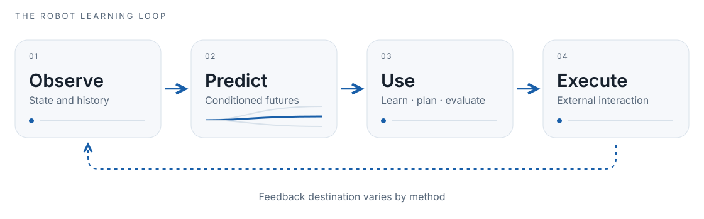

<strong>awesome-robot-world-model</strong>

<h1>From Prediction to Control</h1>

<strong>An Atlas of Robot World Models</strong>

What does a model predict — and how does that prediction change a robot’s decisions?

<a href="docs/paper-index.md">Find a paper</a> · <a href="docs/paper-map.md">Follow the survey</a> · <a href="docs/methods.md">Read the annotations</a> · <a href="docs/resources.md">Find a resource</a>

<picture>
  <source media="(prefers-color-scheme: dark) and (max-width: 600px)" srcset="assets/loop-mobile-dark.svg">
  <source media="(max-width: 600px)" srcset="assets/loop-mobile-light.svg">
  <source media="(prefers-color-scheme: dark)" srcset="assets/loop-dark.svg">
  
</picture>

<strong>600 cited works</strong> &nbsp;·&nbsp; <strong>70 annotated entries</strong> &nbsp;·&nbsp; <strong>21 resource entries</strong>

A companion to **From Prediction to Control: A Survey of Closed-Loop World Models for Robot Learning**. The Atlas follows the paper’s central question: how do predictive models improve robot learning, control and evaluation? Browse by the problem you are solving; use the paper map to recover the original argument.

## Start here

| Your question | Reading route |
|---|---|
| What makes a prediction useful for a robot? | [The Prediction-to-Control Gap](docs/scope-and-taxonomy.md) → [six model roles](docs/roles.md) |
| Which system should I read for my task? | [Annotated entries below](#the-atlas) → [interfaces and evidence boundaries](docs/methods.md) |
| Where is a particular paper or citation key? | [Complete 600-work index](docs/paper-index.md) · [bibliographic catalog](docs/catalog.md) |
| What can I use to train or evaluate? | [Datasets, environments and implementations](docs/resources.md) → [evaluation worksheet](docs/evaluation.md) |

## The Atlas

The reading order moves from foundations to prediction, downstream use, physical grounding and returned feedback. Each entry has one home here and can appear in several [functional roles](docs/roles.md). **Predictive use**, **policy context**, **representation prior**, **generative context** and **benchmark** are different entry kinds. Neither citation presence nor the “predictive use” label automatically establishes strict closed-loop qualification.

[01 Foundations](#track-foundations) · [02 Representations](#track-representations) · [03 Policy learning](#track-learning-control) · [04 Foundation priors, simulation](#track-simulation) · [05 Touch](#track-tactile) · [06 Human video](#track-human-data) · [07 Embodiments](#track-embodiment) · [08 Evaluation, reliability](#track-evaluation) · [09 Datasets, environments](#track-resources) · [10 Interaction](#track-interaction) · [11 Open problems](#track-frontiers)

### 01 · Foundations and the Prediction-to-Control Gap

Define the model’s downstream use and distinguish predictive quality from decision utility.

| Entry | Read for |
|---|---|
| [World Models](docs/methods.md#paper-ha2018worldmodels) · 2018 Predictive use | A compact starting point for learned latent environments. |

[Browse all 27 cited works in this route →](docs/paper-index.md#track-foundations)

### 02 · Representations and predictive mechanics

Choose a state substrate, action interface and rollout mechanism that preserve task-relevant consequences.

| Entry | Read for |
|---|---|
| [DINO-WM](docs/methods.md#paper-zhou2025dinowm) · 2025 Predictive use | Predict frozen visual features for goal-directed planning. |
| [V-JEPA 2](docs/methods.md#paper-assran2025vjepa2) · 2025 Predictive use | Separate video pretraining from action-grounded V-JEPA 2-AC. |
| [ACT-JEPA](docs/methods.md#paper-actjepa2025) · 2025 Representation prior | Predictive representations and action-chunk learning. |
| [Causal-JEPA](docs/methods.md#paper-nam2026causaljepa) · 2026 Representation prior | Object-level predictive dependencies; retain identifiability limits. |
| [ODEWorld](docs/methods.md#paper-liu2026odeworld) · 2026 Generative context | Continuous latent prediction conditioned on observation and goal. |
| [PointWorld](docs/methods.md#paper-pointworld2026) · 2026 Predictive use | Scene point-flow prediction and MPPI; hardware execution is open-loop. |
| [PhysTwin](docs/methods.md#paper-jiang2025phystwin) · 2025 Predictive use | Build deformable physical twins from sparse videos. |

[Browse all 73 cited works in this route →](docs/paper-index.md#track-representations)

### 03 · Policy learning and planning

Separate actor learning through imagination from action selection through search or control.

| Entry | Read for |
|---|---|
| [PlaNet](docs/methods.md#paper-hafner2019planet) · 2019 Predictive use | Plan candidate actions with latent dynamics and CEM. |
| [Dreamer](docs/methods.md#paper-hafner2019dreamer) · 2020 Predictive use | Learn an actor and value model through latent imagination. |
| [DreamerV2](docs/methods.md#paper-hafner2021dreamerv2) · 2021 Predictive use | Discrete latent dynamics for imagined policy learning. |
| [DreamerV3](docs/methods.md#paper-hafner2023dreamerv3) · 2023 Predictive use | A shared world-model agent configuration across domains. |
| [Dreamer4](docs/methods.md#paper-hafner2025dreamer4) · 2025 Predictive use | Scale agent training inside learned worlds. |
| [DayDreamer](docs/methods.md#paper-wu2022daydreamer) · 2022 Predictive use | Connect latent imagination to physical robot learning. |
| [TD-MPC2](docs/methods.md#paper-hansen2024tdmpc2) · 2024 Predictive use | Combine latent planning with scalable continuous control. |
| [WorldPlanner](docs/methods.md#paper-worldplanner2025) · 2025 Predictive use | Action-conditioned visual prediction for MCTS and MPC. |
| [Large Video Planner](docs/methods.md#paper-chen2025largevideoplanner) · 2025 Predictive use | Video prediction for long-horizon plans; retain execution limits. |

[Browse all 40 cited works in this route →](docs/paper-index.md#track-learning-control)

### 04 · Foundation priors, simulation and generated experience

Distinguish general priors, interactive neural environments and pipelines that generate training data.

| Entry | Read for |
|---|---|
| [RoboDreamer](docs/methods.md#paper-robodreamer2024) · 2024 Predictive use | Instruction-conditioned, compositional imagined futures. |
| [Robotic World Model (RWM)](docs/methods.md#paper-li2025roboticworldmodel) · 2025 Predictive use | A learned neural simulator for policy optimization. |
| [Interactive World Simulator (IWS)](docs/methods.md#paper-interactiveworldsim2026) · 2026 Predictive use | Interactive demonstration generation and policy evaluation. |
| [Hi-WM](docs/methods.md#paper-li2026hiwm) · 2026 Predictive use | Human correction through simulator rollback and branching. |
| [GE-Sim 2.0](docs/methods.md#paper-qiu2026gesim2) · 2026 Predictive use | Filter generated rollouts for supervised policy updates. |
| [GeniWorld](docs/methods.md#paper-gu2026geniworld) · 2026 Predictive use | Ground interactive video prediction in rendered robot actions. |
| [DreamGen](docs/methods.md#paper-jang2025dreamgen) · 2025 Predictive use | Recover synthetic robot trajectories from generated videos. |
| [DreamDojo](docs/methods.md#paper-gao2026dreamdojo) · 2026 Predictive use | Human-video interaction priors followed by robot grounding. |
| [WoVR](docs/methods.md#paper-nsim-wovr) · 2026 Predictive use | Use action-conditioned simulation to post-train VLA policies. |
| [Cosmos](docs/methods.md#paper-nvidia2025cosmos) · 2025 Generative context | Pretrained world-model components and generative priors. |
| [Cosmos 3](docs/methods.md#paper-nvidia2026cosmos3) · 2026 Generative context | Shared multimodal understanding, prediction and action interfaces. |
| [Genie](docs/methods.md#paper-bruce2024genie) · 2024 Generative context | Latent-action interactive environments from passive video. |
| [Gen2Act](docs/methods.md#paper-bharadhwaj2025gen2act) · 2025 Predictive use | Condition robot behavior on generated human task motion. |
| [Dreamitate](docs/methods.md#paper-liang2025dreamitate) · 2025 Predictive use | Convert generated task motion into robot behavior. |
| [OpenVLA](docs/methods.md#paper-openvla2024) · 2024 Policy context | An open VLA action prior and policy baseline. |
| [pi0](docs/methods.md#paper-pi0) · 2024 Policy context | A foundation policy with flow-matching action generation. |
| [GR00T N1.7](docs/methods.md#paper-nvidia2026groot17) · 2026 Policy context | A reasoning VLA with an action-cascade interface. |

[Browse all 77 cited works in this route →](docs/paper-index.md#track-simulation)

### 05 · Touch and contact

Connect hidden contact state to predictive control, corrective action and multisensory learning.

| Entry | Read for |
|---|---|
| [Manipulation by Feel](docs/methods.md#paper-tian2019manipulation) · 2019 Predictive use | Predict tactile images to servo toward a contact goal. |
| [RoboPack](docs/methods.md#paper-ai2024robopack) · 2024 Predictive use | Infer physical state from vision and touch for planning. |
| [VIRDO++](docs/methods.md#paper-wi2022virdopp) · 2022 Predictive use | Predict deformable state from vision, contact and force. |
| [ContactWorld](docs/methods.md#paper-zhang2026contactworld) · 2026 Predictive use | Study which visual-tactile representations help prediction. |
| [OmniVTA](docs/methods.md#paper-omnivta2026) · 2026 Predictive use | Use tactile forecasts and feedback for execution-time correction. |
| [Visuo-Tactile World Models](docs/methods.md#paper-visuotactilewm2026) · 2026 Predictive use | Visual-tactile latent dynamics and open-loop physical planning. |
| [DexTacWAM](docs/methods.md#paper-yuan2026dextacwam) · 2026 Predictive use | Transfer video priors into dexterous tactile world-action modeling. |
| [VTAM](docs/methods.md#paper-yuan2026vtam) · 2026 Predictive use | Joint video, tactile and action modeling. |
| [VT-WAM](docs/methods.md#paper-tian2026vtwam) · 2026 Predictive use | Route contact information into world-action prediction. |
| [Dream-Tac](docs/methods.md#paper-lou2026dreamtac) · 2026 Predictive use | Joint future vision, touch and action with contact-aware fusion. |
| [Tactile-WAM](docs/methods.md#paper-wu2026tactilewam) · 2026 Predictive use | Asymmetric tactile attention for world-action modeling. |
| [Sparsh](docs/methods.md#paper-higuera2024sparsh) · 2024 Representation prior | Reusable self-supervised tactile features. |
| [AnyTouch](docs/methods.md#paper-feng2025anytouch) · 2025 Representation prior | Static and dynamic tactile representations across sensors. |
| [OmniVTLA](docs/methods.md#paper-cheng2025omnivtla) · 2025 Policy context | Tactile-conditioned VLA policy context, distinct from OmniVTA. |
| [MuSe](docs/methods.md#paper-clark2026muse) · 2026 Policy context | Add force sensing while testing retention of earlier behavior. |

[Browse all 59 cited works in this route →](docs/paper-index.md#track-tactile)

### 06 · Human video and embodiment grounding

Separate passive priors, action proxies, paired supervision and deployment-time human context.

| Entry | Read for |
|---|---|
| [EgoWAM](docs/methods.md#paper-egowam2026) · 2026 Predictive use | Compare predictive targets using human and robot data. |
| [AnyWorld](docs/methods.md#paper-chen2026anyworld) · 2026 Predictive use | Factor human motion, camera and embodiment conditions. |
| [Zero-WAM](docs/methods.md#paper-zhou2026zerowam) · 2026 Predictive use | Condition frozen world-action models on human demonstrations. |
| [TactAlign](docs/methods.md#paper-tactalign2026) · 2026 Policy context | Align human and robot touch for policy transfer. |
| [EgoZero](docs/methods.md#paper-egozero2025) · 2025 Policy context | Extract robot-grounded learning signals from smart glasses. |

[Browse all 29 cited works in this route →](docs/paper-index.md#track-human-data)

### 07 · Embodiments and task interfaces

Read manipulation, navigation, locomotion and driving through their action units and feedback requirements.

[Browse all 59 cited works in this route →](docs/paper-index.md#track-embodiment)

### 08 · Evaluation, reliability and safety

Assess model quality, policy utility and deployment reliability with use-specific evidence.

| Entry | Read for |
|---|---|
| [RoboWorld](docs/methods.md#paper-nsim-roboworld) · 2026 Predictive use | Compare policies in neural simulation; correlation is not calibration. |
| [WorldEval](docs/methods.md#paper-li2025worldeval) · 2025 Predictive use | Use predicted consequences to evaluate robot policies. |
| [Model-Based Runtime Monitoring](docs/methods.md#paper-liu2024runtime) · 2024 Predictive use | Predict near-term failures to support deployment monitoring. |
| [Sirius-Fleet](docs/methods.md#paper-liu2025siriusfleet) · 2025 Predictive use | Allocate fleet supervision using prospective anomaly prediction. |
| [WorldArena](docs/methods.md#paper-shang2026worldarena) · 2026 Benchmark | Evaluate perception and functional world-model utility. |
| [EWMBench](docs/methods.md#paper-yue2025ewmbench) · 2025 Benchmark | Diagnose scene, motion and semantic generation quality. |
| [World-in-World](docs/methods.md#paper-worldinworld2025) · 2026 Benchmark | Study world-model assessment in a closed-loop setting. |
| [SafeDreamer](docs/methods.md#paper-huang2024safedreamer) · 2024 Predictive use | Use predicted costs in constrained policy learning. |

[Browse all 105 cited works in this route →](docs/paper-index.md#track-evaluation)

### 09 · Datasets, environments and benchmarks

Find the data, tools and evaluation fixtures that support a particular interface.

[Browse all 25 cited works in this route →](docs/paper-index.md#track-resources)

### 10 · Interaction and continual improvement

Track what feedback updates: context, actions, policy, model parameters or memory.

| Entry | Read for |
|---|---|
| [VLA-RFT](docs/methods.md#paper-vlarft2025) · 2025 Predictive use | Policy GRPO with rewards from a frozen world simulator. |
| [World-Gymnast](docs/methods.md#paper-worldgymnast2026) · 2026 Predictive use | Use learned-world interaction for robot policy learning. |
| [WAM-TTT](docs/methods.md#paper-feng2026wamttt) · 2026 Predictive use | Adapt fast weights from human video before execution. |
| [VLAW](docs/methods.md#paper-vlaw2026) · 2026 Predictive use | Refit the world model with real rollouts, then train on selected data. |
| [WorldSample](docs/methods.md#paper-xue2026worldsample) · 2026 Predictive use | Route real and counterfactual transitions into critic and policy learning. |
| [WAM-RL](docs/methods.md#paper-wamrl2026) · 2026 Predictive use | Actor RL and world-model video fine-tuning use separate objectives. |
| [REGEN](docs/methods.md#paper-govind2026regen) · 2026 Predictive use | Generate replay for continual world-action imitation learning. |
| [Planning with Online World Models](docs/methods.md#paper-liu2025onlinewm) · 2025 Predictive use | Refit predictive models for planning across changing environments. |

[Browse all 76 cited works in this route →](docs/paper-index.md#track-interaction)

### 11 · Open problems and frontier directions

Follow unresolved questions in efficiency, streaming, memory, causality and accountable systems.

[Browse all 30 cited works in this route →](docs/paper-index.md#track-frontiers)

## Follow the paper

The complete paper map links every citation-bearing argument group. It preserves multiple uses of the same work, while the main index uses the clearer reading routes above.

[Open the paper map →](docs/paper-map.md)

<strong>All paper sections</strong>

| Section | Guide |
|---|---|
| 01 | [Introduction](docs/chapters/01-introduction.md) |
| 02 | [Positioning Among Existing Surveys](docs/chapters/02-related-surveys.md) |
| 03 | [A Robot Learning Loop View of World Models](docs/chapters/03-foundations.md) |
| 04 | [The Optimizable Roles of World Models](docs/chapters/04-roles.md) |
| 05 | [Representation Substrates and World-Model Mechanics](docs/chapters/05-representations.md) |
| 06 | [From Roles to Policy Improvement](docs/chapters/06-learning-regimes.md) |
| 07 | [Foundation-Driven World Models and Robot Priors](docs/chapters/07-foundation-priors.md) |
| 08 | [Tactile and Contact World Models](docs/chapters/08-tactile-contact.md) |
| 09 | [Human and Egocentric Data as a World-Model Source](docs/chapters/09-human-egocentric.md) |
| 10 | [Embodiment and Task Perspective](docs/chapters/10-embodiments.md) |
| 11 | [Evaluation: From Prediction Metrics to Closed-Loop Utility](docs/chapters/11-evaluation.md) |
| 12 | [Resources: Datasets, Simulators, Benchmarks, and Frameworks](docs/chapters/12-resources.md) |
| 13 | [Frontier Evidence Atlas: 2024–2026](docs/chapters/13-frontier-atlas.md) |
| 14 | [From Interaction to Model Improvement](docs/chapters/14-interaction-learning.md) |
| 15 | [Open Challenges and Future Directions](docs/chapters/15-research-agenda.md) |
| 16 | [Conclusion](docs/chapters/16-conclusion.md) |
| A | [Extended Survey Protocols](docs/chapters/a-review-protocol.md) |

## Read the evidence with the interface

Latent imagination can train an actor without deployment-time planning. Video generation can supply demonstrations without online RL. A planner can select a trajectory that is later executed open-loop. Tactile feedback can correct an action without updating model weights. The [method cards](docs/methods.md) keep these distinctions visible.

[Scope and taxonomy](docs/scope-and-taxonomy.md) · [Reading paths](docs/reading-paths.md) · [Evaluation](docs/evaluation.md)

## Contribute

Correct an identity, clarify a mechanism or add a resource cited by the companion survey. Keep the predictive interface, downstream consumer and evidence boundary together. See [contributing](CONTRIBUTING.md).

[Catalog JSON](data/catalog.json) · [Reading-route JSON](data/organization.json) · [Citation map](data/citation-map.json) · [CSV](data/catalog.csv) · [BibTeX](data/references.bib)

<strong>Snapshot, verification and design references</strong>

Manuscript snapshot: **2026-10-01**. Organization and presentation reviewed: **2026-10-02**. The catalog includes contextual literature. Primary bibliographic checks do not constitute scientific replication; some source records lack an extracted paper URL.

[Verification coverage](docs/provenance.md) · [Five layout references and Apple guidance](docs/design-notes.md)

Linked papers, datasets and code retain their authorship and upstream licenses. No full papers or private manuscript paragraphs are redistributed.

