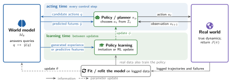

# 2 · From Prediction to Control

[Home](../../README.md) · [← 1 · Introduction](01-introduction.md) · [3 · What the Model Is: Four Design Dials →](03-design-dials.md)

This section fixes the vocabulary of the survey: the robot learning loop, the definition of a world model and the reading key of Figure 1. A first-order expansion, ΔJ ≈ Eq∼Q[(∂J/∂ŷ)(q) ε(q)], shows that the error ε of a model reaches the return J of the deployed policy through two factors that the consumer sets: the queries Q it issues and its sensitivity ∂J/∂ŷ to each error.

This section cites 10 works. A work cited in several subsections appears under each; ⌂ marks the subsection where the README lists it.

## 2.1 The Robot Learning Loop

*Representative works (Figure 2):* [PlaNet](../catalog.md#paper-hafner2019planet), [Dreamer](../catalog.md#paper-hafner2019dreamer), [DayDreamer](../catalog.md#paper-wu2022daydreamer)

No citations.

## 2.2 What Counts as a World Model

*Representative works (Figure 2):* action-conditioned prediction, VLAs as consumers

- **DreamZero**: [World Action Models are Zero-shot Policies](<https://arxiv.org/abs/2602.15922>) · arXiv 2026 · [ⓘ](../catalog.md#paper-ye2026dreamzero)

## 2.3 Why Prediction Is Not Control

*Representative works (Figure 2):* [value equivalence](../catalog.md#paper-grimm2020value), [value-aware learning](../catalog.md#paper-farahmand2017vaml), [MuZero](../catalog.md#paper-schrittwieser2020muzero)

- Value-Aware Loss Function for Model-based Reinforcement Learning · AISTATS 2017 · [ⓘ](../catalog.md#paper-farahmand2017vaml) ⌂
- The Value Equivalence Principle for Model-Based Reinforcement Learning · NeurIPS 2020 · [ⓘ](../catalog.md#paper-grimm2020value) ⌂
- [Deciding What to Model: Value-Equivalent Sampling for Reinforcement Learning](<https://arxiv.org/abs/2206.02072>) · NeurIPS 2022 · [ⓘ](../catalog.md#paper-arumugam2022deciding) ⌂
- [Approximate Information State for Approximate Planning and Reinforcement Learning in Partially Observed Systems](<https://www.jmlr.org/papers/v23/20-1165.html>) · Journal of Machine Learning Research 2022 · [ⓘ](../catalog.md#paper-subramanian2022ais) ⌂
- **WorldEval**: [World Model as Real-World Robot Policies Evaluator](<https://arxiv.org/abs/2505.19017>) · arXiv 2025 · [ⓘ](../catalog.md#paper-worldeval2025)

## 2.4 From the Loop to the Taxonomy

*Representative works (Figure 2):* five pathways and the outer loop

- **PlaNet**: [Learning Latent Dynamics for Planning from Pixels](<https://arxiv.org/abs/1811.04551>) · ICML 2019 · [ⓘ](../catalog.md#paper-hafner2019planet) ⌂
- **Dreamer**: [Dream to Control: Learning Behaviors by Latent Imagination](<https://arxiv.org/abs/1912.01603>) · ICLR 2020 · [ⓘ](../catalog.md#paper-hafner2019dreamer)
- **DayDreamer**: [World Models for Physical Robot Learning](<https://arxiv.org/abs/2206.14176>) · CoRL 2022 · [Code](<https://github.com/danijar/daydreamer>) · [ⓘ](../catalog.md#paper-wu2022daydreamer)
- **DiWA**: [Diffusion Policy Adaptation with World Models](<https://arxiv.org/abs/2508.03645>) · 2025 · [ⓘ](../catalog.md#paper-diwa)

