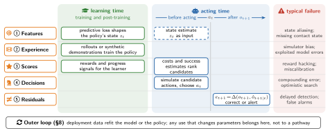

# 4 · How Predictions Are Consumed: Five Pathways

[Home](../../README.md) · [← 3 · What the Model Is: Four Design Dials](03-design-dials.md) · [5 · Who Changes the Robot: Learners and Policies →](05-learners-and-policies.md)

The survey classifies each use of a world model by what the model hands to its consumer: features, generated experience, scores, futures of candidate actions (decisions) or residuals between prediction and observation. Features and experience change what the policy learns, decisions and residuals change what it does at acting time, and scores serve both. An evidence map of pathway against prediction space closes the section.

This section cites 107 works. A work cited in several subsections appears under each; ⌂ marks the subsection where the README lists it.

## Section opening

- **VLA-RFT**: [Vision-Language-Action Reinforcement Fine-tuning with Verified Rewards in World Simulators](<https://arxiv.org/abs/2510.00406>) · arXiv 2025 · [ⓘ](../catalog.md#paper-vlarft2025)
- **DreamZero**: [World Action Models are Zero-shot Policies](<https://arxiv.org/abs/2602.15922>) · arXiv 2026 · [ⓘ](../catalog.md#paper-ye2026dreamzero)
- **EgoWAM**: [World Action Models Beyond Pixels with In-the-Wild Egocentric Human Data](<https://arxiv.org/abs/2607.08436>) · arXiv 2026 · [ⓘ](../catalog.md#paper-egowam2026)

## 4.1 Features: Predictive Training Shapes the Policy's State

*Representative works (Figure 2):* [WMR](../catalog.md#paper-wmr2025), [ODEWorld](../catalog.md#paper-liu2026odeworld), [DBC](../catalog.md#paper-dbc), [EgoWAM](../catalog.md#paper-egowam2026), [PALM](../catalog.md#paper-liu2026palm)

- **WMR**: [Learning Humanoid Locomotion with World Model Reconstruction](<https://arxiv.org/abs/2502.16230>) · 2025 · [ⓘ](../catalog.md#paper-wmr2025) ⌂
- **ODEWorld**: [A Continuous Predictive Architecture via Physical-Time Flow](<https://arxiv.org/abs/2607.27924>) · 2026 · [ⓘ](../catalog.md#paper-liu2026odeworld) ⌂
- **DBC**: [Learning Invariant Representations for Reinforcement Learning without Reconstruction](<https://arxiv.org/abs/2006.10742>) · 2021 · [ⓘ](../catalog.md#paper-dbc) ⌂
- **EgoWAM**: [World Action Models Beyond Pixels with In-the-Wild Egocentric Human Data](<https://arxiv.org/abs/2607.08436>) · arXiv 2026 · [ⓘ](../catalog.md#paper-egowam2026) ⌂
- **PALM**: Progress-Aware Policy Learning via Affordance Reasoning for Long-Horizon Robotic Manipulation · CVPR 2026 · [ⓘ](../catalog.md#paper-liu2026palm) ⌂
- [R3m: A universal visual representation for robot manipulation](<https://arxiv.org/abs/2203.12601>) · arXiv 2022 · [ⓘ](../catalog.md#paper-nair2022r3m) ⌂
- Where are we in the search for an artificial visual cortex for embodied intelligence? · NeurIPS 2023 · [ⓘ](../catalog.md#paper-majumdar2023we) ⌂

## 4.2 Experience: Learning from Generated Data

*Representative works (Figure 2):* [Dreamer](../catalog.md#paper-hafner2019dreamer), [DiWA](../catalog.md#paper-diwa), [RWM](../catalog.md#paper-li2025roboticworldmodel), [VLA-RFT](../catalog.md#paper-vlarft2025), [IWS](../catalog.md#paper-interactiveworldsim2026), [DreamGen](../catalog.md#paper-jang2025dreamgen)

- **Dreamer**: [Dream to Control: Learning Behaviors by Latent Imagination](<https://arxiv.org/abs/1912.01603>) · ICLR 2020 · [ⓘ](../catalog.md#paper-hafner2019dreamer) ⌂
- **DreamerV3**: [Mastering Diverse Domains through World Models](<https://arxiv.org/abs/2301.04104>) · 2023 · [Code](<https://github.com/danijar/dreamerv3>) · [ⓘ](../catalog.md#paper-hafner2023dreamerv3)
- **DayDreamer**: [World Models for Physical Robot Learning](<https://arxiv.org/abs/2206.14176>) · CoRL 2022 · [Code](<https://github.com/danijar/daydreamer>) · [ⓘ](../catalog.md#paper-wu2022daydreamer)
- **RWM**: [Robotic World Model: A Neural Network Simulator for Robust Policy Optimization in Robotics](<https://arxiv.org/abs/2501.10100>) · 2025 · [ⓘ](../catalog.md#paper-li2025roboticworldmodel) ⌂
- **RoboHorizon**: [An llm-assisted multi-view world model for long-horizon robotic manipulation](<https://arxiv.org/abs/2501.06605>) · arXiv 2025 · [ⓘ](../catalog.md#paper-robohorizon2025)
- **DiWA**: [Diffusion Policy Adaptation with World Models](<https://arxiv.org/abs/2508.03645>) · 2025 · [ⓘ](../catalog.md#paper-diwa) ⌂
- **GeniWorld**: [A Generalizable Interactive World Model for Robotic Manipulation via Visual Actions](<https://arxiv.org/abs/2608.06332>) · arXiv 2026 · [ⓘ](../catalog.md#paper-gu2026geniworld) ⌂
- **GE-Sim 2.0**: [A Roadmap Towards Comprehensive Closed-loop Video World Simulators for Robotic Manipulation](<https://arxiv.org/abs/2605.27491>) · arXiv 2026 · [ⓘ](../catalog.md#paper-qiu2026gesim2) ⌂
- [Atlas: A World Model for Spatial Intelligence](<https://www.worldlabs.ai/blog/atlas>) · World Labs Blog 2026 · [ⓘ](../catalog.md#paper-worldlabs2026atlas)
- **SimFoundry**: [Modular and Automated Scene Generation for Policy Learning and Evaluation](<https://arxiv.org/abs/2606.28276>) · 2026 · [ⓘ](../catalog.md#paper-ranawaka2026simfoundry) ⌂
- **IWS**: [Interactive World Simulator for Robot Policy Training and Evaluation](<https://arxiv.org/abs/2603.08546>) · 2026 · [ⓘ](../catalog.md#paper-interactiveworldsim2026) ⌂
- **Hi-WM**: [Human-in-the-World-Model for Scalable Robot Post-Training](<https://arxiv.org/abs/2604.21741>) · 2026 · [ⓘ](../catalog.md#paper-li2026hiwm)
- **DreamGen**: [Unlocking Generalization in Robot Learning through Video World Models](<https://arxiv.org/abs/2505.12705>) · CoRL 2025 · [Code](<https://github.com/NVIDIA/GR00T-dreams>) · [ⓘ](../catalog.md#paper-jang2025dreamgen) ⌂
- [Uncertainty-Aware Robotic World Model Makes Offline Model-Based Reinforcement Learning Work on Real Robots](<https://arxiv.org/abs/2504.16680>) · 2025 · [ⓘ](../catalog.md#paper-nsim-rwmu)
- **WoVR**: [World Models as Reliable Simulators for Post-Training VLA Policies with RL](<https://arxiv.org/abs/2602.13977>) · 2026 · [ⓘ](../catalog.md#paper-nsim-wovr) ⌂
- [RISE: Self-Improving Robot Policy with Compositional World Model](<https://arxiv.org/abs/2602.11075>) · 2026 · [ⓘ](../catalog.md#paper-nsim-rise) ⌂
- **VLAW**: [Iterative Co-Improvement of Vision-Language-Action Policy and World Model](<https://arxiv.org/abs/2602.12063>) · arXiv 2026 · [ⓘ](../catalog.md#paper-vlaw2026)
- **WorldSample**: [Closed-loop Real-robot RL with World Modelling](<https://arxiv.org/abs/2607.02431>) · arXiv 2026 · [ⓘ](../catalog.md#paper-xue2026worldsample)
- **UniSim**: [Learning Interactive Real-World Simulators](<https://arxiv.org/abs/2310.06114>) · ICLR 2024 · [ⓘ](../catalog.md#paper-yang2024unisim)
- RoboScape-R: Unified Reward-Observation World Models for Generalizable Robotics Training via RL · CVPR 2026 · [ⓘ](../catalog.md#paper-roboscape-r) ⌂
- **VLA-RFT**: [Vision-Language-Action Reinforcement Fine-tuning with Verified Rewards in World Simulators](<https://arxiv.org/abs/2510.00406>) · arXiv 2025 · [ⓘ](../catalog.md#paper-vlarft2025) ⌂
- [Reconciling Reality through Simulation: A Real-to-Sim-to-Real Approach for Robust Manipulation](<https://doi.org/10.15607/RSS.2024.XX.015>) · RSS 2024 · [ⓘ](../catalog.md#paper-torne2024rialto)
- X-Sim: Cross-Embodiment Learning via Real-to-Sim-to-Real · CoRL 2025 · [ⓘ](../catalog.md#paper-dan2025xsim) ⌂
- **VideoMimic**: Visual Imitation Enables Contextual Humanoid Control · CoRL 2025 · [ⓘ](../catalog.md#paper-allshire2025videomimic)
- EmbodMocap: In-the-Wild 4D Human-Scene Reconstruction for Embodied Agents · CVPR 2026 · [ⓘ](../catalog.md#paper-wang2026embodmocap) ⌂
- CRISP: Contact-Guided Real2Sim from Monocular Video with Planar Scene Primitives · ICLR 2026 · [ⓘ](../catalog.md#paper-wang2026crisp) ⌂
- [REST3D: Reconstructing Physically Stable 3D Scenes from a Single Image](<https://arxiv.org/abs/2605.30338>) · arXiv 2026 · [ⓘ](../catalog.md#paper-ma2026rest3d) ⌂
- HIL: Hybrid Imitation Learning for Dynamic Athletic Control · ACM Transactions on Graphics 2026 · [ⓘ](../catalog.md#paper-wang2026hil) ⌂
- Generalizing from References using a Multi-Task Reference and Goal-Driven RL Framework · RSS 2026 · [ⓘ](../catalog.md#paper-wang2026generalizing) ⌂
- [VR-Robo: A Real-to-Sim-to-Real Framework for Visual Robot Navigation and Locomotion](<https://doi.org/10.1109/LRA.2025.3575648>) · RA-L 2025 · [ⓘ](../catalog.md#paper-zhu2025vrrobo) ⌂
- [Splatting Physical Scenes: End-to-End Real-to-Sim from Imperfect Robot Data](<https://arxiv.org/abs/2506.04120>) · arXiv 2025 · [ⓘ](../catalog.md#paper-moran2025splatting) ⌂
- [GaussGym: An Open-Source Real-to-Sim Framework for Learning Locomotion from Pixels](<https://arxiv.org/abs/2510.15352>) · arXiv 2025 · [ⓘ](../catalog.md#paper-escontrela2025gaussgym) ⌂
- MonoFusion: Sparse-View 4D Reconstruction via Monocular Fusion · ICCV 2025 · [ⓘ](../catalog.md#paper-wang2025monofusion) ⌂
- Vid2Sim: Realistic and Interactive Simulation from Video for Urban Navigation · CVPR 2025 · [ⓘ](../catalog.md#paper-xie2025vid2sim) ⌂
- **MimicGen**: [A Data Generation System for Scalable Robot Learning using Human Demonstrations](<https://arxiv.org/abs/2310.17596>) · 2023 · [Code](<https://github.com/NVlabs/mimicgen>) · [ⓘ](../catalog.md#paper-mimicgen)
- **DexMimicGen**: [Automated Data Generation for Bimanual Dexterous Manipulation via Imitation Learning](<https://arxiv.org/abs/2410.24185>) · 2024 · [Code](<https://github.com/NVlabs/dexmimicgen>) · [ⓘ](../catalog.md#paper-dexmimicgen)
- [GRAIL: Generating Humanoid Loco-Manipulation from 3D Assets and Video Priors](<https://arxiv.org/abs/2606.05160>) · 2026 · [ⓘ](../catalog.md#paper-xie2026grail)
- Counterfactual Video Generation for Humanoid Loco-Manipulation · RSS 2026 Workshop Whole-body Control and Bimanual Manipulation: Applications in Humanoids and Beyond · [ⓘ](../catalog.md#paper-wang2026counterfactual)
- **World-Gymnast**: [Training robots with reinforcement learning in a world model](<https://arxiv.org/abs/2602.02454>) · arXiv 2026 · [ⓘ](../catalog.md#paper-worldgymnast2026)
- [WISE: World-model-guided Imagination Scheduling for Efficient Post-training of Vision-Language-Action Models](<https://arxiv.org/abs/2609.03681>) · 2026 · [ⓘ](../catalog.md#paper-nsim-wise) ⌂

## 4.3 Scores: Rewards, Success Estimates, and Costs

*Representative works (Figure 2):* [VLAC](../catalog.md#paper-vlac2025), [WorldEval](../catalog.md#paper-worldeval2025), [World-in-World](../catalog.md#paper-worldinworld2025), [SafeDreamer](../catalog.md#paper-huang2024safedreamer)

- **VLAC**: [A Vision-Language-Action-Critic Model for Robotic Real-World Reinforcement Learning](<https://arxiv.org/abs/2509.15937>) · 2025 · [ⓘ](../catalog.md#paper-vlac2025) ⌂
- **Dreamer**: [Dream to Control: Learning Behaviors by Latent Imagination](<https://arxiv.org/abs/1912.01603>) · ICLR 2020 · [ⓘ](../catalog.md#paper-hafner2019dreamer)
- [Deep Reinforcement Learning from Human Preferences](<https://proceedings.neurips.cc/paper/2017/hash/d5e2c0adad503c91f91df240d0cd4e49-Abstract.html>) · NeurIPS 2017 · [ⓘ](../catalog.md#paper-christiano2017preferences) ⌂
- [Vip: Towards universal visual reward and representation via value-implicit pre-training](<https://arxiv.org/abs/2210.00030>) · arXiv 2022 · [ⓘ](../catalog.md#paper-ma2022vip) ⌂
- Vision-language models for robot success detection · AAAI 2024 · [ⓘ](../catalog.md#paper-luo2024vision) ⌂
- [Video-language critic: Transferable reward functions for language-conditioned robotics](<https://arxiv.org/abs/2405.19988>) · arXiv 2024 · [ⓘ](../catalog.md#paper-alakuijala2024video) ⌂
- [GRAPE: Generalizing Robot Policy via Preference Alignment](<https://arxiv.org/abs/2411.19309>) · arXiv 2024 · [ⓘ](../catalog.md#paper-grape2024) ⌂
- [ReWiND: Language-Guided Rewards Teach Robot Policies without New Demonstrations](<https://arxiv.org/abs/2505.10911>) · arXiv 2025 · [ⓘ](../catalog.md#paper-rewind2025)
- **WorldEval**: [World Model as Real-World Robot Policies Evaluator](<https://arxiv.org/abs/2505.19017>) · arXiv 2025 · [ⓘ](../catalog.md#paper-worldeval2025) ⌂
- **IWS**: [Interactive World Simulator for Robot Policy Training and Evaluation](<https://arxiv.org/abs/2603.08546>) · 2026 · [ⓘ](../catalog.md#paper-interactiveworldsim2026)
- **World-in-World**: [World models in a closed-loop world](<https://arxiv.org/abs/2510.18135>) · ICLR 2026 · [ⓘ](../catalog.md#paper-worldinworld2025) ⌂
- **RoboWorld**: [Fast and Reliable Neural Simulators for Generalist Robot Policy Evaluation](<https://arxiv.org/abs/2607.01060>) · 2026 · [ⓘ](../catalog.md#paper-nsim-roboworld) ⌂
- [Evaluating Gemini Robotics Policies in a Veo World Simulator](<https://arxiv.org/abs/2512.10675>) · 2025 · [ⓘ](../catalog.md#paper-nsim-veo) ⌂
- **WorldEcho**: [Do Robotic World Models Really Follow Actions? Diagnosing and Aligning Action-Conditioned Generation for Policy Learning](<https://arxiv.org/abs/2608.24885>) · 2026 · [ⓘ](../catalog.md#paper-chen2026worldsync)
- [Mem-World: Memory-Augmented Action-Conditioned World Models for Persistent Robot Manipulation](<https://arxiv.org/abs/2606.18960>) · 2026 · [ⓘ](../catalog.md#paper-nsim-memworld) ⌂
- **MBPO**: [When to Trust Your Model: Model-Based Policy Optimization](<https://arxiv.org/abs/1906.08253>) · NeurIPS 2019 · [ⓘ](../catalog.md#paper-janner2019mbpo)
- [Uncertainty-Aware Robotic World Model Makes Offline Model-Based Reinforcement Learning Work on Real Robots](<https://arxiv.org/abs/2504.16680>) · 2025 · [ⓘ](../catalog.md#paper-nsim-rwmu) ⌂
- **SafeDreamer**: [Safe reinforcement learning with world models](<https://arxiv.org/abs/2307.07176>) · ICLR 2024 · [Code](<https://github.com/PKU-Alignment/SafeDreamer>) · [ⓘ](../catalog.md#paper-huang2024safedreamer) ⌂
- [Towards Safe Robot Foundation Models](<https://arxiv.org/abs/2503.07404>) · 2025 · [ⓘ](../catalog.md#paper-saferobotfoundation2025) ⌂
- Mixucb: Enhancing safe exploration in contextual bandits with human oversight · Reinforcement Learning Conference 2025 · [ⓘ](../catalog.md#paper-su2025mixucb) ⌂
- [Foundation models in robotics: Applications, challenges, and the future](<https://doi.org/10.1177/02783649241281508>) · The International Journal of Robotics Research 2025 · [ⓘ](../catalog.md#paper-firoozi2025foundation) ⌂
- A survey of reasoning with foundation models: Concepts, methodologies, and outlook · ACM Computing Surveys 2025 · [ⓘ](../catalog.md#paper-sun2025survey) ⌂
- Conformal prediction for uncertainty-aware planning with diffusion dynamics model · NeurIPS 2023 · [ⓘ](../catalog.md#paper-sun2023conformal) ⌂
- Perry: Policy evaluation with confidence intervals using auxiliary data · TMLR 2025 · [ⓘ](../catalog.md#paper-mandyam2025perry) ⌂
- Don't Let Your Robot be Harmful: Responsible Robotic Manipulation via Safety-as-Policy · RA-L 2025 · [ⓘ](../catalog.md#paper-ni2025don) ⌂
- Learning a decision module by imitating driver's control behaviors · CoRL 2021 · [ⓘ](../catalog.md#paper-huang2021learning) ⌂
- Neuro-symbolic program search for autonomous driving decision module design · CoRL 2021 · [ⓘ](../catalog.md#paper-sun2021neuro) ⌂
- ARCH: Hierarchical hybrid learning for long-horizon contact-rich robotic assembly · CoRL 2024 · [ⓘ](../catalog.md#paper-sun2024arch) ⌂
- [MimicPlay: Long-Horizon Imitation Learning by Watching Human Play](<https://arxiv.org/abs/2302.12422>) · CoRL 2023 · [ⓘ](../catalog.md#paper-wang2023mimicplay)
- Diffusion-es: Gradient-free planning with diffusion for autonomous and instruction-guided driving · CVPR 2024 · [ⓘ](../catalog.md#paper-yang2024diffusion) ⌂
- Tractable joint prediction and planning over discrete behavior modes for urban driving · ICRA 2024 · [ⓘ](../catalog.md#paper-villaflor2024tractable) ⌂
- A collision-aware cable grasping method in cluttered environment · ICRA 2024 · [ⓘ](../catalog.md#paper-zhang2024collision) ⌂
- [ParticleFormer: A 3D Point Cloud World Model for Multi-Object, Multi-Material Robotic Manipulation](<https://arxiv.org/abs/2506.23126>) · arXiv 2025 · [ⓘ](../catalog.md#paper-huang2025particleformer)

## 4.4 Decisions: Futures of Candidate Actions

*Representative works (Figure 2):* [TD-MPC2](../catalog.md#paper-hansen2024tdmpc2), [V-JEPA 2-AC](../catalog.md#paper-assran2025vjepa2), [WorldPlanner](../catalog.md#paper-worldplanner2025), [LVP](../catalog.md#paper-chen2025largevideoplanner), [TrAct](../catalog.md#paper-cao2026tract)

- **PlaNet**: [Learning Latent Dynamics for Planning from Pixels](<https://arxiv.org/abs/1811.04551>) · ICML 2019 · [ⓘ](../catalog.md#paper-hafner2019planet)
- **Ego-Vision Contact Planning**: [Ego-vision world model for humanoid contact planning](<https://arxiv.org/abs/2510.11682>) · arXiv 2025 · [ⓘ](../catalog.md#paper-egovisioncontact2025) ⌂
- **PointWorld**: [Scaling 3d world models for in-the-wild robotic manipulation](<https://arxiv.org/abs/2601.03782>) · arXiv 2026 · [ⓘ](../catalog.md#paper-pointworld2026)
- **VT-WM**: [Visuo-Tactile World Models](<https://arxiv.org/abs/2602.06001>) · 2026 · [ⓘ](../catalog.md#paper-visuotactilewm2026)
- **RoboDreamer**: [Learning Compositional World Models for Robot Imagination](<https://arxiv.org/abs/2404.12377>) · 2024 · [ⓘ](../catalog.md#paper-robodreamer2024)
- **V-JEPA 2-AC**: [V-JEPA 2: Self-Supervised Video Models Enable Understanding, Prediction and Planning](<https://arxiv.org/abs/2506.09985>) · arXiv 2025 · [Code](<https://github.com/facebookresearch/vjepa2>) · [ⓘ](../catalog.md#paper-assran2025vjepa2)
- **LVP**: [Large video planner enables generalizable robot control](<https://arxiv.org/abs/2512.15840>) · arXiv 2025 · [ⓘ](../catalog.md#paper-chen2025largevideoplanner) ⌂
- [This&amp;That: Language-Gesture Controlled Video Generation for Robot Planning](<https://arxiv.org/abs/2407.05530>) · ICRA 2025 · [ⓘ](../catalog.md#paper-wang2025thisandthat) ⌂
- [TesserAct: Learning 4D Embodied World Models](<https://arxiv.org/abs/2504.20995>) · ICCV 2025 · [ⓘ](../catalog.md#paper-zhen2025tesseract) ⌂
- **Dreamitate**: [Real-World Visuomotor Policy Learning via Video Generation](<https://arxiv.org/abs/2406.16862>) · CoRL 2025 · [ⓘ](../catalog.md#paper-liang2025dreamitate) ⌂
- **Gen2Act**: [Human Video Generation in Novel Scenarios Enables Generalizable Robot Manipulation](<https://arxiv.org/abs/2409.16283>) · CoRL 2025 · [ⓘ](../catalog.md#paper-bharadhwaj2025gen2act) ⌂
- [Robotic Manipulation by Imitating Generated Videos Without Physical Demonstrations](<https://arxiv.org/abs/2507.00990>) · ICLR 2025 · [ⓘ](../catalog.md#paper-patel2026rigvid) ⌂
- Dream2Flow: Bridging Video Generation and Open-World Manipulation with 3D Object Flow · ICRA 2026 · [ⓘ](../catalog.md#paper-dharmarajan2026dream2flow) ⌂
- [Robot Learning from a Physical World Model](<https://arxiv.org/abs/2511.07416>) · arXiv 2025 · [ⓘ](../catalog.md#paper-mao2025physworld) ⌂
- **WorldPlanner**: [Monte carlo tree search and mpc with action-conditioned visual world models](<https://arxiv.org/abs/2511.03077>) · arXiv 2025 · [ⓘ](../catalog.md#paper-worldplanner2025) ⌂
- **Masked Visual Actions**: [Masked Visual Actions for Unified World Modeling](<https://arxiv.org/abs/2607.19343>) · arXiv 2026 · [ⓘ](../catalog.md#paper-alzayer2026maskedvisual)
- [τ0-WM: A Unified Video-Action World Model for Robotic Manipulation](<https://arxiv.org/abs/2606.01027>) · 2026 · [ⓘ](../catalog.md#paper-zhou2026tau0wm) ⌂
- **TrAct**: [Bridging Robot Control and Visual Prediction with Visual Tracks](<https://arxiv.org/abs/2608.24101>) · 2026 · [ⓘ](../catalog.md#paper-cao2026tract) ⌂
- **DreamZero**: [World Action Models are Zero-shot Policies](<https://arxiv.org/abs/2602.15922>) · arXiv 2026 · [ⓘ](../catalog.md#paper-ye2026dreamzero)
- [Native Video-Action Pretraining for Generalizable Robot Control](<https://arxiv.org/abs/2607.08639>) · arXiv 2026 · [ⓘ](../catalog.md#paper-zhang2026lingbotva2) ⌂
- [Genie Envisioner: A Unified World Foundation Platform for Robotic Manipulation](<https://arxiv.org/abs/2508.05635>) · arXiv 2025 · [ⓘ](../catalog.md#paper-liao2025genie) ⌂

## 4.5 Residuals: Comparing Predictions with Observations

*Representative works (Figure 2):* [OmniVTA](../catalog.md#paper-omnivta2026), [runtime monitoring](../catalog.md#paper-liu2024runtime), [LocoFormer](../catalog.md#paper-locoformer2025)

- **DreamZero**: [World Action Models are Zero-shot Policies](<https://arxiv.org/abs/2602.15922>) · arXiv 2026 · [ⓘ](../catalog.md#paper-ye2026dreamzero)
- **TacForeSight**: [Force-Guided Tactile World Model for Contact-Rich Manipulation](<https://arxiv.org/abs/2606.11184>) · arXiv 2026 · [ⓘ](../catalog.md#paper-zang2026tacforesight) ⌂
- [TouchWorld: A Predictive and Reactive Tactile Foundation Model for Dexterous Manipulation](<https://arxiv.org/abs/2607.07287>) · arXiv 2026 · [ⓘ](../catalog.md#paper-zhou2026touchworld) ⌂
- **OmniVTA**: [Visuo-Tactile World Modeling for Contact-Rich Robotic Manipulation](<https://arxiv.org/abs/2603.19201>) · 2026 · [ⓘ](../catalog.md#paper-omnivta2026)
- **HG-DAgger**: [Interactive Imitation Learning with Human Experts](<https://doi.org/10.1109/ICRA.2019.8793698>) · ICRA 2019 · [ⓘ](../catalog.md#paper-kelly2019hgdagger) ⌂
- [ThriftyDAgger: Budget-Aware Novelty and Risk Gating for Interactive Imitation Learning](<https://proceedings.mlr.press/v164/hoque22a.html>) · CoRL 2022 · [ⓘ](../catalog.md#paper-hoque2022thrifty) ⌂
- **Model-Based Runtime Monitoring**: [Model-Based Runtime Monitoring with Interactive Imitation Learning](<https://arxiv.org/abs/2310.17552>) · ICRA 2024 · [ⓘ](../catalog.md#paper-liu2024runtime) ⌂
- **LocoFormer**: Generalist Locomotion via Long-context Adaptation · CoRL 2025 · [ⓘ](../catalog.md#paper-locoformer2025) ⌂
- [In-Context World Modeling for Robotic Control](<https://arxiv.org/abs/2606.26025>) · arXiv 2026 · [ⓘ](../catalog.md#paper-icwm2026) ⌂

## 4.6 Evidence Map and Open Comparisons

*Representative works (Figure 2):* pathway × prediction space, with evidence labels

- **VT-WAM**: [Visual-Tactile World Action Model for Contact-Rich Manipulation](<https://arxiv.org/abs/2607.02503>) · arXiv 2026 · [ⓘ](../catalog.md#paper-tian2026vtwam) ⌂

