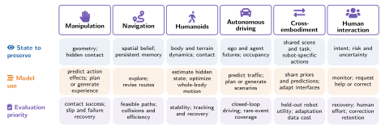

# 6 · Embodiments: What the World Demands

[Home](../../README.md) · [← 5 · Who Changes the Robot: Learners and Policies](05-learners-and-policies.md) · [7 · Evaluation: From Prediction Metrics to Closed-Loop Utility →](07-evaluation.md)

Each embodiment sets requirements on the four dials and favors some pathways over others. The section covers manipulation, navigation, humanoids, autonomous driving, cross-embodiment learning and human-robot interaction, and separates prediction used during execution from priors and generated experience used during learning.

This section cites 66 works. A work cited in several subsections appears under each; ⌂ marks the subsection where the README lists it.

## 6.1 Manipulation

*Representative works (Figure 2):* [WorldPlanner](../catalog.md#paper-worldplanner2025), [PointWorld](../catalog.md#paper-pointworld2026), [RoboHorizon](../catalog.md#paper-robohorizon2025), [VLAW](../catalog.md#paper-vlaw2026)

- **PointWorld**: [Scaling 3d world models for in-the-wild robotic manipulation](<https://arxiv.org/abs/2601.03782>) · arXiv 2026 · [ⓘ](../catalog.md#paper-pointworld2026) ⌂
- **VT-WM**: [Visuo-Tactile World Models](<https://arxiv.org/abs/2602.06001>) · 2026 · [ⓘ](../catalog.md#paper-visuotactilewm2026)
- **WorldPlanner**: [Monte carlo tree search and mpc with action-conditioned visual world models](<https://arxiv.org/abs/2511.03077>) · arXiv 2025 · [ⓘ](../catalog.md#paper-worldplanner2025)
- **RoboHorizon**: [An llm-assisted multi-view world model for long-horizon robotic manipulation](<https://arxiv.org/abs/2501.06605>) · arXiv 2025 · [ⓘ](../catalog.md#paper-robohorizon2025) ⌂
- **IWS**: [Interactive World Simulator for Robot Policy Training and Evaluation](<https://arxiv.org/abs/2603.08546>) · 2026 · [ⓘ](../catalog.md#paper-interactiveworldsim2026)
- **VLAW**: [Iterative Co-Improvement of Vision-Language-Action Policy and World Model](<https://arxiv.org/abs/2602.12063>) · arXiv 2026 · [ⓘ](../catalog.md#paper-vlaw2026)

## 6.2 Navigation &amp; Mobile Robots

*Representative works (Figure 2):* [navigation world models](../catalog.md#paper-bar2025navigation), [Habitat](../catalog.md#paper-habitat), [AI2-THOR](../catalog.md#paper-ai2thor)

- Navigation world models · CVPR 2025 · [ⓘ](../catalog.md#paper-bar2025navigation) ⌂
- [An efficient and multi-modal navigation system with one-step world model](<https://arxiv.org/abs/2601.12277>) · arXiv 2026 · [ⓘ](../catalog.md#paper-shen2026efficient) ⌂
- [Anticipate Before Acting: Future-State-Conditioned Vision-Language Navigation](<https://arxiv.org/abs/2607.18042>) · arXiv 2026 · [ⓘ](../catalog.md#paper-zhang2026anticipate) ⌂
- [Mem2ego: Empowering vision-language models with global-to-ego memory for long-horizon embodied navigation](<https://arxiv.org/abs/2502.14254>) · arXiv 2025 · [ⓘ](../catalog.md#paper-zhang2025mem2ego) ⌂
- [Spatialcot: Advancing spatial reasoning through coordinate alignment and chain-of-thought for embodied task planning](<https://arxiv.org/abs/2501.10074>) · arXiv 2025 · [ⓘ](../catalog.md#paper-liu2025spatialcot) ⌂
- OmniEVA: Embodied versatile planner via task-adaptive 3D-grounded and embodiment-aware reasoning · ICLR 2026 · [ⓘ](../catalog.md#paper-liu2026omnieva) ⌂
- **Habitat**: A platform for embodied AI research · ICCV 2019 · [Code](<https://github.com/facebookresearch/habitat-lab>) · [ⓘ](../catalog.md#paper-habitat) ⌂
- **AI2-THOR**: [An interactive 3d environment for visual ai](<https://arxiv.org/abs/1712.05474>) · arXiv 2017 · [Code](<https://github.com/allenai/ai2thor>) · [ⓘ](../catalog.md#paper-ai2thor) ⌂
- Room-Across-Room: Multilingual vision-and-language navigation with dense spatiotemporal grounding · EMNLP 2020 · [ⓘ](../catalog.md#paper-ku2020room) ⌂

## 6.3 Humanoid Locomotion &amp; Loco-Manipulation

*Representative works (Figure 2):* [WMR](../catalog.md#paper-wmr2025), [VideoMimic](../catalog.md#paper-allshire2025videomimic), [DreamDojo](../catalog.md#paper-gao2026dreamdojo), [ω-0](../catalog.md#paper-li2026omega0)

- [Humanoid Locomotion and Manipulation: Current Progress and Challenges in Control, Planning, and Learning](<https://doi.org/10.1109/TMECH.2025.3579247>) · IEEE/ASME Transactions on Mechatronics 2026 · [ⓘ](../catalog.md#paper-gu2026humanoid) ⌂
- [HumanoidBench: Simulated Humanoid Benchmark for Whole-Body Locomotion and Manipulation](<https://doi.org/10.15607/RSS.2024.XX.061>) · RSS 2024 · [Code](<https://github.com/carlosferrazza/humanoid-bench>) · [ⓘ](../catalog.md#paper-sferrazza2024humanoidbench) ⌂
- [Biped Walking Pattern Generation by Using Preview Control of Zero-Moment Point](<https://doi.org/10.1109/ROBOT.2003.1241826>) · ICRA 2003 · [ⓘ](../catalog.md#paper-kajita2003preview) ⌂
- [Whole-Body Model-Predictive Control Applied to the HRP-2 Humanoid](<https://doi.org/10.1109/IROS.2015.7353843>) · IROS 2015 · [ⓘ](../catalog.md#paper-koenemann2015wholebody) ⌂
- [Real-world humanoid locomotion with reinforcement learning](<https://doi.org/10.1126/scirobotics.adi9579>) · Science Robotics 2024 · [ⓘ](../catalog.md#paper-radosavovic2024realworld) ⌂
- **WMR**: [Learning Humanoid Locomotion with World Model Reconstruction](<https://arxiv.org/abs/2502.16230>) · 2025 · [ⓘ](../catalog.md#paper-wmr2025)
- [DeepMimic: Example-Guided Deep Reinforcement Learning of Physics-Based Character Skills](<https://doi.org/10.1145/3197517.3201311>) · ACM Transactions on Graphics 2018 · [ⓘ](../catalog.md#paper-peng2018deepmimic) ⌂
- **VideoMimic**: Visual Imitation Enables Contextual Humanoid Control · CoRL 2025 · [ⓘ](../catalog.md#paper-allshire2025videomimic) ⌂
- [Hdmi: Learning interactive humanoid whole-body control from human videos](<https://arxiv.org/abs/2509.16757>) · arXiv 2025 · [ⓘ](../catalog.md#paper-weng2025hdmi) ⌂
- **DreamGen**: [Unlocking Generalization in Robot Learning through Video World Models](<https://arxiv.org/abs/2505.12705>) · CoRL 2025 · [Code](<https://github.com/NVIDIA/GR00T-dreams>) · [ⓘ](../catalog.md#paper-jang2025dreamgen)
- [GRAIL: Generating Humanoid Loco-Manipulation from 3D Assets and Video Priors](<https://arxiv.org/abs/2606.05160>) · 2026 · [ⓘ](../catalog.md#paper-xie2026grail) ⌂
- Counterfactual Video Generation Enables Scalable Humanoid Loco-Manipulation · RSS 2026 Workshop Whole-body Control and Bimanual Manipulation: Applications in Humanoids and Beyond · [ⓘ](../catalog.md#paper-wang2026counterfactual) ⌂
- **DreamDojo**: [A Generalist Robot World Model from Large-Scale Human Videos](<https://arxiv.org/abs/2602.06949>) · arXiv 2026 · [ⓘ](../catalog.md#paper-gao2026dreamdojo)
- **ω-0**: [A Latent Predictive World Action Model for Concurrent Humanoid Loco-Manipulation](<https://arxiv.org/abs/2608.06375>) · arXiv 2026 · [ⓘ](../catalog.md#paper-li2026omega0) ⌂

## 6.4 Autonomous Driving World Models

*Representative works (Figure 2):* [GAIA-1](../catalog.md#paper-hu2023gaia1), [Vista](../catalog.md#paper-gao2024vista), [OccWorld](../catalog.md#paper-zheng2024occworld), [DriveDreamer](../catalog.md#paper-wang2024drivedreamer)

- [Model-Based Imitation Learning for Urban Driving](<https://arxiv.org/abs/2210.07729>) · NeurIPS 2022 · [ⓘ](../catalog.md#paper-hu2022mile) ⌂
- **OccWorld**: [Learning a 3D Occupancy World Model for Autonomous Driving](<https://arxiv.org/abs/2311.16038>) · ECCV 2024 · [ⓘ](../catalog.md#paper-zheng2024occworld) ⌂
- **Vista**: [A Generalizable Driving World Model with High Fidelity and Versatile Controllability](<https://arxiv.org/abs/2405.17398>) · NeurIPS 2024 · [ⓘ](../catalog.md#paper-gao2024vista) ⌂
- [Generalized Predictive Model for Autonomous Driving](<https://arxiv.org/abs/2403.09630>) · CVPR 2024 · [ⓘ](../catalog.md#paper-yang2024genad) ⌂
- [GenAD: Generative End-to-End Autonomous Driving](<https://arxiv.org/abs/2402.11502>) · ECCV 2024 · [ⓘ](../catalog.md#paper-zheng2024genadend2end) ⌂
- **GAIA-1**: [A Generative World Model for Autonomous Driving](<https://arxiv.org/abs/2309.17080>) · arXiv 2023 · [ⓘ](../catalog.md#paper-hu2023gaia1) ⌂
- [GAIA-2: A Controllable Multi-View Generative World Model for Autonomous Driving](<https://arxiv.org/abs/2503.20523>) · arXiv 2025 · [ⓘ](../catalog.md#paper-russell2025gaia2) ⌂
- **DriveDreamer**: [Towards Real-world-driven World Models for Autonomous Driving](<https://arxiv.org/abs/2309.09777>) · ECCV 2024 · [ⓘ](../catalog.md#paper-wang2024drivedreamer) ⌂
- [DriveDreamer-2: LLM-Enhanced World Models for Diverse Driving Video Generation](<https://arxiv.org/abs/2403.06845>) · AAAI 2025 · [ⓘ](../catalog.md#paper-zhao2025drivedreamer2) ⌂
- [(Re)^2H2O: Autonomous Driving Scenario Generation via Reversely Regularized Hybrid Offline-and-Online Reinforcement Learning](<https://arxiv.org/abs/2302.13726>) · IV 2023 · [ⓘ](../catalog.md#paper-niu2023re2h2o) ⌂
- [Stackelberg Driver Model for Continual Policy Improvement in Scenario-Based Closed-Loop Autonomous Driving](<https://arxiv.org/abs/2309.14235>) · arXiv 2023 · [ⓘ](../catalog.md#paper-niu2023stackelberg) ⌂
- [World Models for Autonomous Driving: An Initial Survey](<https://arxiv.org/abs/2403.02622>) · IEEE Transactions on Intelligent Vehicles 2024 · [ⓘ](../catalog.md#paper-guan2024worldmodels) ⌂
- [A Survey of World Models for Autonomous Driving](<https://arxiv.org/abs/2501.11260>) · arXiv 2025 · [ⓘ](../catalog.md#paper-feng2025survey) ⌂

## 6.5 Generalist &amp; Cross-Embodiment

*Representative works (Figure 2):* [Open X-Embodiment](../catalog.md#paper-openxembodiment2023), [RT-2](../catalog.md#paper-rt2), [GR00T](../catalog.md#paper-nvidia2025groot)

- **Open X-Embodiment**: [Robotic Learning Datasets and RT-X Models](<https://arxiv.org/abs/2310.08864>) · ICRA 2024 · [Code](<https://github.com/google-deepmind/open_x_embodiment>) · [ⓘ](../catalog.md#paper-openxembodiment2023) ⌂
- **BridgeData V2**: A dataset for robot learning at scale · CoRL 2023 · [Code](<https://github.com/rail-berkeley/bridge_data_v2>) · [ⓘ](../catalog.md#paper-bridgedatav2) ⌂
- **RT-2**: [Vision-language-action models transfer web knowledge to robotic control](<https://arxiv.org/abs/2307.15818>) · arXiv 2023 · [ⓘ](../catalog.md#paper-rt2) ⌂
- **OpenVLA**: [An open-source vision-language-action model](<https://arxiv.org/abs/2406.09246>) · arXiv 2024 · [Code](<https://github.com/openvla/openvla>) · [ⓘ](../catalog.md#paper-openvla2024)
- **π0**: [A Vision-Language-Action Flow Model for General Robot Control](<https://arxiv.org/abs/2410.24164>) · arXiv 2024 · [ⓘ](../catalog.md#paper-pi0)
- **GR00T**: [Gr00t n1: An open foundation model for generalist humanoid robots](<https://arxiv.org/abs/2503.14734>) · arXiv 2025 · [ⓘ](../catalog.md#paper-nvidia2025groot)
- **Cosmos**: [Cosmos world foundation model platform for physical ai](<https://arxiv.org/abs/2501.03575>) · arXiv 2025 · [ⓘ](../catalog.md#paper-nvidia2025cosmos)
- [Do world action models generalize better than vlas? a robustness study](<https://arxiv.org/abs/2603.22078>) · arXiv 2026 · [ⓘ](../catalog.md#paper-zhang2026world) ⌂
- **PointWorld**: [Scaling 3d world models for in-the-wild robotic manipulation](<https://arxiv.org/abs/2601.03782>) · arXiv 2026 · [ⓘ](../catalog.md#paper-pointworld2026)
- **VT-WM**: [Visuo-Tactile World Models](<https://arxiv.org/abs/2602.06001>) · 2026 · [ⓘ](../catalog.md#paper-visuotactilewm2026)
- **WorldPlanner**: [Monte carlo tree search and mpc with action-conditioned visual world models](<https://arxiv.org/abs/2511.03077>) · arXiv 2025 · [ⓘ](../catalog.md#paper-worldplanner2025)
- **IWS**: [Interactive World Simulator for Robot Policy Training and Evaluation](<https://arxiv.org/abs/2603.08546>) · 2026 · [ⓘ](../catalog.md#paper-interactiveworldsim2026)
- **VLAW**: [Iterative Co-Improvement of Vision-Language-Action Policy and World Model](<https://arxiv.org/abs/2602.12063>) · arXiv 2026 · [ⓘ](../catalog.md#paper-vlaw2026)
- [Video Prediction Policy: A Generalist Robot Policy with Predictive Visual Representations](<https://arxiv.org/abs/2412.14803>) · arXiv 2024 · [ⓘ](../catalog.md#paper-hu2024vpp) ⌂
- **DreamDojo**: [A Generalist Robot World Model from Large-Scale Human Videos](<https://arxiv.org/abs/2602.06949>) · arXiv 2026 · [ⓘ](../catalog.md#paper-gao2026dreamdojo)
- [Generalized Predictive Model for Autonomous Driving](<https://arxiv.org/abs/2403.09630>) · CVPR 2024 · [ⓘ](../catalog.md#paper-yang2024genad)
- **EgoBridge**: [Domain Adaptation for Generalizable Imitation from Egocentric Human Data](<https://arxiv.org/abs/2509.19626>) · arXiv 2025 · [ⓘ](../catalog.md#paper-egobridge2025) ⌂

## 6.6 Human-Robot Interaction &amp; Correctable Autonomy

*Representative works (Figure 2):* [ThriftyDAgger](../catalog.md#paper-hoque2022thrifty), [Sirius-Fleet](../catalog.md#paper-liu2025siriusfleet), [Hi-WM](../catalog.md#paper-li2026hiwm), [KnowNo](../catalog.md#paper-ren2023knowno)

- [Corrective Shared Autonomy for Addressing Task Variability](<https://arxiv.org/abs/2102.07165>) · RA-L 2021 · [ⓘ](../catalog.md#paper-hagenow2021corrective) ⌂
- [A Reduction of Imitation Learning and Structured Prediction to No-Regret Online Learning](<https://proceedings.mlr.press/v15/ross11a.html>) · Proceedings of the Fourteenth International Conference on Artificial Intelligence and Statistics 2011 · [ⓘ](../catalog.md#paper-ross2011dagger) ⌂
- [Learning from Interventions: Human-robot interaction as both explicit and implicit feedback](<https://doi.org/10.15607/RSS.2020.XVI.055>) · RSS 2020 · [ⓘ](../catalog.md#paper-spencer2020interventions) ⌂
- [Active Preference-Based Learning of Reward Functions](<https://doi.org/10.15607/RSS.2017.XIII.053>) · RSS 2017 · [ⓘ](../catalog.md#paper-sadigh2017active) ⌂
- [Learning Robot Objectives from Physical Human Interaction](<https://proceedings.mlr.press/v78/bajcsy17a.html>) · CoRL 2017 · [ⓘ](../catalog.md#paper-bajcsy2017objectives) ⌂
- [Correcting Robot Plans with Natural Language Feedback](<https://doi.org/10.15607/RSS.2022.XVIII.065>) · RSS 2022 · [ⓘ](../catalog.md#paper-sharma2022language) ⌂
- **Model-Based Runtime Monitoring**: [Model-Based Runtime Monitoring with Interactive Imitation Learning](<https://arxiv.org/abs/2310.17552>) · ICRA 2024 · [ⓘ](../catalog.md#paper-liu2024runtime)
- **Sirius-Fleet**: [Multi-Task Interactive Robot Fleet Learning with Visual World Models](<https://proceedings.mlr.press/v270/liu25g.html>) · CoRL 2025 · [ⓘ](../catalog.md#paper-liu2025siriusfleet) ⌂
- **Hi-WM**: [Human-in-the-World-Model for Scalable Robot Post-Training](<https://arxiv.org/abs/2604.21741>) · 2026 · [ⓘ](../catalog.md#paper-li2026hiwm) ⌂
- [Shared Autonomy via Hindsight Optimization](<https://doi.org/10.15607/RSS.2015.XI.032>) · RSS 2015 · [ⓘ](../catalog.md#paper-javdani2015shared) ⌂
- **ThriftyDAgger**: [Budget-Aware Novelty and Risk Gating for Interactive Imitation Learning](<https://proceedings.mlr.press/v164/hoque22a.html>) · CoRL 2022 · [ⓘ](../catalog.md#paper-hoque2022thrifty) ⌂
- **KnowNo**: [Robots That Ask For Help: Uncertainty Alignment for Large Language Model Planners](<https://proceedings.mlr.press/v229/ren23a.html>) · CoRL 2023 · [ⓘ](../catalog.md#paper-ren2023knowno) ⌂
- [Risk-Calibrated Human-Robot Interaction via Set-Valued Intent Prediction](<https://doi.org/10.15607/RSS.2024.XX.027>) · RSS 2024 · [ⓘ](../catalog.md#paper-lidard2024rcip) ⌂
- [Effects of Robot Competency and Motion Legibility on Human Correction Feedback](<https://arxiv.org/abs/2501.03515>) · 2025 · [ⓘ](../catalog.md#paper-wang2025correctionfeedback) ⌂

