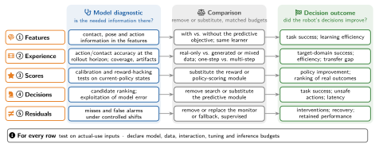

# 7 · Evaluation: From Prediction Metrics to Closed-Loop Utility

[Home](../../README.md) · [← 6 · Embodiments: What the World Demands](06-embodiments.md) · [8 · The Outer Loop: From Deployment Experience to Model Improvement →](08-outer-loop.md)

The utility of a world model is observable only in the real world. Evaluation therefore separates three axes, model quality, closed-loop utility and deployment reliability, and states the evidence boundary of each claim. The section also reviews datasets, simulators and benchmarks, and protocols for reporting results.

This section cites 43 works. A work cited in several subsections appears under each; ⌂ marks the subsection where the README lists it.

## 7.1 Model Quality and Physical Validity

*Representative works (Figure 2):* [FVD](../catalog.md#paper-unterthiner2018fvd), [Physics-IQ](../catalog.md#paper-motamed2026physicsiq), [WorldArena](../catalog.md#paper-shang2026worldarena), [WorldEcho](../catalog.md#paper-chen2026worldsync)

- **FVD**: [Towards Accurate Generative Models of Video: A New Metric &amp; Challenges](<https://arxiv.org/abs/1812.01717>) · arXiv 2018 · [ⓘ](../catalog.md#paper-unterthiner2018fvd) ⌂
- The Value Equivalence Principle for Model-Based Reinforcement Learning · NeurIPS 2020 · [ⓘ](../catalog.md#paper-grimm2020value)
- [Mastering Atari, Go, chess and shogi by planning with a learned model](<https://doi.org/10.1038/s41586-020-03051-4>) · Nature 2020 · [ⓘ](../catalog.md#paper-schrittwieser2020muzero) ⌂
- **Dreamer**: [Dream to Control: Learning Behaviors by Latent Imagination](<https://arxiv.org/abs/1912.01603>) · ICLR 2020 · [ⓘ](../catalog.md#paper-hafner2019dreamer)
- **MBPO**: [When to Trust Your Model: Model-Based Policy Optimization](<https://arxiv.org/abs/1906.08253>) · NeurIPS 2019 · [ⓘ](../catalog.md#paper-janner2019mbpo)
- **WorldEcho**: [Do Robotic World Models Really Follow Actions? Diagnosing and Aligning Action-Conditioned Generation for Policy Learning](<https://arxiv.org/abs/2608.24885>) · 2026 · [ⓘ](../catalog.md#paper-chen2026worldsync) ⌂
- **Physics-IQ**: [Do Generative Video Models Understand Physical Principles?](<https://arxiv.org/abs/2501.09038>) · WACV 2026 · [ⓘ](../catalog.md#paper-motamed2026physicsiq) ⌂
- [Physics-IQ Verified](<https://arxiv.org/abs/2606.18943>) · 2026 · [ⓘ](../catalog.md#paper-radsch2026physicsiqverified) ⌂
- **WorldArena**: [A Unified Benchmark for Evaluating Perception and Functional Utility of Embodied World Models](<https://arxiv.org/abs/2602.08971>) · arXiv 2026 · [ⓘ](../catalog.md#paper-shang2026worldarena) ⌂
- [PhysisForcing: Physics Reinforced World Simulator for Robotic Manipulation](<https://arxiv.org/abs/2606.28128>) · 2026 · [ⓘ](../catalog.md#paper-zhang2026physisforcing) ⌂
- [CreFlow: Corrective Reflow for Sparse-Reward Embodied Video Diffusion RL](<https://arxiv.org/abs/2605.14274>) · arXiv 2026 · [ⓘ](../catalog.md#paper-ni2026creflow) ⌂
- [EmboAlign: Aligning Video Generation with Compositional Constraints for Zero-Shot Manipulation](<https://arxiv.org/abs/2603.05757>) · arXiv 2026 · [ⓘ](../catalog.md#paper-zhang2026emboalign) ⌂

## 7.2 Attributing Closed-Loop Utility

*Representative works (Figure 2):* matched substitution and pathway removal

- [Deep Reinforcement Learning That Matters](<https://doi.org/10.1609/aaai.v32i1.11694>) · AAAI 2018 · [ⓘ](../catalog.md#paper-henderson2018deep) ⌂
- Deep Reinforcement Learning at the Edge of the Statistical Precipice · NeurIPS 2021 · [ⓘ](../catalog.md#paper-agarwal2021precipice)
- Empirical Design in Reinforcement Learning · Journal of Machine Learning Research 2024 · [ⓘ](../catalog.md#paper-patterson2024empirical) ⌂
- [Robot Learning as an Empirical Science: Best Practices for Policy Evaluation](<https://arxiv.org/abs/2409.09491>) · arXiv 2024 · [ⓘ](../catalog.md#paper-kressgazit2024robot)
- **RWM**: [Robotic World Model: A Neural Network Simulator for Robust Policy Optimization in Robotics](<https://arxiv.org/abs/2501.10100>) · 2025 · [ⓘ](../catalog.md#paper-li2025roboticworldmodel)
- **RoboHorizon**: [An llm-assisted multi-view world model for long-horizon robotic manipulation](<https://arxiv.org/abs/2501.06605>) · arXiv 2025 · [ⓘ](../catalog.md#paper-robohorizon2025)
- Objective Mismatch in Model-based Reinforcement Learning · Proceedings of the 2nd Conference on Learning for Dynamics and Control 2020 · [ⓘ](../catalog.md#paper-lambert2020objective) ⌂
- Defining and Characterizing Reward Gaming · NeurIPS 2022 · [ⓘ](../catalog.md#paper-skalse2022reward) ⌂
- **IWS**: [Interactive World Simulator for Robot Policy Training and Evaluation](<https://arxiv.org/abs/2603.08546>) · 2026 · [ⓘ](../catalog.md#paper-interactiveworldsim2026)
- **WorldEval**: [World Model as Real-World Robot Policies Evaluator](<https://arxiv.org/abs/2505.19017>) · arXiv 2025 · [ⓘ](../catalog.md#paper-worldeval2025)

## 7.3 Deployment Reliability

*Representative works (Figure 2):* shift, interventions, recovery

- [Artificial Intelligence for Long-Term Robot Autonomy: A Survey](<https://doi.org/10.1109/LRA.2018.2860628>) · RA-L 2018 · [ⓘ](../catalog.md#paper-kunze2018ai) ⌂
- **WMR**: [Learning Humanoid Locomotion with World Model Reconstruction](<https://arxiv.org/abs/2502.16230>) · 2025 · [ⓘ](../catalog.md#paper-wmr2025)
- Task-Driven Out-of-Distribution Detection with Statistical Guarantees for Robot Learning · CoRL 2022 · [ⓘ](../catalog.md#paper-farid2022taskdriven) ⌂
- Task-Relevant Failure Detection for Trajectory Predictors in Autonomous Vehicles · CoRL 2023 · [ⓘ](../catalog.md#paper-farid2023taskrelevant) ⌂
- Unpacking failure modes of generative policies: Runtime monitoring of consistency and progress · CoRL 2025 · [ⓘ](../catalog.md#paper-agia2025unpacking) ⌂
- Closing the loop on runtime monitors with fallback-safe MPC · CDC 2023 · [ⓘ](../catalog.md#paper-sinha2023closing) ⌂
- Hidden Technical Debt in Machine Learning Systems · NeurIPS 2015 · [ⓘ](../catalog.md#paper-sculley2015hidden) ⌂
- [Waymo Simulated Driving Behavior in Reconstructed Fatal Crashes within an Autonomous Vehicle Operating Domain](<https://doi.org/10.1016/j.aap.2021.106454>) · Accident Analysis &amp; Prevention 2021 · [ⓘ](../catalog.md#paper-scanlon2021waymo) ⌂
- [Responsiblerobotbench: Benchmarking responsible robot manipulation using multi-modal large language models](<https://arxiv.org/abs/2512.04308>) · arXiv 2025 · [ⓘ](../catalog.md#paper-zhang2025responsiblerobotbench) ⌂

## 7.4 Resources

*Representative works (Figure 2):* [Open X-Embodiment](../catalog.md#paper-openxembodiment2023), [DROID](../catalog.md#paper-khazatsky2024droid), [ManiSkill3](../catalog.md#paper-maniskill3), [MimicGen](../catalog.md#paper-mimicgen)

### 7.4.1 Available Resources and Reuse

- **RoboNet**: [Large-Scale Multi-Robot Learning](<https://arxiv.org/abs/1910.11215>) · 2019 · [ⓘ](../catalog.md#paper-robonet) ⌂
- **Open X-Embodiment**: [Robotic Learning Datasets and RT-X Models](<https://arxiv.org/abs/2310.08864>) · ICRA 2024 · [Code](<https://github.com/google-deepmind/open_x_embodiment>) · [ⓘ](../catalog.md#paper-openxembodiment2023)
- **DROID**: A Large-Scale In-The-Wild Robot Manipulation Dataset · RSS 2024 · [ⓘ](../catalog.md#paper-khazatsky2024droid) ⌂
- **OpenVLA**: [An open-source vision-language-action model](<https://arxiv.org/abs/2406.09246>) · arXiv 2024 · [Code](<https://github.com/openvla/openvla>) · [ⓘ](../catalog.md#paper-openvla2024)
- **ManiSkill3**: [GPU Parallelized Robotics Simulation and Rendering for Generalizable Embodied AI](<https://arxiv.org/abs/2410.00425>) · 2024 · [Code](<https://github.com/haosulab/ManiSkill>) · [ⓘ](../catalog.md#paper-maniskill3) ⌂
- **RWM**: [Robotic World Model: A Neural Network Simulator for Robust Policy Optimization in Robotics](<https://arxiv.org/abs/2501.10100>) · 2025 · [ⓘ](../catalog.md#paper-li2025roboticworldmodel)
- **MimicGen**: [A Data Generation System for Scalable Robot Learning using Human Demonstrations](<https://arxiv.org/abs/2310.17596>) · 2023 · [Code](<https://github.com/NVlabs/mimicgen>) · [ⓘ](../catalog.md#paper-mimicgen) ⌂
- **DexMimicGen**: [Automated Data Generation for Bimanual Dexterous Manipulation via Imitation Learning](<https://arxiv.org/abs/2410.24185>) · 2024 · [Code](<https://github.com/NVlabs/dexmimicgen>) · [ⓘ](../catalog.md#paper-dexmimicgen) ⌂
- **World-in-World**: [World models in a closed-loop world](<https://arxiv.org/abs/2510.18135>) · ICLR 2026 · [ⓘ](../catalog.md#paper-worldinworld2025)

## 7.5 Reporting Protocols and Evidence Boundaries

*Representative works (Figure 2):* protocols and evidence boundaries

- Deep Reinforcement Learning at the Edge of the Statistical Precipice · NeurIPS 2021 · [ⓘ](../catalog.md#paper-agarwal2021precipice) ⌂
- [Robot Learning as an Empirical Science: Best Practices for Policy Evaluation](<https://arxiv.org/abs/2409.09491>) · arXiv 2024 · [ⓘ](../catalog.md#paper-kressgazit2024robot) ⌂
- **DayDreamer**: [World Models for Physical Robot Learning](<https://arxiv.org/abs/2206.14176>) · CoRL 2022 · [Code](<https://github.com/danijar/daydreamer>) · [ⓘ](../catalog.md#paper-wu2022daydreamer)
- Autonomous Reinforcement Learning: Formalism and Benchmarking · ICLR 2022 · [ⓘ](../catalog.md#paper-sharma2022autonomous) ⌂
- [Improving Reproducibility in Machine Learning Research (A Report from the NeurIPS 2019 Reproducibility Program)](<https://jmlr.org/papers/v22/20-303.html>) · Journal of Machine Learning Research 2021 · [ⓘ](../catalog.md#paper-pineau2021improving) ⌂
- [How Should World Models Be Evaluated for Embodied Decision-Making? A Decision-Making-Centric Position](<https://arxiv.org/abs/2606.15032>) · arXiv 2026 · [ⓘ](../catalog.md#paper-yu2026howshould) ⌂

