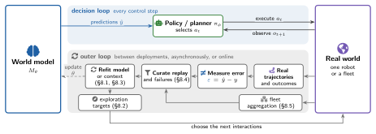

# 8 · The Outer Loop: From Deployment Experience to Model Improvement

[Home](../../README.md) · [← 7 · Evaluation: From Prediction Metrics to Closed-Loop Utility](07-evaluation.md) · [9 · Open Problems →](09-open-problems.md)

As the policy improves, the queries it poses drift toward regions the model has seen least. The outer loop returns deployment experience to the model. The section covers what to revise, exploration, continual updating, failure mining and fleet-scale data flywheels.

This section cites 124 works. A work cited in several subsections appears under each; ⌂ marks the subsection where the README lists it.

## 8.1 Formulation and Architecture of the Outer Loop

*Representative works (Figure 2):* [Dyna](../catalog.md#paper-sutton1991dyna), [MBPO](../catalog.md#paper-janner2019mbpo), [DayDreamer](../catalog.md#paper-wu2022daydreamer), [VLAW](../catalog.md#paper-vlaw2026), [WAM-RL](../catalog.md#paper-wamrl2026)

- **Dyna**: Dyna, an Integrated Architecture for Learning, Planning, and Reacting · ACM SIGART Bulletin 1991 · [ⓘ](../catalog.md#paper-sutton1991dyna) ⌂
- **MBPO**: [When to Trust Your Model: Model-Based Policy Optimization](<https://arxiv.org/abs/1906.08253>) · NeurIPS 2019 · [ⓘ](../catalog.md#paper-janner2019mbpo) ⌂
- [Deep Dynamics Models for Learning Dexterous Manipulation](<https://arxiv.org/abs/1909.11652>) · CoRL 2019 · [ⓘ](../catalog.md#paper-nagabandi2019pddm) ⌂
- **Dreamer**: [Dream to Control: Learning Behaviors by Latent Imagination](<https://arxiv.org/abs/1912.01603>) · ICLR 2020 · [ⓘ](../catalog.md#paper-hafner2019dreamer)
- **DreamerV3**: [Mastering Diverse Domains through World Models](<https://arxiv.org/abs/2301.04104>) · 2023 · [Code](<https://github.com/danijar/dreamerv3>) · [ⓘ](../catalog.md#paper-hafner2023dreamerv3) ⌂
- **DayDreamer**: [World Models for Physical Robot Learning](<https://arxiv.org/abs/2206.14176>) · CoRL 2022 · [Code](<https://github.com/danijar/daydreamer>) · [ⓘ](../catalog.md#paper-wu2022daydreamer)
- [Augmenting Physical Simulators with Stochastic Neural Networks: Case Study of Planar Pushing and Bouncing](<https://arxiv.org/abs/1808.03246>) · IROS 2018 · [ⓘ](../catalog.md#paper-ajay2018residual) ⌂
- [ASAP: Aligning Simulation and Real-World Physics for Learning Agile Humanoid Whole-Body Skills](<https://arxiv.org/abs/2502.01143>) · RSS 2025 · [ⓘ](../catalog.md#paper-he2025asap) ⌂
- [Closing the Sim-to-Real Loop: Adapting Simulation Randomization with Real World Experience](<https://arxiv.org/abs/1810.05687>) · ICRA 2019 · [ⓘ](../catalog.md#paper-chebotar2019simopt) ⌂
- [TossingBot: Learning to Throw Arbitrary Objects with Residual Physics](<https://arxiv.org/abs/1903.11239>) · IEEE Transactions on Robotics 2020 · [ⓘ](../catalog.md#paper-zeng2019tossingbot) ⌂
- **VLAW**: [Iterative Co-Improvement of Vision-Language-Action Policy and World Model](<https://arxiv.org/abs/2602.12063>) · arXiv 2026 · [ⓘ](../catalog.md#paper-vlaw2026) ⌂
- **WorldSample**: [Closed-loop Real-robot RL with World Modelling](<https://arxiv.org/abs/2607.02431>) · arXiv 2026 · [ⓘ](../catalog.md#paper-xue2026worldsample)
- **DGAC**: [Robot Self-Improvement via Human-Video Dynamics Models](<https://arxiv.org/abs/2606.21406>) · 2026 · [ⓘ](../catalog.md#paper-dgac2026)
- [RoboCat: A Self-Improving Generalist Agent for Robotic Manipulation](<https://arxiv.org/abs/2306.11706>) · arXiv 2023 · [ⓘ](../catalog.md#paper-bousmalis2023robocat) ⌂
- [EvoVLA: Self-Evolving Vision-Language-Action Model](<https://arxiv.org/abs/2511.16166>) · arXiv 2025 · [ⓘ](../catalog.md#paper-liu2025evovla) ⌂
- [π\*0.6: a VLA That Learns From Experience](<https://arxiv.org/abs/2511.14759>) · arXiv 2025 · [ⓘ](../catalog.md#paper-pi2025pistar06)
- [Robot Learning on the Job: Human-in-the-Loop Autonomy and Learning During Deployment](<https://doi.org/10.15607/RSS.2023.XIX.005>) · RSS 2025 · [ⓘ](../catalog.md#paper-liu2023sirius)
- **Sirius-Fleet**: [Multi-Task Interactive Robot Fleet Learning with Visual World Models](<https://proceedings.mlr.press/v270/liu25g.html>) · CoRL 2025 · [ⓘ](../catalog.md#paper-liu2025siriusfleet)
- [Self-Evolving World Models for LLM Agent Planning](<https://arxiv.org/abs/2606.30639>) · arXiv 2026 · [ⓘ](../catalog.md#paper-zhang2026worldevolver)
- Value-Aware Loss Function for Model-based Reinforcement Learning · AISTATS 2017 · [ⓘ](../catalog.md#paper-farahmand2017vaml)
- The Value Equivalence Principle for Model-Based Reinforcement Learning · NeurIPS 2020 · [ⓘ](../catalog.md#paper-grimm2020value)
- Objective Mismatch in Model-based Reinforcement Learning · Proceedings of the 2nd Conference on Learning for Dynamics and Control 2020 · [ⓘ](../catalog.md#paper-lambert2020objective)
- **World-model risk survey**: [Safety, Security, and Cognitive Risks in World Models](<https://arxiv.org/abs/2604.01346>) · 2026 · [ⓘ](../catalog.md#paper-worldmodelrisks2026) ⌂
- **WAM-RL**: [World-Action Model Reinforcement Learning with Reconstruction Rewards and Online Video SFT](<https://arxiv.org/abs/2606.17906>) · arXiv 2026 · [ⓘ](../catalog.md#paper-wamrl2026) ⌂

## 8.2 Autonomous Exploration and Active Interaction

*Representative works (Figure 2):* [Plan2Explore](../catalog.md#paper-sekar2020plan2explore), [LEXA](../catalog.md#paper-mendonca2021lexa), autonomous practice

- [Curiosity-driven Exploration by Self-supervised Prediction](<https://arxiv.org/abs/1705.05363>) · ICML 2017 · [ⓘ](../catalog.md#paper-pathak2017icm) ⌂
- [Exploration by Random Network Distillation](<https://arxiv.org/abs/1810.12894>) · ICLR 2019 · [ⓘ](../catalog.md#paper-burda2018rnd) ⌂
- [Self-Supervised Exploration via Disagreement](<https://arxiv.org/abs/1906.04161>) · ICML 2019 · [ⓘ](../catalog.md#paper-pathak2019disagreement) ⌂
- **Plan2Explore**: [Planning to Explore via Self-Supervised World Models](<https://arxiv.org/abs/2005.05960>) · ICML 2020 · [ⓘ](../catalog.md#paper-sekar2020plan2explore) ⌂
- **LEXA**: [Discovering and Achieving Goals via World Models](<https://arxiv.org/abs/2110.09514>) · NeurIPS 2021 · [ⓘ](../catalog.md#paper-mendonca2021lexa) ⌂
- [Curious Exploration via Structured World Models Yields Zero-Shot Object Manipulation](<https://arxiv.org/abs/2206.11403>) · NeurIPS 2022 · [ⓘ](../catalog.md#paper-sancaktar2022ceeus) ⌂
- [Active Learning of Dynamics for Data-Driven Control Using Koopman Operators](<https://doi.org/10.1109/TRO.2019.2923880>) · IEEE Transactions on Robotics 2019 · [ⓘ](../catalog.md#paper-abraham2019active) ⌂
- [Reward-Free Exploration for Reinforcement Learning](<https://proceedings.mlr.press/v119/jin20d.html>) · ICML 2020 · [ⓘ](../catalog.md#paper-jin2020rewardfree) ⌂
- [Deciding What to Model: Value-Equivalent Sampling for Reinforcement Learning](<https://arxiv.org/abs/2206.02072>) · NeurIPS 2022 · [ⓘ](../catalog.md#paper-arumugam2022deciding)
- [Between Rate-Distortion Theory &amp; Value Equivalence in Model-Based Reinforcement Learning](<https://arxiv.org/abs/2206.02025>) · RLDM 2022 · [ⓘ](../catalog.md#paper-arumugam2022ratedistortion) ⌂
- [Leave no Trace: Learning to Reset for Safe and Autonomous Reinforcement Learning](<https://arxiv.org/abs/1711.06782>) · ICLR 2018 · [ⓘ](../catalog.md#paper-eysenbach2018leavenotrace) ⌂
- [Reset-Free Reinforcement Learning via Multi-Task Learning: Learning Dexterous Manipulation Behaviors without Human Intervention](<https://arxiv.org/abs/2104.11203>) · ICRA 2021 · [ⓘ](../catalog.md#paper-gupta2021resetfree) ⌂
- Autonomous Reinforcement Learning: Formalism and Benchmarking · ICLR 2022 · [ⓘ](../catalog.md#paper-sharma2022autonomous)
- **DayDreamer**: [World Models for Physical Robot Learning](<https://arxiv.org/abs/2206.14176>) · CoRL 2022 · [Code](<https://github.com/danijar/daydreamer>) · [ⓘ](../catalog.md#paper-wu2022daydreamer)
- [ALAN: Autonomously Exploring Robotic Agents in the Real World](<https://arxiv.org/abs/2302.06604>) · ICRA 2023 · [ⓘ](../catalog.md#paper-mendonca2023alan) ⌂
- [Structured World Models from Human Videos](<https://arxiv.org/abs/2308.10901>) · RSS 2023 · [ⓘ](../catalog.md#paper-mendonca2023swim) ⌂
- [PlayWorld: Learning Robot World Models from Autonomous Play](<https://arxiv.org/abs/2603.09030>) · 2026 · [ⓘ](../catalog.md#paper-yin2026playworld) ⌂

## 8.3 Continual Learning and Online Model Updating

*Representative works (Figure 2):* [REGEN](../catalog.md#paper-govind2026regen), [MuSe](../catalog.md#paper-clark2026muse), [H2O](../catalog.md#paper-h2o2022), [xTED](../catalog.md#paper-xted2026)

- [Test-Time Scaling for World Action Models via Zero-Shot Geometric Evaluation](<https://arxiv.org/abs/2607.17454>) · arXiv 2026 · [ⓘ](../catalog.md#paper-zhao2026ttswam) ⌂
- [Stream-T1: Test-Time Scaling for Streaming Video Generation](<https://arxiv.org/abs/2605.04461>) · arXiv 2026 · [ⓘ](../catalog.md#paper-tu2026streamt1) ⌂
- PILCO: A Model-Based and Data-Efficient Approach to Policy Search · ICML 2011 · [ⓘ](../catalog.md#paper-deisenroth2011pilco) ⌂
- **DayDreamer**: [World Models for Physical Robot Learning](<https://arxiv.org/abs/2206.14176>) · CoRL 2022 · [Code](<https://github.com/danijar/daydreamer>) · [ⓘ](../catalog.md#paper-wu2022daydreamer)
- [Learning to Adapt in Dynamic, Real-World Environments Through Meta-Reinforcement Learning](<https://arxiv.org/abs/1803.11347>) · ICLR 2019 · [ⓘ](../catalog.md#paper-nagabandi2019adapt) ⌂
- [Deep Online Learning via Meta-Learning: Continual Adaptation for Model-Based RL](<https://arxiv.org/abs/1812.07671>) · ICLR 2019 · [ⓘ](../catalog.md#paper-nagabandi2019mole) ⌂
- **VLAW**: [Iterative Co-Improvement of Vision-Language-Action Policy and World Model](<https://arxiv.org/abs/2602.12063>) · arXiv 2026 · [ⓘ](../catalog.md#paper-vlaw2026)
- [Structured World Models from Human Videos](<https://arxiv.org/abs/2308.10901>) · RSS 2023 · [ⓘ](../catalog.md#paper-mendonca2023swim)
- [Closing the Sim-to-Real Loop: Adapting Simulation Randomization with Real World Experience](<https://arxiv.org/abs/1810.05687>) · ICRA 2019 · [ⓘ](../catalog.md#paper-chebotar2019simopt)
- [AdaptiGraph: Material-Adaptive Graph-Based Neural Dynamics for Robotic Manipulation](<https://arxiv.org/abs/2407.07889>) · arXiv 2024 · [ⓘ](../catalog.md#paper-zhang2024adaptigraph)
- [Context-aware Dynamics Model for Generalization in Model-Based Reinforcement Learning](<https://arxiv.org/abs/2005.06800>) · ICML 2020 · [ⓘ](../catalog.md#paper-lee2020cadm) ⌂
- [Dynamics as Prompts: In-Context Learning for Sim-to-Real System Identifications](<https://arxiv.org/abs/2410.20357>) · arXiv 2024 · [ⓘ](../catalog.md#paper-zhang2024dynprompt) ⌂
- [s1: Simple test-time scaling](<https://arxiv.org/abs/2501.19393>) · arXiv 2025 · [ⓘ](../catalog.md#paper-muennighoff2025s1) ⌂
- [A Generalist Agent](<https://arxiv.org/abs/2205.06175>) · arXiv 2022 · [ⓘ](../catalog.md#paper-reed2022gato) ⌂
- In-context Reinforcement Learning with Algorithm Distillation · ICLR 2023 · [ⓘ](../catalog.md#paper-laskin2023distillation) ⌂
- Human-Timescale Adaptation in an Open-Ended Task Space · ICML 2023 · [ⓘ](../catalog.md#paper-bauer2023ada) ⌂
- [In-Context Imitation Learning via Next-Token Prediction](<https://arxiv.org/abs/2408.15980>) · arXiv 2024 · [ⓘ](../catalog.md#paper-fu2024icrt) ⌂
- [Instant Policy: In-Context Imitation Learning via Graph Diffusion](<https://arxiv.org/abs/2411.12633>) · arXiv 2024 · [ⓘ](../catalog.md#paper-vosylius2024instantpolicy) ⌂
- **Zero-WAM**: [In-Context World-Action Modeling from Human Videos for Open-Ended Task Generalization](<https://arxiv.org/abs/2608.26103>) · arXiv 2026 · [ⓘ](../catalog.md#paper-zhou2026zerowam)
- **WAM-TTT**: [Steering World-Action Models by Watching Human Play at Test Time](<https://arxiv.org/abs/2607.06988>) · arXiv 2026 · [ⓘ](../catalog.md#paper-feng2026wamttt) ⌂
- [Learning to (Learn at Test Time): RNNs with Expressive Hidden States](<https://arxiv.org/abs/2407.04620>) · arXiv 2024 · [ⓘ](../catalog.md#paper-sun2024ttt) ⌂
- [RoboTTT: Context Scaling for Robot Policies](<https://arxiv.org/abs/2607.15275>) · arXiv 2026 · [ⓘ](../catalog.md#paper-jiang2026robottt) ⌂
- [In-Context World Modeling for Robotic Control](<https://arxiv.org/abs/2606.26025>) · arXiv 2026 · [ⓘ](../catalog.md#paper-icwm2026)
- **LocoFormer**: Generalist Locomotion via Long-context Adaptation · CoRL 2025 · [ⓘ](../catalog.md#paper-locoformer2025)
- Rapidly Adapting Policies to the Real-World via Simulation-Guided Fine-Tuning · ICLR 2025 · [ⓘ](../catalog.md#paper-sgft2025) ⌂
- **xTED**: [Cross-Domain Adaptation via Diffusion-Based Trajectory Editing](<https://doi.org/10.65109/BENP4894>) · AAMAS 2026 · [ⓘ](../catalog.md#paper-xted2026) ⌂
- Robot Trains Robot: Automatic Real-World Policy Adaptation and Learning for Humanoids · CoRL 2025 · [ⓘ](../catalog.md#paper-rtr2025) ⌂
- [On-the-Fly VLA Adaptation via Test-Time Reinforcement Learning](<https://doi.org/10.18653/v1/2026.acl-long.1863>) · Proceedings of the 64th Annual Meeting of the Association for Computational Linguistics (Volume 1: Long Papers) 2026 · [ⓘ](../catalog.md#paper-ontheflyvla2026) ⌂
- [Zeva: In-Context Causal Learning for Generalizable Embodied Manipulation](<https://arxiv.org/abs/2608.30880>) · arXiv 2026 · [ⓘ](../catalog.md#paper-chen2026zeva) ⌂
- [Self-Evolving World Models for LLM Agent Planning](<https://arxiv.org/abs/2606.30639>) · arXiv 2026 · [ⓘ](../catalog.md#paper-zhang2026worldevolver) ⌂
- [Zetta: An Efficient Closed-Loop Embodied Harness for Self-Evolving Physical Intelligence](<https://arxiv.org/abs/2608.16590>) · arXiv 2026 · [ⓘ](../catalog.md#paper-ding2026zetta) ⌂
- **Hi-WM**: [Human-in-the-World-Model for Scalable Robot Post-Training](<https://arxiv.org/abs/2604.21741>) · 2026 · [ⓘ](../catalog.md#paper-li2026hiwm)
- [Continual Predictive Learning from Videos](<https://arxiv.org/abs/2204.05624>) · CVPR 2022 · [ⓘ](../catalog.md#paper-chen2022cpl) ⌂
- **Planning with Online World Models**: [Continual Reinforcement Learning by Planning with Online World Models](<https://arxiv.org/abs/2507.09177>) · ICML 2025 · [ⓘ](../catalog.md#paper-liu2025onlinewm) ⌂
- **REGEN**: [World Action Models Enable Continual Imitation Learning with Recurrent Generative Replays](<https://arxiv.org/abs/2606.27374>) · arXiv 2026 · [ⓘ](../catalog.md#paper-govind2026regen) ⌂
- **MuSe**: [Multisensory Continual Learning: Adapting Pretrained Visuomotor Policies to Force](<https://arxiv.org/abs/2606.30988>) · arXiv 2026 · [ⓘ](../catalog.md#paper-clark2026muse) ⌂
- [Sim-to-Real Transfer in Deep Reinforcement Learning for Robotics: a Survey](<https://arxiv.org/abs/2009.13303>) · 2020 · [ⓘ](../catalog.md#paper-zhao2020simtoreal) ⌂
- **TWIST**: [Teacher-Student World Model Distillation for Efficient Sim-to-Real Transfer](<https://arxiv.org/abs/2311.03622>) · 2023 · [ⓘ](../catalog.md#paper-twist2023) ⌂
- **WMR**: [Learning Humanoid Locomotion with World Model Reconstruction](<https://arxiv.org/abs/2502.16230>) · 2025 · [ⓘ](../catalog.md#paper-wmr2025)
- **H2O**: When to Trust Your Simulator: Dynamics-Aware Hybrid Offline-and-Online Reinforcement Learning · NeurIPS 2022 · [ⓘ](../catalog.md#paper-h2o2022) ⌂
- [H2O+: An Improved Framework for Hybrid Offline-and-Online RL with Dynamics Gaps](<https://doi.org/10.1109/ICRA55743.2025.11127503>) · ICRA 2025 · [ⓘ](../catalog.md#paper-h2oplus2025) ⌂
- [RoboCat: A Self-Improving Generalist Agent for Robotic Manipulation](<https://arxiv.org/abs/2306.11706>) · arXiv 2023 · [ⓘ](../catalog.md#paper-bousmalis2023robocat)
- [EvoVLA: Self-Evolving Vision-Language-Action Model](<https://arxiv.org/abs/2511.16166>) · arXiv 2025 · [ⓘ](../catalog.md#paper-liu2025evovla)
- [Moshi: a speech-text foundation model for real-time dialogue](<https://arxiv.org/abs/2410.00037>) · arXiv 2024 · [ⓘ](../catalog.md#paper-defossez2024moshi) ⌂
- [DuplexSLA: A Full-Duplex Spoken Language Model with Synchronized Speech, Language, and Action](<https://arxiv.org/abs/2605.20755>) · arXiv 2026 · [ⓘ](../catalog.md#paper-zhang2026duplexsla) ⌂
- [DyaPlex: Full-Duplex Speech-Motion Model for Dyadic Interaction](<https://arxiv.org/abs/2606.03874>) · arXiv 2026 · [ⓘ](../catalog.md#paper-nagano2026dyaplex) ⌂

## 8.4 Failure Mining and Experience Curation

*Representative works (Figure 2):* [Curious Replay](../catalog.md#paper-kauvar2023curious), [DGAC](../catalog.md#paper-dgac2026), [WorldSample](../catalog.md#paper-xue2026worldsample), [REFLECT](../catalog.md#paper-liu2023reflect)

- [Prioritized Experience Replay](<https://arxiv.org/abs/1511.05952>) · ICLR 2016 · [ⓘ](../catalog.md#paper-schaul2015per) ⌂
- **Curious Replay**: [Curious Replay for Model-based Adaptation](<https://arxiv.org/abs/2306.15934>) · ICML 2023 · [ⓘ](../catalog.md#paper-kauvar2023curious) ⌂
- **DGAC**: [Robot Self-Improvement via Human-Video Dynamics Models](<https://arxiv.org/abs/2606.21406>) · 2026 · [ⓘ](../catalog.md#paper-dgac2026) ⌂
- **WorldSample**: [Closed-loop Real-robot RL with World Modelling](<https://arxiv.org/abs/2607.02431>) · arXiv 2026 · [ⓘ](../catalog.md#paper-xue2026worldsample) ⌂
- **GE-Sim 2.0**: [A Roadmap Towards Comprehensive Closed-loop Video World Simulators for Robotic Manipulation](<https://arxiv.org/abs/2605.27491>) · arXiv 2026 · [ⓘ](../catalog.md#paper-qiu2026gesim2)
- [RoboCurate: Harnessing Diversity with Action-Verified Neural Trajectory for Robot Learning](<https://arxiv.org/abs/2602.18742>) · 2026 · [ⓘ](../catalog.md#paper-robocurate2026) ⌂
- [Robot Data Curation with Mutual Information Estimators](<https://arxiv.org/abs/2502.08623>) · RSS 2025 · [ⓘ](../catalog.md#paper-hejna2025deminf) ⌂
- [A Reduction of Imitation Learning and Structured Prediction to No-Regret Online Learning](<https://proceedings.mlr.press/v15/ross11a.html>) · Proceedings of the Fourteenth International Conference on Artificial Intelligence and Statistics 2011 · [ⓘ](../catalog.md#paper-ross2011dagger)
- [Robot Learning on the Job: Human-in-the-Loop Autonomy and Learning During Deployment](<https://doi.org/10.15607/RSS.2023.XIX.005>) · RSS 2025 · [ⓘ](../catalog.md#paper-liu2023sirius) ⌂
- **ThriftyDAgger**: [Budget-Aware Novelty and Risk Gating for Interactive Imitation Learning](<https://proceedings.mlr.press/v164/hoque22a.html>) · CoRL 2022 · [ⓘ](../catalog.md#paper-hoque2022thrifty)
- **REFLECT**: [Summarizing robot experiences for failure explanation and correction](<https://arxiv.org/abs/2306.15724>) · arXiv 2023 · [ⓘ](../catalog.md#paper-liu2023reflect) ⌂
- [Aha: A vision-language-model for detecting and reasoning over failures in robotic manipulation](<https://arxiv.org/abs/2410.00371>) · arXiv 2024 · [ⓘ](../catalog.md#paper-duan2024aha) ⌂
- **VLAC**: [A Vision-Language-Action-Critic Model for Robotic Real-World Reinforcement Learning](<https://arxiv.org/abs/2509.15937>) · 2025 · [ⓘ](../catalog.md#paper-vlac2025)
- [ReWiND: Language-Guided Rewards Teach Robot Policies without New Demonstrations](<https://arxiv.org/abs/2505.10911>) · arXiv 2025 · [ⓘ](../catalog.md#paper-rewind2025) ⌂
- [Eureka: Human-Level Reward Design via Coding Large Language Models](<https://arxiv.org/abs/2310.12931>) · ICLR 2024 · [ⓘ](../catalog.md#paper-ma2023eureka) ⌂
- [AI models collapse when trained on recursively generated data](<https://doi.org/10.1038/s41586-024-07566-y>) · Nature 2024 · [ⓘ](../catalog.md#paper-shumailov2024collapse) ⌂
- [Is Model Collapse Inevitable? Breaking the Curse of Recursion by Accumulating Real and Synthetic Data](<https://arxiv.org/abs/2404.01413>) · arXiv 2024 · [ⓘ](../catalog.md#paper-gerstgrasser2024collapse) ⌂
- **World-in-World**: [World models in a closed-loop world](<https://arxiv.org/abs/2510.18135>) · ICLR 2026 · [ⓘ](../catalog.md#paper-worldinworld2025)

## 8.5 Fleets and Data Flywheels

*Representative works (Figure 2):* [QT-Opt](../catalog.md#paper-kalashnikov2018qtopt), [AutoRT](../catalog.md#paper-ahn2024autort), [Sirius-Fleet](../catalog.md#paper-liu2025siriusfleet), [Ego2Robot](../catalog.md#paper-wang2026ego2robot)

- **RoboNet**: [Large-Scale Multi-Robot Learning](<https://arxiv.org/abs/1910.11215>) · 2019 · [ⓘ](../catalog.md#paper-robonet)
- **V-JEPA 2-AC**: [V-JEPA 2: Self-Supervised Video Models Enable Understanding, Prediction and Planning](<https://arxiv.org/abs/2506.09985>) · arXiv 2025 · [Code](<https://github.com/facebookresearch/vjepa2>) · [ⓘ](../catalog.md#paper-assran2025vjepa2)
- **DROID**: A Large-Scale In-The-Wild Robot Manipulation Dataset · RSS 2024 · [ⓘ](../catalog.md#paper-khazatsky2024droid)
- [Data Scaling Laws in Imitation Learning for Robotic Manipulation](<https://arxiv.org/abs/2410.18647>) · ICLR 2025 · [ⓘ](../catalog.md#paper-lin2024datascaling) ⌂
- **Zero-WAM**: [In-Context World-Action Modeling from Human Videos for Open-Ended Task Generalization](<https://arxiv.org/abs/2608.26103>) · arXiv 2026 · [ⓘ](../catalog.md#paper-zhou2026zerowam)
- **UniSim**: [Learning Interactive Real-World Simulators](<https://arxiv.org/abs/2310.06114>) · ICLR 2024 · [ⓘ](../catalog.md#paper-yang2024unisim)
- Ctrl-World: A controllable generative world model for robot manipulation · ICLR 2026 · [ⓘ](../catalog.md#paper-guo2026ctrl) ⌂
- **Sirius-Fleet**: [Multi-Task Interactive Robot Fleet Learning with Visual World Models](<https://proceedings.mlr.press/v270/liu25g.html>) · CoRL 2025 · [ⓘ](../catalog.md#paper-liu2025siriusfleet)
- **QT-Opt**: [Scalable Deep Reinforcement Learning for Vision-Based Robotic Manipulation](<https://arxiv.org/abs/1806.10293>) · CoRL 2018 · [ⓘ](../catalog.md#paper-kalashnikov2018qtopt) ⌂
- [Robot Fleet Learning via Policy Merging](<https://arxiv.org/abs/2310.01362>) · ICLR 2024 · [ⓘ](../catalog.md#paper-wang2023fleetmerge) ⌂
- [Fleet-DAgger: Interactive Robot Fleet Learning with Scalable Human Supervision](<https://arxiv.org/abs/2206.14349>) · CoRL 2022 · [ⓘ](../catalog.md#paper-hoque2022fleetdagger) ⌂
- **AutoRT**: [Embodied Foundation Models for Large Scale Orchestration of Robotic Agents](<https://arxiv.org/abs/2401.12963>) · arXiv 2024 · [ⓘ](../catalog.md#paper-ahn2024autort) ⌂
- [Agibot world colosseo: A large-scale manipulation platform for scalable and intelligent embodied systems](<https://arxiv.org/abs/2503.06669>) · arXiv 2025 · [ⓘ](../catalog.md#paper-bu2025agibot)
- [RoboCat: A Self-Improving Generalist Agent for Robotic Manipulation](<https://arxiv.org/abs/2306.11706>) · arXiv 2023 · [ⓘ](../catalog.md#paper-bousmalis2023robocat)
- **DreamGen**: [Unlocking Generalization in Robot Learning through Video World Models](<https://arxiv.org/abs/2505.12705>) · CoRL 2025 · [Code](<https://github.com/NVIDIA/GR00T-dreams>) · [ⓘ](../catalog.md#paper-jang2025dreamgen)
- Failure Prediction with Statistical Guarantees for Vision-Based Robot Control · RSS 2022 · [ⓘ](../catalog.md#paper-farid2022failure) ⌂
- Closing the loop on runtime monitors with fallback-safe MPC · CDC 2023 · [ⓘ](../catalog.md#paper-sinha2023closing)
- **World-in-World**: [World models in a closed-loop world](<https://arxiv.org/abs/2510.18135>) · ICLR 2026 · [ⓘ](../catalog.md#paper-worldinworld2025)
- [Scalable vision-language-action model pretraining for robotic manipulation with real-life human activity videos](<https://arxiv.org/abs/2510.21571>) · arXiv 2025 · [ⓘ](../catalog.md#paper-li2025scalable)
- **Ego2Robot**: [Scalable Robot Data Synthesis from Egocentric Human Data](<https://arxiv.org/abs/2608.02580>) · arXiv 2026 · [ⓘ](../catalog.md#paper-wang2026ego2robot) ⌂
- [H2R: A Human-to-Robot Data Augmentation for Robot Pre-training from Videos](<https://arxiv.org/abs/2505.11920>) · arXiv 2025 · [ⓘ](../catalog.md#paper-h2r2025)
- Phantom: Training Robots Without Robots Using Only Human Videos · CoRL 2025 · [ⓘ](../catalog.md#paper-lepert2025phantomtrainingrobots) ⌂
- Masquerade: Learning from In-the-wild Human Videos using Data-Editing · ICRA 2026 · [ⓘ](../catalog.md#paper-lepert2025masquerade) ⌂
- [HandEdit: A Unified Benchmark for Egocentric Human-to-Robot Dexterous Hand Image Editing](<https://arxiv.org/abs/2608.12122>) · arXiv 2026 · [ⓘ](../catalog.md#paper-handedit2026) ⌂
- **AnyWorld**: [Factorized Egocentric World Models for Cross-Embodiment Generalization](<https://arxiv.org/abs/2608.29242>) · 2026 · [ⓘ](../catalog.md#paper-chen2026anyworld) ⌂
- **VLAW**: [Iterative Co-Improvement of Vision-Language-Action Policy and World Model](<https://arxiv.org/abs/2602.12063>) · arXiv 2026 · [ⓘ](../catalog.md#paper-vlaw2026)
- **World-Gymnast**: [Training robots with reinforcement learning in a world model](<https://arxiv.org/abs/2602.02454>) · arXiv 2026 · [ⓘ](../catalog.md#paper-worldgymnast2026) ⌂
- **MimicGen**: [A Data Generation System for Scalable Robot Learning using Human Demonstrations](<https://arxiv.org/abs/2310.17596>) · 2023 · [Code](<https://github.com/NVlabs/mimicgen>) · [ⓘ](../catalog.md#paper-mimicgen)
- GenSim: Generating robotic simulation tasks via large language models · ICLR 2024 · [ⓘ](../catalog.md#paper-wang2024gensim) ⌂
- [Geometry-Instructed Video Editing](<https://arxiv.org/abs/2606.24225>) · arXiv 2026 · [ⓘ](../catalog.md#paper-chang2026geometry) ⌂
- ASSIST-3D: Adapted Scene Synthesis for Class-Agnostic 3D Instance Segmentation · AAAI 2026 · [ⓘ](../catalog.md#paper-zhou2026assist) ⌂
- **PhysTwin**: [Physics-Informed Reconstruction and Simulation of Deformable Objects from Videos](<https://arxiv.org/abs/2503.17973>) · ICCV 2025 · [ⓘ](../catalog.md#paper-jiang2025phystwin)
- [Reconciling Reality through Simulation: A Real-To-Sim-to-Real Approach for Robust Manipulation](<https://doi.org/10.15607/RSS.2024.XX.015>) · RSS 2024 · [ⓘ](../catalog.md#paper-torne2024rialto)
- Total-Decom: Decomposed 3D scene reconstruction with minimal interaction · CVPR 2024 · [ⓘ](../catalog.md#paper-lyu2024total) ⌂
- **IWS**: [Interactive World Simulator for Robot Policy Training and Evaluation](<https://arxiv.org/abs/2603.08546>) · 2026 · [ⓘ](../catalog.md#paper-interactiveworldsim2026)

